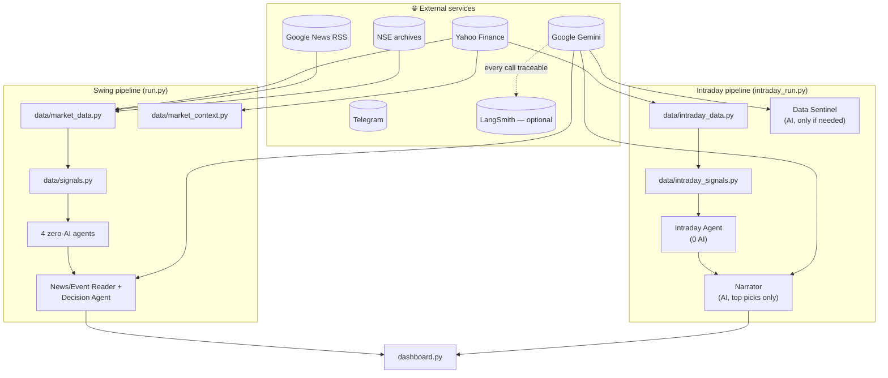

# How It Works — the full tour

This document explains, in plain English, **exactly** what happens when you
run `python run.py` (the daily swing scan) or `python intraday_run.py` (the
same-day scanner): which files run, which ones call Google's Gemini AI,
which ones are just doing arithmetic, which real websites/APIs get hit, and
what formula produces every number you see. If [README.md](README.md) is
the map, this is the guided tour with a magnifying glass.

No prior finance or programming knowledge assumed — every term is defined
where it's first used, and a glossary sits at the bottom.

---

## The one-sentence version

The app pulls real numbers from a few free websites, does a lot of ordinary
math on them (moving averages, volatility, VWAP, etc.), and only asks an AI
model for help on the things pure math genuinely can't do: **reading
news**, **judging a genuinely ambiguous data anomaly**, **explaining a
score in plain English**, and **weighing conflicting evidence into one
final decision**.

---

## Part 1 — The architecture diagram, explained box by box

**What each box actually is, in plain words:**

- **Yahoo Finance** — the same company behind finance.yahoo.com. We use a
  free Python library called `yfinance` to ask it for a stock's daily
  price/volume history, its 5-minute intraday price/volume for today, and
  some company facts (revenue growth, debt, etc.). No signup, no key, no
  cost.
- **Google News RSS** — Google News has a free "search feed" you can fetch
  like a webpage, no login needed. We ask it for recent articles about a
  company and get back real headlines.
- **NSE archives** — the National Stock Exchange of India publishes plain
  spreadsheet files (CSVs) listing exactly which 50 (or 500) companies are
  in the Nifty 50/500 index today. We download those directly.
- **Google Gemini** — the actual AI model. This is the only paid/keyed
  service, and the only one that "thinks" rather than just fetching facts.
- **Telegram** — a messaging app; its "Bot API" lets a program send you a
  chat message. Optional — only used if you set up a bot.
- **LangSmith** — an optional monitoring tool. If you turn it on, every
  real Gemini call and every pipeline step gets logged as a visual trace
  you can inspect after the fact — the exact prompt, the exact response,
  how long it took, how many tokens it used. Entirely opt-in; the app
  behaves identically whether it's on or off.
- **`data/market_data.py`** — calls Yahoo Finance and Google News for the
  swing pipeline and turns the raw response into a clean Python dictionary
  ("bundle") per stock, using a **year** of daily price history.
- **`data/intraday_data.py`** — the intraday equivalent: calls Yahoo
  Finance for today's 5-minute bars only, plus objective (code-only)
  quality checks for stale/broken data.
- **`data/signals.py`** / **`data/intraday_signals.py`** — no network calls
  at all. Take the price history already fetched and compute real
  statistics from it (RSI, volatility, beta, VWAP, opening range, etc.) —
  pure arithmetic.
- **`data/market_context.py`** — fetches the Nifty 50 index itself (once
  per swing run, not once per stock) so every stock's move can be judged
  *relative to the market*, not in isolation.
- **The zero-AI agents** — Research (Scout), Fundamental (Analyst),
  Technical (Chart Reader), Risk (Skeptic), and the Intraday Agent (Day
  Trader). Each is a plain Python file with a scoring formula. Zero calls
  to Gemini.
- **The AI-calling agents** — News/Event Reader and Decision Agent
  (swing pipeline), Data Sentinel and Narrator (intraday pipeline), plus
  an optional Scorekeeper for end-of-day backtesting. These are the only
  places the app pays for and waits on an AI response.
- **`run.py`** / **`intraday_run.py`** — "the conductors." Call everything
  above in order and glue the results together.
- **`dashboard.py`** — a web page (built with Streamlit) that shows you the
  results of both pipelines and can trigger either one for you.

---

## Part 2 — Which agent calls AI, and which is just math

| Agent | File | Pipeline | Calls Gemini? | How many times per run |
|---|---|---|---|---|
| Research Agent (Scout) | `agents/research_agent.py` | Swing | ❌ No | 0 |
| Fundamental Agent (Analyst) | `agents/fundamental_agent.py` | Swing | ❌ No | 0 |
| Technical Agent (Chart Reader) | `agents/technical_agent.py` | Swing | ❌ No | 0 |
| Risk Agent (Skeptic) | `agents/risk_agent.py` | Swing | ❌ No | 0 |
| News/Event Reader | `agents/sentiment_agent.py` | Swing | ✅ Yes | **1**, for every shortlisted stock together |
| Decision Agent (Manager) | `agents/decision_agent.py` | Swing | ✅ Yes | **1 per risk-appetite tier** you selected, each covering every stock together |
| Intraday Agent (Day Trader) | `agents/intraday_agent.py` | Intraday | ❌ No | 0 |
| Data Sentinel | `agents/intraday_quality_agent.py` | Intraday | ✅ Yes | **0 or 1**, only if a stock shows an unusual, unexplained gap |
| Narrator | `agents/intraday_narrator_agent.py` | Intraday | ✅ Yes | **1**, for the top picks together (not the whole universe) |
| Scorekeeper *(optional)* | `agents/intraday_backtest_agent.py` | Intraday (end-of-day) | ✅ Yes | **1**, only if you run `intraday_backtest.py` |
| Profile structuring | `profile/profile_loader.py` | Shared | ✅ Yes (only for a non-JSON profile file) | 0 or 1, once, not per stock |

So a typical **swing run with one risk profile** makes **2 AI calls total**.
A typical **intraday scan on a normal day** makes **1 AI call** (just the
Narrator — the Data Sentinel usually has nothing to review). Compare that
to the very first version of this app, which called Gemini **~23 times**
per swing run alone — once per specialist agent, per stock.

**Why can most "analysts" run without any AI at all?** Because their job
has an *exact mathematical answer*. "Is the stock above its 50-day average
price?" isn't a judgment call — it's a comparison of two numbers. Asking an
AI to do that would be like hiring a consultant to tell you whether 7 is
bigger than 5. The agents that *do* use AI have jobs a formula genuinely
can't do: understanding what a news headline *means*, weighing several
conflicting real signals into one coherent recommendation, judging whether
an unusual price gap is a real corporate action or bad data (with no
corporate-actions calendar to confirm it either way), and explaining a
mechanical score in plain, trader-readable language.

---

## Part 3 — Following one stock through a swing run

Let's trace a single stock — **TCS** — from the moment `run.py` starts to
the moment it either makes the final shortlist or doesn't. All numbers
below are realistic examples, not the exact output of any specific run.

### Step 0 — Real market context (`data/market_context.py`)
Before looking at any individual stock, the app fetches the **Nifty 50**
index's own price history from Yahoo Finance (ticker `^NSEI`) — once, for
the whole run. Today, say, the Nifty is **down 0.9%**.

*Why first?* Because "TCS fell 2%" means something completely different if
the whole market fell 3% that day (TCS actually did *better* than average)
versus if the market was flat (TCS's drop is real, stock-specific news).

### Step 1 — Fetch TCS's real data (`data/market_data.py`)
The app asks Yahoo Finance for `TCS.NS` (`.NS` = NSE-listed) and gets:
- A year of daily open/high/low/close/volume prices.
- Company facts: revenue growth, profit margins, debt levels, valuation
  ratios, sector ("Information Technology"), etc. — whatever Yahoo actually
  publishes for TCS (not every field exists for every company; missing
  ones are simply left out, never invented).

It also asks Google News for `"TCS NSE stock"` and gets back, say, 6 recent
headlines like *"TCS shares fall on weak Q1 guidance"*.

If Yahoo has no data at all for a symbol (typo, delisted, etc.), that
symbol is **skipped and logged** — it doesn't crash the whole run.

### Step 2 — Turn raw data into real signals (`data/signals.py`)
Still zero AI. Plain formulas turn the raw price history into RSI, moving
averages, volatility, beta, max drawdown, relative strength vs. the Nifty,
a volatility anomaly z-score, and historical P/E context — see Part 4 for
the exact formula behind each one.

### Step 3 — The Scout decides if TCS is worth a closer look (`agents/research_agent.py`)
Zero AI. A formula combines: how far TCS moved *relative to the Nifty*,
how unusual that move is for TCS specifically, the volume spike, whether
it broke a 20-day high, and whether it gapped up/down overnight — into one
**anomaly score**. All ~50 (or however many) scanned stocks get this score;
the ~10 highest scores become the "watchlist." If TCS isn't in the top 10,
its story ends here for today — no further analysis is wasted on it.

Say TCS scores high because it fell 2% while the Nifty only fell 0.6% (a
real relative underperformance) on 1.8x normal volume. It makes the
watchlist.

### Step 4 — Three pure-math specialists score TCS

**The Analyst** (`agents/fundamental_agent.py`) — starts at a baseline
score of 5/10, then adjusts up for good revenue growth/ROE/margins, down
for high debt, and up/down depending on whether TCS's current valuation
sits in the cheap or expensive end of its *own* historical range. Might
land at 9/10 with "Strong business quality; valuation looks fair relative
to its own history."

**The Chart Reader** (`agents/technical_agent.py`) — starts at 5/10,
adjusts for trend, RSI extremes, proximity to its 52-week high, volume
confirmation, and relative strength vs the Nifty. Might land at 4/10 with
"Downtrend, RSI 38, off 52-week highs, 1.8x volume, -2.1% vs Nifty over
1m, ATR ₹42 (typical daily range)."

**The Skeptic** (`agents/risk_agent.py`) — starts at 0 ("no risk") and adds
points for thin liquidity, high volatility, high beta, deep drawdowns, and
large overnight gaps. Might land at 2/10 with "No major red flags in the
available real data."

### Step 5 — The News/Event Reader reads real headlines (`agents/sentiment_agent.py`) — **AI call**
This happens **once for every shortlisted stock together**, not once per
stock. Before the AI even sees anything, the code clusters near-duplicate
headlines — if 4 different publishers all wrote about the same story, that
becomes ONE entry noting "4 sources," not 4 separate texts.

Gemini is then asked, for TCS and every other shortlisted stock at once:
"what actually happened, how material is it, and what's the sentiment?" It
might reply: *sentiment: negative, event_type: earnings, materiality: high,
summary: "TCS shares fell after missing Q1 revenue estimates and citing
cautious client spending."*

### Step 6 — Memory reports what changed (`memory/memory_layer.py`)
Zero AI. Before the final decision, the app checks: did we analyse TCS
before? If so, it pulls up the last real recorded price and scores and
computes a genuine comparison: *"Previous call (2 days ago): hold; price
₹3,450 → ₹3,390 (-1.7% since); technical 5 → 4; risk 2 → 2."* This is a
real diff, not a summary written by AI.

### Step 7 — The Manager makes the final call (`agents/decision_agent.py`) — **AI call, once per risk tier**
If your profile has one risk appetite selected, this happens once. If you
selected more than one (e.g. Conservative *and* Aggressive), it runs
**once per tier**, each time producing an independently-reasoned shortlist
— a Conservative-profile run may skip TCS entirely if it's too volatile
for that tier, while an Aggressive-profile run may include it.

Gemini receives, **for every shortlisted stock at once**: the real scores
and labels from Steps 4–6, the real Nifty context from Step 0, your
investor profile, and the real sector mix of today's watchlist. It's asked
to produce, per stock: an opportunity score (0–100), a confidence score
kept *deliberately separate* from opportunity, a bull case, a bear case, a
stance (accumulate/hold/avoid), a reference target price with reasoning,
portfolio fit, and an invalidation condition.

**Three things the AI is *not* asked to do**, all computed afterward in
plain Python:
- **Conviction (HIGH/LOW)** — derived from the confidence score by a fixed
  rule (≥70 → HIGH, else LOW), not self-reported by the AI. This keeps it
  consistent every time instead of drifting between calls.
- **Suggested quantity** — the *most* shares a single stock should ever
  get, from your real stated capital and max-position-size rule, scaled
  down further if the stock's own risk score is high, and further still by
  a risk-appetite-tier multiplier (Conservative tightens it, Aggressive
  loosens it, both still bounded by your own stated limit).
- **The actual ₹ split across today's picks** (`_allocate_capital`) —
  higher-opportunity-score picks get a bigger share of your capital, every
  pick still capped at your max position-size %, and any leftover capital
  (once every pick has hit its own cap) is redistributed proportionally to
  the remaining uncapped picks. This is a real, deterministic allocation
  algorithm — never an AI guess.

### Step 8 — Save and send
The finished shortlist(s) are saved to `output/analysis_DATE.json`, sent
to your Telegram (split into multiple messages if the combined text is
over Telegram's 4096-character limit), and today's real scores are stored
in Memory for tomorrow's delta comparison.

---

## Part 3B — Following one stock through an intraday scan

Same idea, but same-day only. Let's trace **RELIANCE** through
`intraday_run.py`, run mid-morning.

### Step 1 — Fetch today's real 5-minute bars (`data/intraday_data.py`)
The app asks Yahoo Finance for `RELIANCE.NS` with 5-minute bars for
today's session, and also pulls yesterday's real closing price
(`previousClose`) and the stock's normal average daily volume.

### Step 2 — Objective, code-only quality checks
Before any scoring happens, plain code checks for: 3+ consecutive bars
with identical prices (a stale/broken feed), any bar with zero volume, and
any single bar that moved >10% on almost no volume (a likely bad print).
Any of these gets RELIANCE **excluded** from today's scan entirely — no AI
judgment needed, these are unambiguous.

### Step 3 — Data Sentinel, only if there's something to review — **0 or 1 AI call**
Separately, the app checks: did RELIANCE gap unusually far from
yesterday's close (≥8%), with none of the mechanical red flags above? If
not, this step is skipped entirely for RELIANCE — no AI call. If it did
gap that much, **one batched AI call** (covering every stock with an
unusual gap today, not just RELIANCE) asks Gemini to weigh in: is this
gap size and shape more consistent with a real corporate action, or does
it look like a bad print? Gemini is explicitly told it has no
corporate-actions calendar and must say so honestly rather than assert
certainty — e.g. *"Gap of +7.2% is within plausible trading limits; cannot
confirm news or corporate actions due to lack of external feeds."*

### Step 4 — Mechanical scoring (`agents/intraday_agent.py`) — zero AI
A fixed scorecard, entirely code:
- Broke above the opening 15-minute range's high: **+3**. Broke below its
  low: **−3**.
- Trading above today's VWAP (volume-weighted average price so far):
  **+2**. Below it: **−1**.
- Volume running >1.5x the normal pace for this time of day: **+2**
  (and this also sets a "volume confirmed" flag). Below 0.7x (unusually
  thin): **−1**.
- Moved ≥1% since the open, either direction: **+1 / −1**.

Say RELIANCE broke above its opening range, is trading above VWAP, but
volume is only 0.8x normal — score lands around **+4**, direction
**bullish**.

**Conviction** is a plain rule, not an opinion: **HIGH** only if there was
a real breakout *and* volume confirmed it; otherwise **LOW**. Here,
without volume confirmation, RELIANCE gets **LOW conviction** — "no clean
breakout with volume behind it yet, treat as a name to watch."

**Entry/stop/target** are a textbook opening-range-breakout (ORB)
projection, not invented numbers: entry at the breakout level, stop at the
opposite end of the opening range, target = breakout level + the range's
own width.

### Step 5 — Rank and keep the top picks
Every scored stock is ranked by the *size* of its score (bullish or
bearish, doesn't matter — a strong signal either way is interesting), and
only the top `TOP_N` go on to the next step.

### Step 6 — Narrator — **1 AI call, top picks only**
For just the handful of top picks (not the whole universe), one batched
call asks Gemini to do two things using ONLY the structured signals and
the real bar-by-bar price sequence it's given — never inventing price
levels or news:
1. **Narrative** — 2–3 plain-English sentences on *why* it scored the way
   it did, explicitly naming which signals fired. For RELIANCE, something
   like: *"RELIANCE broke above its opening range and is holding above
   VWAP, but the move lacks strong volume support, keeping conviction low
   despite the bullish structure."*
2. **Pattern tag** — one label for the shape of today's chart:
   `clean_breakout`, `fakeout_risk`, `choppy_range`, `exhaustion`, or
   `retest_in_progress`.

This is explicitly **write-only**: the system prompt tells the model it
has no ability to change the score, rank, or conviction already set in
Step 4 — it can only explain what's already been decided.

### Step 7 — Send and save
The picks are sent to Telegram and saved to
`output/intraday_scan_DATE_TIME.json`.

### Optional Step 8 — End of day, the Scorekeeper (`intraday_backtest.py`) — **1 AI call**
Run separately after market close. Refetches real end-of-day price action
for today's HIGH-conviction picks and asks Gemini for a short, factual
outcome log — target hit, stop hit, or neither — for a running record of
which signal combinations actually work. No advice, no "next time"
language, just facts.

---

## Part 4 — Every real formula used, in plain English

### Swing pipeline — `data/signals.py` (zero AI, zero network calls)

| Signal | Plain-English formula | What it tells you |
|---|---|---|
| **% change** | (today's price − yesterday's price) ÷ yesterday's price × 100 | Did it go up or down, and by how much |
| **Moving average (SMA)** | Average closing price over the last N days | The general trend direction |
| **RSI** | Ratio of "average size of up-days" to "average size of down-days" over 14 days, squashed to 0-100 | Overbought (>70) or oversold (<30) |
| **ATR (Average True Range)** | Average of the last 14 days' true trading range (high-low, accounting for overnight gaps) | The stock's typical daily "wiggle room" in ₹ |
| **Historical volatility** | Standard deviation of daily % returns, scaled to a yearly figure | How wildly the stock normally swings |
| **Downside volatility** | Same as above, but only counting days it went *down* | How rough the bad days specifically are |
| **Beta** | How much the stock's daily moves track the Nifty's daily moves | >1 = amplifies market moves, <1 = dampens them |
| **Max drawdown** | The worst percentage drop from any peak to the lowest point after it, in the lookback window | The worst-case scenario you'd have lived through |
| **Relative strength** | Stock's % return minus the Nifty's % return, over the same period | Is it beating or lagging the market |
| **Gap %** | (today's opening price − yesterday's closing price) ÷ yesterday's close × 100 | Did something happen overnight (news, earnings) |
| **Volatility anomaly (z-score)** | Today's return ÷ the stock's own typical daily swing | Is today's move big *for this stock specifically* |
| **Trend structure** | Compares today's price to the 50-day and 200-day averages | Labels it strong uptrend / recovery / downtrend / sideways |
| **Historical P/E context** | Where today's valuation sits between the cheapest and most expensive the stock has been over the last year | Cheap/fair/expensive *relative to itself*, not a generic rule |

### Intraday pipeline — `data/intraday_signals.py` (zero AI, zero network calls)

| Signal | Plain-English formula | What it tells you |
|---|---|---|
| **VWAP** | Sum of (typical price × volume) for every 5-min bar today, divided by total volume today | The "fair price" the average rupee traded at today — above it = buyers winning, below = sellers winning |
| **Opening range** | The highest and lowest price in the first 15 minutes of trading | The reference box a breakout is measured against |
| **Volume surge ratio** | Today's cumulative volume so far ÷ (this stock's normal average daily volume × how much of the trading day has elapsed) | Is trading busier or quieter than normal *for this point in the day*, not just "vs. yesterday's total" |
| **Intraday momentum %** | (latest price − today's opening price) ÷ today's opening price × 100 | How far it's moved since the market opened today |

### Money math — `agents/decision_agent.py` (zero AI, plain Python)

| Calculation | Plain-English formula | What it tells you |
|---|---|---|
| **Conviction** | Confidence score ≥ 70 → HIGH, else LOW | A consistent, rule-based label — never self-reported by the AI |
| **Suggested quantity (per stock)** | Your capital × an effective position-size % (tightened for risky stocks and by your risk-appetite tier, capped at your own stated max) ÷ current price | The MOST shares that single stock should ever get |
| **Capital allocation (across the shortlist)** | Capital split proportionally by each pick's opportunity score, each capped at your max position-size %, leftover redistributed to the next-highest scorer | The actual suggested ₹ amount per stock today, summing to your capital (or less, if caps bind) |

---

## Part 5 — Every real API/data source, precisely

| What | Exact source | Called from | Needs a key? |
|---|---|---|---|
| Stock prices/volume (daily, 1yr) | `yfinance` library → Yahoo Finance, ticker `SYMBOL.NS` | `data/market_data.py` | No |
| Stock prices/volume (5-min, today) | `yfinance` library, `interval="5m"` | `data/intraday_data.py` | No |
| Company fundamentals | Same `yfinance` call's `.info` dictionary (revenue growth, ROE, debt, valuation ratios, sector, previous close, average volume...) | `data/market_data.py`, `data/intraday_data.py` | No |
| Nifty 50 index | `yfinance`, ticker `^NSEI` | `data/market_context.py` | No |
| News headlines | Google News RSS search feed (`news.google.com/rss/search?q=...`) | `data/market_data.py` | No |
| Nifty 50/500 constituent lists | NSE's public CSV files (`archives.nseindia.com/.../ind_nifty50list.csv`) | `data/nse_universe.py` | No |
| AI reasoning | Google Gemini, via the official `google-genai` Python SDK | `agents/base_agent.py` (shared by every AI-calling agent) | **Yes** |
| Sending the alert | Telegram Bot API (`api.telegram.org/bot<token>/sendMessage`) | `alerts/telegram_alert.py` | Yes, optional |
| Storing memory | ChromaDB, a small local vector database (no internet involved) | `memory/memory_layer.py` | No |
| Tracing AI calls | LangSmith, via the official `langsmith` Python SDK's `@traceable` decorator | `observability.py`, applied across `agents/*.py`, `run.py`, `intraday_run.py`, `intraday_backtest.py` | Yes, optional |

---

## Part 6 — How the tracing actually works (`observability.py`)

Every agent's `run()` method, and the actual Gemini call inside
`base_agent.py`, is wrapped in a decorator called `@traceable`. Think of a
decorator as a wrapper that runs some extra code before and after a
function, without changing what the function itself does.

- If `LANGSMITH_API_KEY` is **not** set in `.env`, `traceable` is a
  harmless no-op — it just returns the function unchanged. Nothing is
  sent anywhere, and the app behaves exactly as if the decorator wasn't
  there at all.
- If it **is** set, every call becomes one node in a tree sent to
  LangSmith: the pipeline's `main()` function is the root, each agent's
  `run()` is a child node, and the actual Gemini call is a grandchild
  labeled with which agent made it, plus the real input/output tokens
  Gemini reported for that call.
- **A tracing failure can never break the app.** If the LangSmith upload
  fails (bad key, no internet), the SDK logs a warning to the console and
  the actual function still runs and returns its real result — tracing is
  purely observational, never load-bearing.

One deliberate choice: the raw data-fetching functions (a year of daily
prices, a full day of 5-minute bars) are **not** traced directly, since
their outputs are large and would bloat every trace with noise instead of
useful signal. The parts that matter for understanding a run — which
agent ran, in what order, what it decided, and what each AI call actually
cost — are all covered without them.

---

## Part 7 — Glossary (for the non-finance reader)

- **RSI (Relative Strength Index)**: a 0-100 score measuring recent
  momentum. Not "strength" like a company's balance sheet — it's purely
  about recent price direction.
- **Moving average**: the average price over the last N days. A "50-day
  moving average" smooths out daily noise to show the medium-term trend.
- **P/E ratio**: price-to-earnings — how many years of current profit it'd
  take to "pay back" the stock's price. Higher usually means the market
  expects faster future growth (or the stock is simply expensive).
- **ROE**: return on equity — how much profit a company generates per
  rupee of shareholder money invested in it.
- **Volatility**: how much a stock's price swings around, regardless of
  direction. High volatility = bigger daily surprises, both up and down.
- **Beta**: a stock's tendency to amplify or dampen the broader market's
  moves. Beta 1.5 → tends to move 1.5x whatever the Nifty does that day.
- **Drawdown**: the size of a decline from a previous peak. "Max drawdown
  -30%" means at its worst, the stock was 30% below its recent high.
- **Liquidity / turnover**: how much rupee value of the stock trades
  hands per day on average — low liquidity means it could be hard to sell
  a large position quickly without moving the price against you.
- **Basis point / percentile**: "percentile in own range" of 20 means
  today's valuation is near the cheap end (20% of the way up) of where
  this stock has traded over the lookback window.
- **VWAP (Volume-Weighted Average Price)**: the average price paid per
  share so far *today*, weighted by how much volume traded at each price.
  A rough gauge of whether "today's crowd" is, on balance, in profit
  (price above VWAP) or underwater (below it).
- **Opening range**: the high and low price set in the first few minutes
  of trading — used as a reference box; breaking out of it is a classic
  day-trading signal.
- **Conviction (HIGH/LOW)**: not an opinion — a fixed rule based on the
  confidence score (swing) or on whether a real breakout is
  volume-confirmed (intraday). Always means the same thing wherever you
  see it.
- **Write-only field**: a value an AI is allowed to add (like a plain-
  English explanation) but never allowed to use to change a decision
  that's already been made by deterministic code.

---

## Still have questions?

Read the source — every file above has a docstring at the top written in
the same plain style as this document, and every function name says what
it does. Start with `run.py` for the swing pipeline or `intraday_run.py`
for the intraday one; each calls everything else in order.
