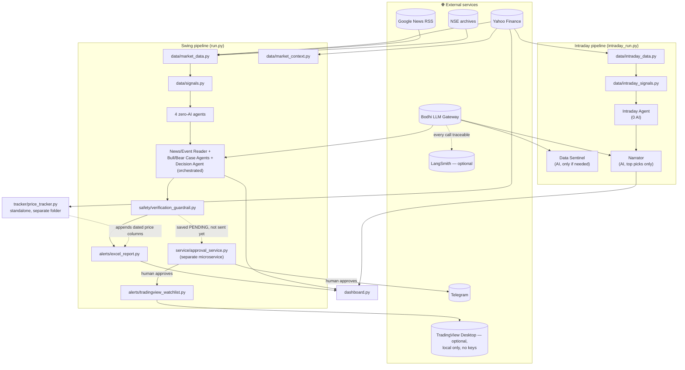

# How It Works — the full tour

This document explains, in plain English, **exactly** what happens when you
run `python run.py` (the daily swing scan) or `python intraday_run.py` (the
same-day scanner): which files run, which ones call Bodhi's LLM Gateway,
which ones are just doing arithmetic, which real websites/APIs get hit, and
what formula produces every number you see. If [README.md](README.md) is
the map, this is the guided tour with a magnifying glass.

No prior finance or programming knowledge assumed — every term is defined
where it's first used, and a glossary sits at the bottom.

---

## The one-sentence version

The app pulls real numbers from a few free websites, does a lot of ordinary
math on them (moving averages, volatility, VWAP, etc.), and only asks an AI
model for help on the things pure math genuinely can't do: **reading
news**, **judging a genuinely ambiguous data anomaly**, **explaining a
score in plain English**, and **weighing conflicting evidence into one
final decision**.

---

## Part 1 — The architecture diagram, explained box by box



**What each box actually is, in plain words:**

- **Yahoo Finance** — the same company behind finance.yahoo.com. We use a
  free Python library called `yfinance` to ask it for a stock's daily
  price/volume history, its 5-minute intraday price/volume for today, and
  some company facts (revenue growth, debt, etc.). No signup, no key, no
  cost.
- **Google News RSS** — Google News has a free "search feed" you can fetch
  like a webpage, no login needed. We ask it for recent articles about a
  company and get back real headlines.
- **NSE archives** — the National Stock Exchange of India publishes plain
  spreadsheet files (CSVs) listing exactly which 50 (or 500) companies are
  in the Nifty 50/500 index today. We download those directly.
- **Bodhi LLM Gateway** — the one governed entry point every AI call in
  this app goes through. This is the only paid/keyed service, and the
  only one that "thinks" rather than just fetching facts.
- **Telegram** — a messaging app; its "Bot API" lets a program send you a
  chat message. Optional — only used if you set up a bot.
- **LangSmith** — an optional monitoring tool. If you turn it on, every
  real Bodhi LLM Gateway call and every pipeline step gets logged as a visual trace
  you can inspect after the fact — the exact prompt, the exact response,
  how long it took, how many tokens it used. Entirely opt-in; the app
  behaves identically whether it's on or off.
- **TradingView Desktop** — optional. If enabled, `alerts/tradingview_watchlist.py`
  pushes today's shortlisted symbols to your real TradingView watchlist by
  driving your already-logged-in Desktop app locally over Chrome DevTools
  Protocol (a debugging interface, not a public API) — no TradingView
  credentials are ever stored or sent anywhere.
- **`alerts/excel_report.py`** — writes each run into a persistent workbook,
  `output/portfolio_tracker.xlsx`: one new sheet per run date, with the
  selected shortlist and the full top-10 watchlist as two tables.
- **`tracker/price_tracker.py`** — a standalone tool, deliberately kept
  separate from `agents/` since it isn't part of the daily pipeline. Run
  it whenever you like to append a real, dated price column to every past
  sheet in that workbook.
- **`data/market_data.py`** — calls Yahoo Finance and Google News for the
  swing pipeline and turns the raw response into a clean Python dictionary
  ("bundle") per stock, using a **year** of daily price history.
- **`data/intraday_data.py`** — the intraday equivalent: calls Yahoo
  Finance for today's 5-minute bars only, plus objective (code-only)
  quality checks for stale/broken data.
- **`data/signals.py`** / **`data/intraday_signals.py`** — no network calls
  at all. Take the price history already fetched and compute real
  statistics from it (RSI, volatility, beta, VWAP, opening range, etc.) —
  pure arithmetic.
- **`data/market_context.py`** — fetches the Nifty 50 index itself (once
  per swing run, not once per stock) so every stock's move can be judged
  *relative to the market*, not in isolation.
- **The zero-AI agents** — Research (Scout), Fundamental (Analyst),
  Technical (Chart Reader), Risk (Skeptic), and the Intraday Agent (Day
  Trader). Each is a plain Python file with a scoring formula. Zero calls
  to Bodhi's LLM Gateway.
- **The AI-calling agents** — News/Event Reader, Bull Case Agent, Bear
  Case Agent, and Decision Agent (swing pipeline — see Part 2 for how
  these four fit together, and why there are 5 boxes' worth of agents
  packed into the "EventDecision" diagram box above), Data Sentinel and
  Narrator (intraday pipeline), plus an optional Scorekeeper for
  end-of-day backtesting. These are the only places the app pays for and
  waits on an AI response.
- **`safety/verification_guardrail.py`** — sits right after the Decision
  Agent's output is final, before anything is stored or published. A
  DETERMINISTIC (zero AI) circuit-breaker: if two independent, non-LLM
  tools (TradingView's symbol search and this project's own local MCP
  server) BOTH failed to confirm a shortlisted symbol is a real, tradeable
  NSE equity, this forcibly overrides that pick to "avoid" and caps its
  confidence — regardless of how confidently the AI argued for it. See
  Part 3's Step 7B for a worked example.
- **`service/approval_service.py`** — a genuinely SEPARATE, independently
  deployable microservice (its own process, its own `Dockerfile`) that
  exposes the same approve/reject/publish logic as `approve_run.py` (the
  CLI) and `dashboard.py`'s sidebar over plain HTTP — see Part 3G.
- **`run.py`** / **`intraday_run.py`** — "the conductors." Call everything
  above in order and glue the results together.
- **`dashboard.py`** — a web page (built with Streamlit) that shows you the
  results of both pipelines and can trigger either one for you.

---

## Part 2 — Which agent calls AI, and which is just math

| Agent | File | Pipeline | Calls Bodhi's LLM Gateway? | How many times per run |
|---|---|---|---|---|
| Research Agent (Scout) | `agents/research_agent.py` | Swing | ❌ No | 0 |
| Fundamental Agent (Analyst) | `agents/fundamental_agent.py` | Swing | ❌ No | 0 |
| Technical Agent (Chart Reader) | `agents/technical_agent.py` | Swing | ❌ No | 0 |
| Risk Agent (Skeptic) | `agents/risk_agent.py` | Swing | ❌ No | 0 |
| News/Event Reader | `agents/sentiment_agent.py` | Swing | ✅ Yes | **1**, for every shortlisted stock together |
| Bull Case Agent (Optimist) | `agents/bull_case_agent.py` | Swing | ✅ Yes | **1**, batched, runs once per run (not per tier), genuinely in PARALLEL with Bear |
| Bear Case Agent (Skeptic's Voice) | `agents/bear_case_agent.py` | Swing | ✅ Yes | **1**, batched, runs once per run (not per tier), genuinely in PARALLEL with Bull |
| Decision Agent (Manager) | `agents/decision_agent.py` | Swing | ✅ Yes | **1 per risk-appetite tier** you selected, each covering every stock together |
| Orchestrator (Controller) | `agents/orchestrator_agent.py` | Swing | ✅ Yes, but **only when a retry is actually needed** | 0 or 1 extra call per tier — a real LangGraph router, not a fixed step (see Step 7B) |
| Intraday Agent (Day Trader) | `agents/intraday_agent.py` | Intraday | ❌ No | 0 |
| Data Sentinel | `agents/intraday_quality_agent.py` | Intraday | ✅ Yes | **0 or 1**, only if a stock shows an unusual, unexplained gap |
| Narrator | `agents/intraday_narrator_agent.py` | Intraday | ✅ Yes | **1**, for the top picks together (not the whole universe) |
| Scorekeeper *(optional)* | `agents/intraday_backtest_agent.py` | Intraday (end-of-day) | ✅ Yes | **1**, only if you run `intraday_backtest.py` |
| Profile structuring | `profile/profile_loader.py` | Shared | ✅ Yes (only for a non-JSON profile file) | 0 or 1, once, not per stock |

So a typical **swing run with one risk profile** makes **4 AI calls
total**: News/Event Reader (1) + Bull Case Agent and Bear Case Agent,
run once and genuinely in parallel, shared across every risk tier (2) +
Decision Agent (1). Selecting a second risk-appetite tier (e.g.
Conservative *and* Aggressive) adds one more Decision Agent call, not a
second Bull/Bear pair — they don't repeat per tier. The Orchestrator
adds 0 or 1 more call per tier, only on the rare run where its own
quality check on the Decision Agent's output finds something worth a
bounded retry (see Step 7B below) — it doesn't fire on a clean run. A
typical **intraday scan on a normal day** makes **1 AI call** (just the
Narrator — the Data Sentinel usually has nothing to review). Compare
that to the very first version of this app, which called the AI model
**~23 times** per swing run alone — once per specialist agent, per
stock — and an even earlier post-restructure version that made 2 calls
per run, before the Bull/Bear debate and the Orchestrator's retry loop
existed at all.

**Why can most "analysts" run without any AI at all?** Because their job
has an *exact mathematical answer*. "Is the stock above its 50-day average
price?" isn't a judgment call — it's a comparison of two numbers. Asking an
AI to do that would be like hiring a consultant to tell you whether 7 is
bigger than 5. The agents that *do* use AI have jobs a formula genuinely
can't do: understanding what a news headline *means*, weighing several
conflicting real signals into one coherent recommendation, judging whether
an unusual price gap is a real corporate action or bad data (with no
corporate-actions calendar to confirm it either way), and explaining a
mechanical score in plain, trader-readable language.

**Not everything zero-AI is an "agent."** `alerts/excel_report.py`,
`alerts/tradingview_watchlist.py`, and `tracker/price_tracker.py` are also
zero-AI and real-data-only, but they're plain output/reporting utilities,
not part of the `agents/` scoring framework — they don't inherit from
`BaseAgent` and don't have a `system_instruction`. They're listed
throughout this document anyway since "which files touch real vs. AI-
derived data" matters just as much as "which agents call Bodhi's LLM Gateway."

---

## Part 3 — Following one stock through a swing run

Let's trace a single stock — **TCS** — from the moment `run.py` starts to
the moment it either makes the final shortlist or doesn't. All numbers
below are realistic examples, not the exact output of any specific run.

### Step 0 — Real market context (`data/market_context.py`)
Before looking at any individual stock, the app fetches the **Nifty 50**
index's own price history from Yahoo Finance (ticker `^NSEI`) — once, for
the whole run. Today, say, the Nifty is **down 0.9%**.

*Why first?* Because "TCS fell 2%" means something completely different if
the whole market fell 3% that day (TCS actually did *better* than average)
versus if the market was flat (TCS's drop is real, stock-specific news).

### Step 1 — Fetch TCS's real data (`data/market_data.py`)
The app asks Yahoo Finance for `TCS.NS` (`.NS` = NSE-listed) and gets:
- A year of daily open/high/low/close/volume prices.
- Company facts: revenue growth, profit margins, debt levels, valuation
  ratios, sector ("Information Technology"), etc. — whatever Yahoo actually
  publishes for TCS (not every field exists for every company; missing
  ones are simply left out, never invented).

It also asks Google News for `"TCS NSE stock"` and gets back, say, 6 recent
headlines like *"TCS shares fall on weak Q1 guidance"*.

If Yahoo has no data at all for a symbol (typo, delisted, etc.), that
symbol is **skipped and logged** — it doesn't crash the whole run.

### Step 2 — Turn raw data into real signals (`data/signals.py`)
Still zero AI. Plain formulas turn the raw price history into RSI, moving
averages, volatility, beta, max drawdown, relative strength vs. the Nifty,
a volatility anomaly z-score, and historical P/E context — see Part 4 for
the exact formula behind each one.

### Step 3 — The Scout decides if TCS is worth a closer look (`agents/research_agent.py`)
Zero AI. A formula combines: how far TCS moved *relative to the Nifty*,
how unusual that move is for TCS specifically, the volume spike, whether
it broke a 20-day high, and whether it gapped up/down overnight — into one
**anomaly score**. All ~50 (or however many) scanned stocks get this score;
the ~10 highest scores become the "watchlist." If TCS isn't in the top 10,
its story ends here for today — no further analysis is wasted on it.

Say TCS scores high because it fell 2% while the Nifty only fell 0.6% (a
real relative underperformance) on 1.8x normal volume. It makes the
watchlist.

### Step 3B — Two independent, non-AI tools double-check TCS is real (`integrations/tradingview_quote.py`, `integrations/mcp_pipeline_client.py`)
Before any AI money gets spent on TCS, two SEPARATE, optional real tool
calls (neither is an AI call — both are plain lookups) each ask, a
different way, "is `TCS` actually a real, currently-tradeable NSE
symbol?": TradingView's own symbol-search REST endpoint (`TRADINGVIEW_SYMBOL_SEARCH_ENABLED`,
&lt;1s typical), and a real local MCP server this project owns
(`MCP_VERIFICATION_ENABLED`, checked against this project's own NIFTY50
universe list — see Part 3F for what MCP means and why there's a whole
separate server for this). Both are best-effort and off by default: if
either is disabled, unreachable, or TradingView Desktop isn't open, that
check is simply skipped — TCS proceeds with one fewer data-quality
signal, never a crash. For a real symbol like TCS both normally confirm
it fine and nothing is flagged; if BOTH somehow failed to confirm it
(e.g. a typo'd or delisted symbol slipped through), that fact is
recorded as a real, structured "data quality" flag carried all the way
to Step 7 — and see Step 7C for what happens if the Manager still
recommends it confidently anyway.

### Step 4 — Three pure-math specialists score TCS

**The Analyst** (`agents/fundamental_agent.py`) — starts at a baseline
score of 5/10, then adjusts up for good revenue growth/ROE/margins, down
for high debt, and up/down depending on whether TCS's current valuation
sits in the cheap or expensive end of its *own* historical range. Might
land at 9/10 with "Strong business quality; valuation looks fair relative
to its own history."

**The Chart Reader** (`agents/technical_agent.py`) — starts at 5/10,
adjusts for trend, RSI extremes, proximity to its 52-week high, volume
confirmation, and relative strength vs the Nifty. Might land at 4/10 with
"Downtrend, RSI 38, off 52-week highs, 1.8x volume, -2.1% vs Nifty over
1m, ATR ₹42 (typical daily range)."

**The Skeptic** (`agents/risk_agent.py`) — starts at 0 ("no risk") and adds
points for thin liquidity, high volatility, high beta, deep drawdowns, and
large overnight gaps. Might land at 2/10 with "No major red flags in the
available real data."

### Step 5 — The News/Event Reader reads real headlines (`agents/sentiment_agent.py`) — **AI call**
This happens **once for every shortlisted stock together**, not once per
stock. Before the AI even sees anything, the code clusters near-duplicate
headlines — if 4 different publishers all wrote about the same story, that
becomes ONE entry noting "4 sources," not 4 separate texts.

The model is then asked, via Bodhi's LLM Gateway, for TCS and every other shortlisted stock at once:
"what actually happened, how material is it, and what's the sentiment?" It
might reply: *sentiment: negative, event_type: earnings, materiality: high,
summary: "TCS shares fell after missing Q1 revenue estimates and citing
cautious client spending."*

### Step 6 — Memory reports what changed — AND resurfaces any open GOAL (`memory/memory_layer.py`)
Zero AI, two distinct things, not one. First, the short-term/consolidated
comparison this doc already described: did we analyse TCS before? If so,
it pulls up the last real recorded price and scores and computes a
genuine comparison: *"Previous call (2 days ago): hold; price ₹3,450 →
₹3,390 (-1.7% since); technical 5 → 4; risk 2 → 2."* This is a real diff,
not a summary written by AI.

Second — newer, and a genuinely different mechanism — **persisted GOAL
tracking** (`memory_layer.py::goal_status()`), which looks further back
than that short-term comparison for something specific: did a PAST call
on TCS ever give it a real target price and an invalidation condition
("what would make me wrong")? If so, this computes, in plain code, the
real price move since then against that stored target — e.g. *"On
2026-08-28 TCS was given a target price of ₹3,600. Today's real price
(₹3,390) is 6.2% away from it. Its stated invalidation condition was:
'a break below the 200-day moving average' — judge from today's real
data whether that has now happened."* The FACT (has the price crossed
the target) is computed by code; whether the qualitative condition
("broke below the moving average," "guidance was cut") has actually
happened is left to the Manager to judge in Step 7 below, using today's
real data — same plain-code/judgment split as everywhere else in this
project. This is genuinely different from the short-term delta above: it
persists ACROSS separate days of real market movement, not just "what
changed since I last looked."

### Step 6B — Two independent AI analysts argue opposite sides — **AI calls, run in parallel** (`agents/bull_case_agent.py`, `agents/bear_case_agent.py`)
Before the Manager ever sees TCS, two OTHER AI calls already ran — once
for the whole run, not once per risk tier, and genuinely at the same
time (a real LangGraph fan-out, timed in `tests/test_research_graph.py`
to prove it's actually parallel, not just described that way). The Bull
Case Agent is handed the same real data from Steps 0–6 and asked to
build the STRONGEST HONEST case *for* TCS; the Bear Case Agent gets the
identical data and is asked to build the strongest honest case *against*
it. Neither one ever sees what the other concluded — that's deliberate
ISOLATION (see Part 6's "Isolate" discussion), guarding against one
agent's reasoning anchoring the other's if either saw the other's
argument first. For TCS, the Bull Case Agent might come back with
*"bull_strength 65/100: valuation has become attractive after the
pullback, and the underlying business fundamentals haven't actually
deteriorated (target ₹3,550)"*, while the Bear Case Agent might say
*"bear_severity 55/100: cautious guidance signals a real, not
one-quarter, slowdown in client spending (key risk: further guidance
cuts next quarter)."* Both are handed to the Manager in Step 7 — neither
one is "the answer" by itself.

### Step 7 — The Manager makes the final call (`agents/decision_agent.py`) — **AI call, once per risk tier**
If your profile has one risk appetite selected, this happens once. If you
selected more than one (e.g. Conservative *and* Aggressive), it runs
**once per tier**, each time producing an independently-reasoned shortlist
— a Conservative-profile run may skip TCS entirely if it's too volatile
for that tier, while an Aggressive-profile run may include it.

Bodhi's LLM Gateway receives, **for every shortlisted stock at once**: the real scores
and labels from Steps 4–6, the real Nifty context from Step 0, your
investor profile, the real sector mix of today's watchlist, the Bull and
Bear Case Agents' two independent arguments from Step 6B, any LIVE
TradingView quote and open persisted goal from Steps 3B/6, and real,
retrieved sector-risk notes pulled from this project's own knowledge base
(actual filtered search — see Part 6 — not static boilerplate). Its job
is no longer to invent both sides of the argument alone: it must
**adjudicate** between the Bull and Bear cases — say explicitly where it
agrees, disagrees, or thinks one side overstates its case — and that
adjudication, not either agent alone, is what drives the final call. It's
asked to produce, per stock: an opportunity score (0–100), a confidence
score kept *deliberately separate* from opportunity, an adjudicated bull
case, an adjudicated bear case, a stance (accumulate/hold/avoid), a
reference target price with reasoning, portfolio fit, and an
invalidation condition.

**Every piece of text above has an explicit size cap before it's
assembled into this prompt** — not just the retrieved notes, but the
Bull/Bear cases, the news summary, the Scout's own note, the persisted
goal, your profile's free-text constraints, and any Orchestrator retry
feedback (Step 7B) — each capped at 500 characters with a visible
"…[trimmed for context budget]" marker if it's actually cut. The reason
is a real, already-existing constraint, not a made-up limit: this one
call is batched across the WHOLE watchlist (up to 10 stocks), so any one
of these fields left uncapped would multiply across every stock in the
same prompt. See Part 3E for the exact number this measures out to and
why compaction (trimming), not one AI call per stock, was the right fix
for THIS constraint specifically.

### Step 7B — The Orchestrator checks the Manager's own work (`agents/orchestrator_agent.py`) — **0 or 1 extra AI call**
The Manager's output isn't just trusted as final. A real, plain-code
check runs first — is a required field missing, is a score out of range,
is the call internally inconsistent (e.g. "avoid" paired with a high
opportunity score, or high confidence despite a flagged data-quality
issue)? If everything passes, this step costs nothing extra. If it finds
a real, fixable issue, the Orchestrator — an actual AI call, not a fixed
retry — decides at runtime whether it's worth sending back: if so, the
Manager gets a SPECIFIC instruction on what to fix (never "try again,"
always "here's exactly what's wrong") and re-runs once, bounded — this
can never loop more than one extra time per tier, however the AI
responds. This is what makes the pipeline a genuine multi-agent
controller rather than a fixed script calling agents in a hardcoded
order.

### Step 7C — A deterministic guardrail catches a confidently WRONG call (`safety/verification_guardrail.py`) — zero AI
This runs after EVERY tier's Manager+Orchestrator loop finishes, across
the whole shortlist. It's not a retry, and it can't be argued with: if
TCS was flagged by BOTH independent tools in Step 3B (TradingView's
symbol search AND the local MCP check) as unable to confirm it's a real,
tradeable equity, this forcibly overrides whatever the Manager said —
`action` becomes `"avoid"`, `confidence` is capped low, and the
conviction badge is recomputed to match — regardless of how confidently
the AI argued for it. The trigger is deliberately narrow (a single failed
tool is already shown to the Manager as context in Step 7 for it to
weigh itself; only BOTH together bypasses its judgment), so for a real
symbol like TCS this virtually never fires — it exists for the rare case
where the underlying symbol itself, not the reasoning about it, is the
actual problem, which a retry can't fix since re-reasoning over the same
(wrong) symbol changes nothing. Every override is logged to
`output/reliability_log.jsonl` with what the Manager originally said, for
a real audit trail.

**Three things the AI is *not* asked to do**, all computed afterward in
plain Python:
- **Conviction (HIGH/LOW)** — derived from the confidence score by a fixed
  rule (≥70 → HIGH, else LOW), not self-reported by the AI. This keeps it
  consistent every time instead of drifting between calls.
- **Suggested quantity** — the *most* shares a single stock should ever
  get, from your real stated capital and max-position-size rule, scaled
  down further if the stock's own risk score is high, and further still by
  a risk-appetite-tier multiplier (Conservative tightens it, Aggressive
  loosens it, both still bounded by your own stated limit).
- **The actual ₹ split across today's picks** (`_allocate_capital`) —
  higher-opportunity-score picks get a bigger share of your capital, every
  pick still capped at your max position-size %, and any leftover capital
  (once every pick has hit its own cap) is redistributed proportionally to
  the remaining uncapped picks. This is a real, deterministic allocation
  algorithm — never an AI guess.

### Step 8 — Verify, guard, save — but NOT send yet
Today's real scores (plus TCS's target price/invalidation, if it made
the cut — feeding Step 6's goal tracking on some future run) are stored
in Memory, the reliability guardrail from Step 7C runs across the whole
shortlist, and:
- **`integrations/bodhi_risk_insights.py`** (only if `BODHI_ENABLED=true`)
  sends today's real shortlist to your Bodhi workflow and waits for its
  answer — see Part 3D. If it finds a per-symbol verdict, any
  `avoid`/high-risk symbol is excluded from the TradingView candidate
  list built below. If Bodhi is off, unreachable, or gives no parseable
  verdict, nothing changes from before this integration existed.
- **`alerts/excel_report.py`** (always on, zero AI) writes today's deduped
  shortlist and the full top-10 watchlist into a new dated sheet in
  `output/portfolio_tracker.xlsx` — creating the workbook on the first
  run, replacing that day's sheet on a same-day re-run, leaving every
  other date's sheet untouched. This happens regardless of what comes
  next — it's local record-keeping, not "sending out" anything.

**Nothing is sent to Telegram or pushed to TradingView here.** This
project hands out real financial recommendations, so the finished
shortlist is saved as a PENDING run (`alerts/approval_gate.py`) instead —
a real pause, not a formality — and `run.py`'s own job ends there.

### Step 9 — A human approves, THEN it's actually sent (`approve_run.py`, `dashboard.py`, or `service/approval_service.py`)
Publishing is a separate, deliberate step against THIS specific pending
run. Three interfaces exist onto the exact same underlying logic — none
of them re-implements it, they're three doors onto one real function
(`approve_run.py::_publish()`):
- **The CLI**: `uv run python approve_run.py --latest` — shows you what
  it would send, asks a real y/n, then publishes on "y".
- **The dashboard**'s "② Review & Approve" section — the same summary, an
  "✅ Approve & publish" button.
- **The approval microservice** (`service/approval_service.py`, see Part
  3G) — the identical action over plain HTTP (`POST
  /pending/{run_id}/approve`), for automation or a system other than a
  browser/terminal.

Whichever door you use, approving does the SAME two things together:
Telegram gets the shortlist (split into multiple messages if it's over
Telegram's 4096-character limit), plus, if Bodhi ran, a second message
with its full narrative report; and `alerts/tradingview_watchlist.py`
(only if `TRADINGVIEW_WATCHLIST_ENABLED=true`) pushes the Bodhi-approved
subset of shortlisted symbols to your real TradingView watchlist — a
local-only connection to your own already-running Desktop app; if it
isn't open, this just logs a skip message. A run can only ever be
approved (or rejected) once — the file physically moves out of the
pending folder as part of that action, so nothing can be double-published
by accident, from any of the three doors.

---

## Part 3B — Following one stock through an intraday scan

Same idea, but same-day only. Let's trace **RELIANCE** through
`intraday_run.py`, run mid-morning.

### Step 1 — Fetch today's real 5-minute bars (`data/intraday_data.py`)
The app asks Yahoo Finance for `RELIANCE.NS` with 5-minute bars for
today's session, and also pulls yesterday's real closing price
(`previousClose`) and the stock's normal average daily volume.

### Step 2 — Objective, code-only quality checks
Before any scoring happens, plain code checks for: 3+ consecutive bars
with identical prices (a stale/broken feed), any bar with zero volume, and
any single bar that moved >10% on almost no volume (a likely bad print).
Any of these gets RELIANCE **excluded** from today's scan entirely — no AI
judgment needed, these are unambiguous.

### Step 3 — Data Sentinel, only if there's something to review — **0 or 1 AI call**
Separately, the app checks: did RELIANCE gap unusually far from
yesterday's close (≥8%), with none of the mechanical red flags above? If
not, this step is skipped entirely for RELIANCE — no AI call. If it did
gap that much, **one batched AI call** (covering every stock with an
unusual gap today, not just RELIANCE) asks the model, via Bodhi's LLM
Gateway, to weigh in: is this gap size and shape more consistent with a
real corporate action, or does it look like a bad print? The model is
explicitly told it has no corporate-actions calendar and must say so honestly rather than assert
certainty — e.g. *"Gap of +7.2% is within plausible trading limits; cannot
confirm news or corporate actions due to lack of external feeds."*

### Step 4 — Mechanical scoring (`agents/intraday_agent.py`) — zero AI
A fixed scorecard, entirely code:
- Broke above the opening 15-minute range's high: **+3**. Broke below its
  low: **−3**.
- Trading above today's VWAP (volume-weighted average price so far):
  **+2**. Below it: **−1**.
- Volume running >1.5x the normal pace for this time of day: **+2**
  (and this also sets a "volume confirmed" flag). Below 0.7x (unusually
  thin): **−1**.
- Moved ≥1% since the open, either direction: **+1 / −1**.

Say RELIANCE broke above its opening range, is trading above VWAP, but
volume is only 0.8x normal — score lands around **+4**, direction
**bullish**.

**Conviction** is a plain rule, not an opinion: **HIGH** only if there was
a real breakout *and* volume confirmed it; otherwise **LOW**. Here,
without volume confirmation, RELIANCE gets **LOW conviction** — "no clean
breakout with volume behind it yet, treat as a name to watch."

**Entry/stop/target** are a textbook opening-range-breakout (ORB)
projection, not invented numbers: entry at the breakout level, stop at the
opposite end of the opening range, target = breakout level + the range's
own width.

### Step 5 — Rank and keep the top picks
Every scored stock is ranked by the *size* of its score (bullish or
bearish, doesn't matter — a strong signal either way is interesting), and
only the top `TOP_N` go on to the next step.

### Step 6 — Narrator — **1 AI call, top picks only**
For just the handful of top picks (not the whole universe), one batched
call asks the model, via Bodhi's LLM Gateway, to do two things using ONLY the structured signals and
the real bar-by-bar price sequence it's given — never inventing price
levels or news:
1. **Narrative** — 2–3 plain-English sentences on *why* it scored the way
   it did, explicitly naming which signals fired. For RELIANCE, something
   like: *"RELIANCE broke above its opening range and is holding above
   VWAP, but the move lacks strong volume support, keeping conviction low
   despite the bullish structure."*
2. **Pattern tag** — one label for the shape of today's chart:
   `clean_breakout`, `fakeout_risk`, `choppy_range`, `exhaustion`, or
   `retest_in_progress`.

This is explicitly **write-only**: the system prompt tells the model it
has no ability to change the score, rank, or conviction already set in
Step 4 — it can only explain what's already been decided.

### Step 7 — Send and save
The picks are sent to Telegram, written into a new dated sheet in
`output/intraday_tracker.xlsx` (`alerts/intraday_excel_report.py` — same
one-sheet-per-date rule as the swing workbook, a same-day re-run replaces
that day's sheet), and saved to `output/intraday_scan_DATE_TIME.json`.

### Optional Step 8 — End of day, the Scorekeeper (`intraday_backtest.py`) — **1 AI call**
Run separately after market close. Refetches real end-of-day price action
for today's HIGH-conviction picks and asks the model, via Bodhi's LLM
Gateway, for a short, factual outcome log — target hit, stop hit, or neither — for a running record of
which signal combinations actually work. No advice, no "next time"
language, just facts.

---

## Part 3C — The standalone price tracker (`tracker/price_tracker.py`)

This one isn't part of either pipeline — it's a maintenance tool you run
whenever you want to check how *past* picks have actually performed, swing
or intraday. Zero AI: it's a real price lookup and a subtraction, nothing
more.

### Step 1 — Find every table in every sheet, in both workbooks
It opens **both** `output/portfolio_tracker.xlsx` (swing, written by
`excel_report.py`) and `output/intraday_tracker.xlsx` (intraday, written
by `intraday_excel_report.py`) and scans every sheet in each for tables —
recognised by a header row whose first cell is literally `"Symbol"`. Every
table matching that shape gets tracked, regardless of which workbook or
which of the two writer modules produced it — `_find_tables()` doesn't
know or care which pipeline a sheet came from.

### Step 2 — Work out what to compare against
For each table, it looks at the *rightmost* column in that table's header
that's a genuine price checkpoint — either the original `"Current Price"`
column (the very first time you run the tracker against that sheet), or
the most recent date-named column a *previous* run of the tracker added
(every time after that). It deliberately skips over non-price columns
like `"Tier(s)"` or `"Description"` when looking.

### Step 3 — Fetch real current prices, once per symbol
For every distinct symbol across every sheet *in both workbooks*, it
fetches one real current price via Yahoo Finance and caches it — so a
stock that shows up in five different sheets (or in both the swing and
intraday workbook) only costs one real network call this run, not five.

### Step 4 — Append the new column
For each table, it adds one new column, headered with today's date, and
writes each stock's real current price plus its % change vs. the
checkpoint found in Step 2 — e.g. `₹1,325.50 (+2.3%)`. It never overwrites
an existing column, including on a same-day re-run: the first run of the
day gets a clean date-only header (`2026-09-01`); any re-run after that
gets a second column headered with the *actual* date and time it ran
(`2026-09-01 14:32:07`), not a bare counter. An earlier version overwrote
a same-day column in place; that trusted a date-string match as proof it
was a harmless re-run, which turned out not to hold in practice and
silently destroyed real tracked history — so this tool no longer deletes
anything, full stop.

### A worked example
Say a sheet from 3 weeks ago has `HCLTECH` in its Selected Stocks table,
listed then at ₹1,300.00. You've run the tracker twice since: once a week
later (added a `+1w-date` column showing `₹1,285.00 (-1.2%)`), and once
just now. The new column added just now compares against *that* most
recent tracked value, not the original ₹1,300.00 — so if HCLTECH is at
₹1,310.00 today, the new cell reads `₹1,310.00 (+1.9%)` (vs. the ₹1,285.00
checkpoint), even though it's actually only +0.8% above the *original*
listing price. This is deliberate: each column answers "how has it moved
since I last checked," not "how has it moved since day one."

---

## Part 3D — Bodhi risk verification (`integrations/bodhi_risk_insights.py`)

Optional (`BODHI_ENABLED=true`), and best-effort: called between Step 7
(Decision Agent) and Step 8 (Telegram/TradingView/Excel) of the swing
pipeline. A failure here is logged and swallowed, never fatal — the same
pattern as the TradingView push — and if it fails, Step 8 proceeds exactly
as if Bodhi didn't exist. Bodhi is a separate, external multi-agent AI
platform (not part of this codebase); this is a REST client plus a
parser for whatever it answers with, confirmed working end-to-end against
a live, purpose-built Bodhi workflow.

### The actual Bodhi workflow this talks to
```
Start Node → Risk Analyst Agent → Contrarian Agent → End Node
                     │
              MCP Tool: bodhi-deep-research
```
- **Start Node / Workflow Variables** hold the two entry-point variables
  (`Investmentportfolio`, `Query_for_risk_assessment` by default — Bodhi
  variable names can't contain spaces). Deliberately **not** a UI Node: a
  UI Node pauses a run waiting for a human to fill in a form in Bodhi's
  own web UI, which breaks an API-triggered run (confirmed: this was the
  original design, and it failed every time it was triggered headlessly —
  "waiting on a form no one's there to fill in").
- **Risk Analyst Agent** reads both variables via
  `{{$var[Investmentportfolio]}}` / `{{$var[Query_for_risk_assessment]}}`
  in its system prompt, and researches real, current, stock-specific risk
  factors using the `bodhi-deep-research` MCP tool wired to its `tool`
  port.
- **Contrarian Agent** reads the Risk Analyst's output via
  `{{Risk Analyst Agent[data.result.response]}}` plus the original
  portfolio, red-team-challenges it (confirmed in a live run: it overrode
  a Risk Analyst "caution" verdict to "clear," judging the cited risks
  already priced into the stock's valuation), and closes with a
  `{"verdicts": [...]}` JSON block per the prompt's explicit instruction.
- **End Node**'s "Configure Workflow Output" is set to
  `{{Contrarian Agent[data.result.response]}}` — this is what makes the
  Contrarian's answer the workflow's official, retrievable output.

### Step 1 — Build a real, full-detail shortlist
`_shortlist_payload()` dedupes the shortlist across every risk tier you
ran and keeps every field the Decision Agent actually produced — symbol,
sector (from `analyses`), action, opportunity score, confidence,
conviction, current/target price, bull case, bear case, risk %, ₹
allocated, tier(s). `_portfolio_text()` turns that into JSON text for the
portfolio variable; `_query_text()` builds the query variable's value —
your configured risk question, plus an explicit ask for a `"verdicts"`
JSON array (`{"symbol", "verdict": "clear"|"caution"|"avoid", "notes"}`).

### Step 2 — Start a run, poll, extract the answer
`integrations/bodhi_client.py` is a start-run / poll / extract-answer
client: `POST .../tasks/{task_id}/runs` with both fields as workflow
variables (names set by `BODHI_PORTFOLIO_VARIABLE` / `BODHI_QUERY_VARIABLE`),
poll `GET .../runs/{run_id}` until `status` is a completed/failed state.

**Where the real answer actually lives in that response — confirmed
against a real raw API payload, not a guess:** the top level of the run
object is mostly bookkeeping (`id`, `status`, `startedAt`/`finishedAt`,
`overrides` — what you sent) plus `exec_metadata`, which itself holds a
full copy of the workflow's *definition* (every node's stored config —
including any node's raw, unresolved `{{...}}` template text, which looks
deceptively like real content) alongside the one field that actually
matters: `exec_metadata.allOutputs`. That's shaped as
`{<run_name>: {<node_name>: {"data": {...}, "status": ...}}}`, and inside
it, `End → data → result` is the real, resolved final answer.
`extract_bodhi_answer()` reads this path first — preferring the `End`
node's result, falling back to the last agent-shaped node if there's no
End node — and only falls back further (checking `outputs`/`result` at
the top level, then a last-resort fuzzy text search) for a differently-
shaped Bodhi response. That fuzzy fallback is a genuine footgun: it's what
originally (before this was fixed) matched a node's *stored, unresolved
template config* instead of its *real output*, and returned that as if it
were the answer — a real, observed bug now fixed by checking the correct
path first.

### Step 3 — Parse a per-symbol verdict, if there is one
`_parse_verdicts()` looks for a JSON array/object anywhere in Bodhi's
answer text (inside a fenced ```` ```json ```` block or not) whose items
have both a `"symbol"` and a `"verdict"` key. If your workflow's final
agent wasn't asked to return that shape, this returns `None` — Bodhi's
narrative report still gets shown, nothing gets filtered downstream.
Symbols whose verdict text contains a flag keyword (`avoid`, `high risk`,
`flag`, `reject`, ...) go into `flagged_symbols`.

### Step 4 — What `run.py` does with the result
`verify_shortlist()` returns `{ran, report, verdicts, flagged_symbols}`.
`run.py` builds the Telegram alert with each pick's Bodhi verdict shown
inline (if any), sends Bodhi's full report as a separate Telegram message,
and pushes only the *unflagged* symbols to TradingView — see Step 8 in
Part 3. Run this on its own, without re-running the whole swing pipeline,
via `integrations/run_bodhi_risk_insight.py` (loads the most recent
`output/analysis_*.json`) — or the dashboard's 🧠 button, which shells out
to that same script (it doesn't touch TradingView on its own; that gating
only happens inside a real `run.py` run).

**If you build your own Bodhi workflow instead of copying the one above**,
two things depend on it, not this codebase — `BODHI_PORTFOLIO_VARIABLE` /
`BODHI_QUERY_VARIABLE` must match your Start Node's actual variable names,
and your final agent's prompt needs to actually be asked to return the
`"verdicts"` JSON array for the TradingView gate to have anything to act
on. Both are flagged in the module's own docstring.

---

## Part 3E — Governing the Bodhi Gateway itself (`config.py`)

Every single AI call in this app — every one of the 10 agents named
above — funnels through exactly one function, `config.call_llm()`. Two
real, opt-in governance features live there, both about controlling that
one choke point rather than any individual agent.

**Deliberate per-agent model selection (`BODHI_LLM_MODEL_OVERRIDES`).**
By default every agent uses the same configured model
(`BODHI_LLM_MODEL`). This setting lets you route SPECIFIC agents to a
different one — the documented example is
`"Orchestrator=gemini-2.5-flash"`: the Orchestrator's job (Step 7B) is a
classification-shaped decision (temperature 0.1, one short JSON field:
retry or finish) that doesn't need the same model as the Manager's real
multi-signal synthesis (Step 7). It's a deliberate choice with a stated
reason, not an accidental downgrade — and it's left commented/opt-in
rather than shipped active with a guessed model id, because a wrong id
here would hard-fail that agent's very first real call, and the actual
model catalog is account-specific (this project's own token got a real
`403` — "explicit deny in an identity-based policy" — querying Bodhi's
own `GET /v1/models`, so there was no safe way to "confirm" one for
every account). The mechanism itself is fully proven working regardless:
`tests/test_config_gateway.py::test_per_agent_model_override_is_used_in_the_real_request`
asserts the overridden model id lands in the real outgoing request body.

**A real, ENFORCED token budget (`BODHI_LLM_TOKEN_BUDGET_LIMIT`).**
Distinct from `BODHI_LLM_TOKEN_BUDGET_WARNING`, which only logs a visible
note AFTER a call already succeeded and reported an unusually high real
token count. The LIMIT is a hard ceiling checked BEFORE anything is ever
sent: it estimates a prompt's size (characters ÷ 4 — a documented rough
approximation, not a real tokenizer, since Bodhi can route to different
backends) and simply refuses the call — `BodhiGatewayBudgetExceededError`,
nothing sent to the gateway — if that estimate would exceed the limit.
The shipped default (`.env.example`: `WARNING=12000`, `LIMIT=20000`) is a
MEASURED number, not a guess: the Manager's own batched, up-to-10-stock
prompt (Step 7 above) is the single largest real prompt in this app, and
since every variable-length field feeding it is already capped (Step 7's
"every piece of text... has an explicit size cap" paragraph), its true
worst case is computable rather than open-ended. Building that exact
worst case — 10 stocks, every optional field at its trimmed cap —
through the real prompt-assembly code measures **~59,700 real
characters, ~14,920 estimated tokens**; `LIMIT` sits about 34% above
that measured ceiling, so an ordinary maximal-but-legitimate run never
trips it, while a genuinely runaway prompt (a bug duplicating data into
it, say) still gets refused before a rupee is spent. Tested in
`tests/test_config_gateway.py` by asserting `requests.post` is never
even called when the limit would be exceeded.

---

## Part 3F — A second, real MCP server this project owns (`integrations/mcp_server.py`, `integrations/mcp_pipeline_client.py`)

Part 3D's Bodhi workflow already uses MCP once — `bodhi-deep-research`,
a tool Bodhi's own platform exposes over HTTP, that this project's
workflow JSON calls. This is a SEPARATE, second MCP surface, one this
project builds and owns end to end, over a genuinely different
transport.

**What MCP actually is, briefly:** a standard protocol for an AI
system to call external tools/data in a structured way — like a plug
shape that any compliant "server" (the tool side) and "client" (the
AI-system side) both fit, instead of a one-off integration per tool.

**Why a second one, not just reusing Bodhi's:** to demonstrate the OTHER
half of what MCP defines. Bodhi's `bodhi-deep-research` is reached over
HTTP and exposes one primitive (a Tool). This project's own server
(`integrations/mcp_server.py`) runs over **stdio** — a local process
pipe, not a network call — and exposes all THREE server primitives the
MCP spec defines: a **Tool** (`verify_nse_symbol` — the local check used
in Step 3B above), a **Resource** (`sector-notes://{sector}`, serving
this project's own real sector-risk text), and a **Prompt**
(`risk_review_prompt`, a parameterized template). One real, documented,
researched omission: **Sampling**, an MCP client primitive, is
deliberately NOT implemented — the current MCP spec (checked directly
against the official docs before deciding this, not assumed) marks it
**deprecated**, recommending direct provider-API integration instead;
building a deprecated feature just to check a box would be worse than
explaining why it was skipped.

**A real bug this surfaced, worth knowing if you extend this server:**
stdio transport means **stdout IS the protocol channel** — any stray
`print()` from imported code corrupts the JSON-RPC stream. This
project's own `data/nse_universe.py` prints real status lines for normal
CLI use, which broke the MCP server the first time it called
`resolve_universe()` — fixed with a context manager
(`_stdout_reserved_for_mcp_protocol()`) that redirects stdout→stderr for
just the duration of that one call, without touching `nse_universe.py`'s
normal (correct-for-every-other-caller) behaviour.

9 real tests (`tests/test_mcp_pipeline_client.py`) spawn the actual
server as a subprocess and speak the actual protocol over actual pipes —
no mocking of the protocol itself, deterministic and CI-safe since the
server needs nothing beyond Python and a cached NSE fetch (no
TradingView Desktop, no Bodhi credentials).

---

## Part 3G — The approval/publish path as a real, separate microservice (`service/approval_service.py`)

Step 9 named three doors onto the same publish logic; this is the third
one, in more detail. `service/approval_service.py` is a genuinely
SEPARATE process — its own `Dockerfile`, its own port, deployable on its
own schedule/host, entirely independent of whether `run.py` is currently
executing or a browser has the dashboard open.

**Why split it out specifically:** `run.py` is a batch job — it runs
once a day, takes minutes, and has no reason to sit listening on a
network port. The approve/reject decision is the opposite shape: a human
(or another system) needs to be able to act on a pending run **at any
time**. This project already had that seam conceptually (`run.py` never
publishes; approval was already a separate step) — this service just
gives it a THIRD interface, reachable over plain HTTP, instead of only a
CLI or a browser tab.

**Not a rewrite of the logic** — every endpoint calls straight into the
same `alerts/approval_gate.py` state machine and `approve_run.py::_publish()`
function the CLI and dashboard already use, so there's exactly one real
"what does approving a run do," not three to keep in sync:

| Endpoint | What it does |
|---|---|
| `GET /health` | Real health check, for a load balancer or container orchestrator |
| `GET /pending` | List pending runs with a per-tier pick count |
| `GET /pending/{run_id}` | The full record for one pending run |
| `POST /pending/{run_id}/approve` | Publishes to every configured channel, moves the run to `output/approved/` |
| `POST /pending/{run_id}/reject` | Moves the run to `output/rejected/` with a reason |

`run_id` is checked against the exact real pending-filename shape
BEFORE it's ever used to build a filesystem path — a malformed or
path-traversal attempt is refused with a `400`/`404`, never silently
joined into a path. Run it standalone with `uv run uvicorn
service.approval_service:app --host 0.0.0.0 --port 8000`; a real
`uvicorn` process (not just an in-process test client) was started and
hit with real HTTP requests against this project's actual pending-run
data during development. 8 tests (`tests/test_approval_service.py`)
exercise every endpoint over genuine HTTP, including that approving
over HTTP triggers the identical coordinated Telegram+TradingView
publish the CLI path gets.

---

## Part 4 — Every real formula used, in plain English

### Swing pipeline — `data/signals.py` (zero AI, zero network calls)

| Signal | Plain-English formula | What it tells you |
|---|---|---|
| **% change** | (today's price − yesterday's price) ÷ yesterday's price × 100 | Did it go up or down, and by how much |
| **Moving average (SMA)** | Average closing price over the last N days | The general trend direction |
| **RSI** | Ratio of "average size of up-days" to "average size of down-days" over 14 days, squashed to 0-100 | Overbought (>70) or oversold (<30) |
| **ATR (Average True Range)** | Average of the last 14 days' true trading range (high-low, accounting for overnight gaps) | The stock's typical daily "wiggle room" in ₹ |
| **Historical volatility** | Standard deviation of daily % returns, scaled to a yearly figure | How wildly the stock normally swings |
| **Downside volatility** | Same as above, but only counting days it went *down* | How rough the bad days specifically are |
| **Beta** | How much the stock's daily moves track the Nifty's daily moves | >1 = amplifies market moves, <1 = dampens them |
| **Max drawdown** | The worst percentage drop from any peak to the lowest point after it, in the lookback window | The worst-case scenario you'd have lived through |
| **Relative strength** | Stock's % return minus the Nifty's % return, over the same period | Is it beating or lagging the market |
| **Gap %** | (today's opening price − yesterday's closing price) ÷ yesterday's close × 100 | Did something happen overnight (news, earnings) |
| **Volatility anomaly (z-score)** | Today's return ÷ the stock's own typical daily swing | Is today's move big *for this stock specifically* |
| **Trend structure** | Compares today's price to the 50-day and 200-day averages | Labels it strong uptrend / recovery / downtrend / sideways |
| **Historical P/E context** | Where today's valuation sits between the cheapest and most expensive the stock has been over the last year | Cheap/fair/expensive *relative to itself*, not a generic rule |

### Intraday pipeline — `data/intraday_signals.py` (zero AI, zero network calls)

| Signal | Plain-English formula | What it tells you |
|---|---|---|
| **VWAP** | Sum of (typical price × volume) for every 5-min bar today, divided by total volume today | The "fair price" the average rupee traded at today — above it = buyers winning, below = sellers winning |
| **Opening range** | The highest and lowest price in the first 15 minutes of trading | The reference box a breakout is measured against |
| **Volume surge ratio** | Today's cumulative volume so far ÷ (this stock's normal average daily volume × how much of the trading day has elapsed) | Is trading busier or quieter than normal *for this point in the day*, not just "vs. yesterday's total" |
| **Intraday momentum %** | (latest price − today's opening price) ÷ today's opening price × 100 | How far it's moved since the market opened today |

### Money math — `agents/decision_agent.py` (zero AI, plain Python)

| Calculation | Plain-English formula | What it tells you |
|---|---|---|
| **Conviction** | Confidence score ≥ 70 → HIGH, else LOW | A consistent, rule-based label — never self-reported by the AI |
| **Suggested quantity (per stock)** | Your capital × an effective position-size % (tightened for risky stocks and by your risk-appetite tier, capped at your own stated max) ÷ current price | The MOST shares that single stock should ever get |
| **Capital allocation (across the shortlist)** | Capital split proportionally by each pick's opportunity score, each capped at your max position-size %, leftover redistributed to the next-highest scorer | The actual suggested ₹ amount per stock today, summing to your capital (or less, if caps bind) |

---

## Part 5 — Every real API/data source, precisely

| What | Exact source | Called from | Needs a key? |
|---|---|---|---|
| Stock prices/volume (daily, 1yr) | `yfinance` library → Yahoo Finance, ticker `SYMBOL.NS` | `data/market_data.py` | No |
| Stock prices/volume (5-min, today) | `yfinance` library, `interval="5m"` | `data/intraday_data.py` | No |
| Company fundamentals | Same `yfinance` call's `.info` dictionary (revenue growth, ROE, debt, valuation ratios, sector, previous close, average volume...) | `data/market_data.py`, `data/intraday_data.py` | No |
| Nifty 50 index | `yfinance`, ticker `^NSEI` | `data/market_context.py` | No |
| News headlines | Google News RSS search feed (`news.google.com/rss/search?q=...`) | `data/market_data.py` | No |
| Nifty 50/500 constituent lists | NSE's public CSV files (`archives.nseindia.com/.../ind_nifty50list.csv`) | `data/nse_universe.py` | No |
| AI reasoning | Bodhi's LLM Gateway (an OpenAI-compatible `chat/completions` endpoint), via a plain `requests` REST call — no provider SDK | `agents/base_agent.py` (shared by every AI-calling agent), through `config.call_llm()` | **Yes** |
| Sending the alert | Telegram Bot API (`api.telegram.org/bot<token>/sendMessage`) | `alerts/telegram_alert.py` | Yes, optional |
| Storing memory | ChromaDB, a small local vector database (no internet involved) | `memory/memory_layer.py` | No |
| Tracing AI calls | LangSmith, via the official `langsmith` Python SDK's `@traceable` decorator | `observability.py`, applied across `agents/*.py`, `run.py`, `intraday_run.py`, `intraday_backtest.py` | Yes, optional |
| Pushing to TradingView | [tradingview-mcp](https://github.com/tradesdontlie/tradingview-mcp) CLI, driving your logged-in TradingView Desktop app over Chrome DevTools Protocol on `localhost` — not a public API, no credentials | `alerts/tradingview_watchlist.py` | No (local only) |
| Writing the workbook | `openpyxl`, a local Python library — no network call at all | `alerts/excel_report.py`, `tracker/price_tracker.py` | No |
| Bodhi Risk Insight | Bodhi's REST API (`POST/GET .../tasks/{task_id}/runs`), a separate external AI platform | `integrations/bodhi_client.py`, `integrations/bodhi_risk_insights.py` | Yes, optional (PAT token) |
| Local MCP symbol verification | A real MCP server THIS project owns, over stdio transport (no network at all) — Part 3F | `integrations/mcp_server.py`, `integrations/mcp_pipeline_client.py` | No |
| Approval/publish over HTTP | This project's own `service/approval_service.py`, a real FastAPI microservice — Part 3G | `service/approval_service.py` | No (local/self-hosted) |

---

## Part 6 — How the tracing actually works (`observability.py`)

Every agent's `run()` method, and the actual Bodhi LLM Gateway call inside
`base_agent.py`, is wrapped in a decorator called `@traceable`. Think of a
decorator as a wrapper that runs some extra code before and after a
function, without changing what the function itself does.

- If `LANGSMITH_API_KEY` is **not** set in `.env`, `traceable` is a
  harmless no-op — it just returns the function unchanged. Nothing is
  sent anywhere, and the app behaves exactly as if the decorator wasn't
  there at all.
- If it **is** set, every call becomes one node in a tree sent to
  LangSmith: the pipeline's `main()` function is the root, each agent's
  `run()` is a child node, and the actual Bodhi LLM Gateway call is a grandchild
  labeled with which agent made it, plus the real input/output tokens
  the gateway reported for that call.
- **A tracing failure can never break the app.** If the LangSmith upload
  fails (bad key, no internet), the SDK logs a warning to the console and
  the actual function still runs and returns its real result — tracing is
  purely observational, never load-bearing.

One deliberate choice: the raw data-fetching functions (a year of daily
prices, a full day of 5-minute bars) are **not** traced directly, since
their outputs are large and would bloat every trace with noise instead of
useful signal. The parts that matter for understanding a run — which
agent ran, in what order, what it decided, and what each AI call actually
cost — are all covered without them.

---

## Part 7 — Glossary (for the non-finance reader)

- **RSI (Relative Strength Index)**: a 0-100 score measuring recent
  momentum. Not "strength" like a company's balance sheet — it's purely
  about recent price direction.
- **Moving average**: the average price over the last N days. A "50-day
  moving average" smooths out daily noise to show the medium-term trend.
- **P/E ratio**: price-to-earnings — how many years of current profit it'd
  take to "pay back" the stock's price. Higher usually means the market
  expects faster future growth (or the stock is simply expensive).
- **ROE**: return on equity — how much profit a company generates per
  rupee of shareholder money invested in it.
- **Volatility**: how much a stock's price swings around, regardless of
  direction. High volatility = bigger daily surprises, both up and down.
- **Beta**: a stock's tendency to amplify or dampen the broader market's
  moves. Beta 1.5 → tends to move 1.5x whatever the Nifty does that day.
- **Drawdown**: the size of a decline from a previous peak. "Max drawdown
  -30%" means at its worst, the stock was 30% below its recent high.
- **Liquidity / turnover**: how much rupee value of the stock trades
  hands per day on average — low liquidity means it could be hard to sell
  a large position quickly without moving the price against you.
- **Basis point / percentile**: "percentile in own range" of 20 means
  today's valuation is near the cheap end (20% of the way up) of where
  this stock has traded over the lookback window.
- **VWAP (Volume-Weighted Average Price)**: the average price paid per
  share so far *today*, weighted by how much volume traded at each price.
  A rough gauge of whether "today's crowd" is, on balance, in profit
  (price above VWAP) or underwater (below it).
- **Opening range**: the high and low price set in the first few minutes
  of trading — used as a reference box; breaking out of it is a classic
  day-trading signal.
- **Conviction (HIGH/LOW)**: not an opinion — a fixed rule based on the
  confidence score (swing) or on whether a real breakout is
  volume-confirmed (intraday). Always means the same thing wherever you
  see it.
- **Write-only field**: a value an AI is allowed to add (like a plain-
  English explanation) but never allowed to use to change a decision
  that's already been made by deterministic code.
- **Goal tracking (persisted)**: remembering a specific target/condition
  an agent set on a PAST call, so a LATER call (a different day, a
  different run) can check real, current data against it — distinct from
  a short-term "what changed since last time" comparison. See Step 6.
- **Guardrail**: a check that stops or overrides bad output. This project
  has two, for two different failure shapes: `safety/text_safety.py`
  scans/redacts UNTRUSTED INPUT (an uploaded profile document) before it
  reaches a prompt; `safety/verification_guardrail.py` overrides
  CONFIDENT-BUT-WRONG OUTPUT after the AI has already answered — see
  Step 7C.
- **MCP (Model Context Protocol)**: a standard way for an AI system to
  call external tools/data through a shared shape, instead of a one-off
  integration per tool. This project uses it twice, two different ways —
  see Part 3D (Bodhi's own, over HTTP) and Part 3F (this project's own,
  over stdio).
- **Microservice**: a piece of a system deliberately split out to run as
  its own independent process/deployment, reachable over a standard
  interface (here, plain HTTP) — see Part 3G.
- **Token budget**: a limit on how much text (estimated in "tokens," a
  rough unit AI models are billed and limited by) a single AI request is
  allowed to contain, checked and enforced BEFORE the request is sent —
  see Part 3E.

---

## Still have questions?

Read the source — every file above has a docstring at the top written in
the same plain style as this document, and every function name says what
it does. Start with `run.py` for the swing pipeline or `intraday_run.py`
for the intraday one; each calls everything else in order.
