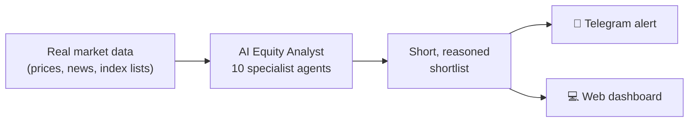
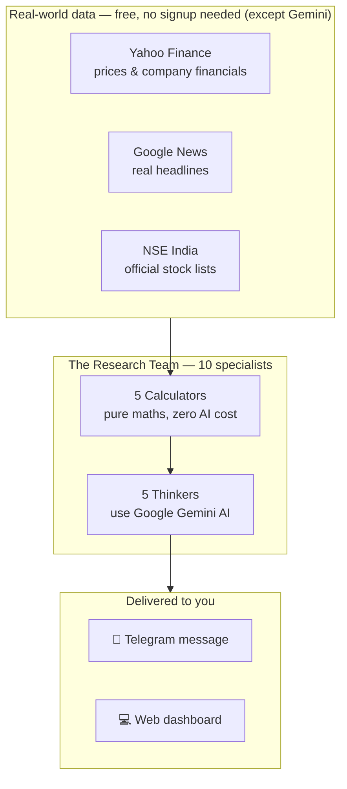
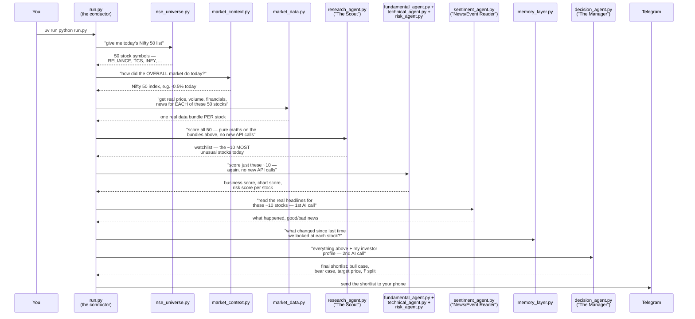
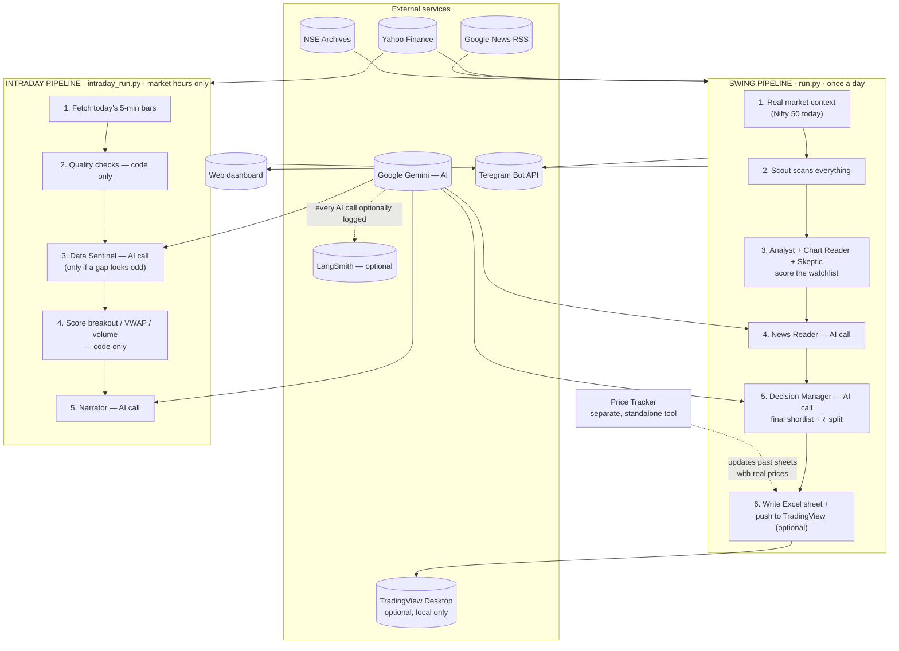

# AI Equity Analyst — Project Overview

*A plain-English summary of what we built, how it's put together, and what it costs to run — prepared for a non-technical audience.*

---

## 1. What is this, in one paragraph

We built an AI-powered research assistant for the Indian stock market (NSE). Every morning it scans up to 500 stocks, does the same kind of number-crunching a junior analyst would do (price trends, financial health, risk), reads the real news headlines, and hands back a short, reasoned list of 2–3 stocks worth a closer look — with the reasoning shown, not hidden. It also has a second, separate mode that watches a stock **during the trading day** for a real breakout in price. Everything it looks at is real market data; there is no demo mode and no made-up numbers anywhere.

**The one thing worth remembering:** this is not a chatbot and not an auto-trader. It's a workflow — *look at real data → reason about it → hand you a short, explained shortlist* — and a human still makes every decision.

---

## 2. High-level architecture (the 30-second version)

We don't read the market ourselves and ask one big AI to "figure it out." Instead, we built a small **team of specialists**, each with one narrow job — the same way a real research desk splits work across a fundamentals analyst, a chart reader, a risk officer, and a manager who makes the final call.

**The key design decision, and why it matters commercially:** only **5 of the 10 specialists actually use paid AI**. The other 5 do pure arithmetic — the kind of thing a spreadsheet formula does — because their job (is this stock above its average price? has it broken a 20-day high?) has one exact right answer. Asking an AI to do that would be slower, more expensive, and *less* consistent than a formula. We only pay for AI where a formula genuinely can't do the job: **understanding what a news headline means**, and **weighing several conflicting opinions into one final, explained call**.

That decision is why this app makes roughly **2 AI calls per full scan of the market**, whether we're scanning 10 stocks or 500.

---

## 3. Meet the team — all 10 agents

We have two separate "crews": one that runs once a day (the **Swing crew**, for multi-day/multi-week ideas) and one that only makes sense while the market is open (the **Intraday crew**, for same-day price action).

### The Swing crew (runs once a day, via `run.py`)

| # | Agent (nickname) | What it actually does | Uses paid AI? |
|---|---|---|---|
| 1 | **Research Agent** ("The Scout") | Scans the whole universe and scores every stock on how *unusual* today's move is — vs. the market, vs. its own normal volatility, vs. its own volume. Picks the ~10 most interesting names. | ❌ No — pure maths |
| 2 | **Fundamental Agent** ("The Analyst") | Scores business quality from real revenue growth, profit margins, debt, cash flow, and how cheap/expensive the stock is *vs. its own history*. | ❌ No — pure maths |
| 3 | **Technical Agent** ("The Chart Reader") | Scores the price chart itself — trend direction, momentum (RSI), how it's doing vs. the Nifty 50. | ❌ No — pure maths |
| 4 | **Risk Agent** ("The Skeptic") | Scores downside risk — volatility, how sharply it's crashed before, how easy it'd be to sell a position without moving the price. | ❌ No — pure maths |
| 5 | **News/Event Reader** | Reads the real, deduplicated news headlines for every shortlisted stock **at once** and works out what happened, how big a deal it is, and whether it's good or bad news. | ✅ Yes — **1 AI call**, covers every stock together |
| 6 | **Decision Agent** ("The Manager") | Weighs all four scores above + the real news read + your own investor profile (risk appetite, capital, sector preferences) and writes the final shortlist: bull case, bear case, a target price, and how much money to actually put into each pick. | ✅ Yes — **1 AI call**, covers every stock together |

### The Intraday crew (runs on demand, during market hours, via `intraday_run.py`)

This is a completely separate, same-day mode: it looks at price action **minute-by-minute today**, not the last year of history, to catch a real breakout while it's happening.

| # | Agent (nickname) | What it actually does | Uses paid AI? |
|---|---|---|---|
| 7 | **Intraday Agent** | Mechanically scores today's price action: did it break out of its opening 15-minute range, is it above the day's average traded price, is volume unusually heavy, how far has it moved since the open. | ❌ No — pure maths |
| 8 | **Data Sentinel** | A safety check that runs *before* scoring: catches broken/stale price feeds automatically (code), and only asks AI to weigh in on the rare case of an unusually large, unexplained overnight price gap — is it a real move, or a data glitch? | ✅ Yes, but **only when needed** (often 0 calls a day) |
| 9 | **Narrator** | Writes a 2–3 sentence plain-English explanation of *why* each top pick scored the way it did, for the handful of stocks that made the final cut — it explains the score, it can never change it. | ✅ Yes — **1 AI call**, top picks only |
| 10 | **Scorekeeper** *(optional, end-of-day)* | A separate, optional script you can run after the market closes: compares today's picks to what actually happened (target hit? stop hit? neither?) — a factual report card, not advice. | ✅ Yes — **1 AI call**, only if run |

**Bottom line: 5 of the 10 agents never touch AI at all**, and the 5 that do are batched to cover the *whole* watchlist in a single call each, not one call per stock.

---

## 4. The exact flow of one swing run — step by step, with a worked example

This section is the "zoom in" view — exactly which file calls which, in what order, for the **daily swing scan only** (the intraday scanner is a separate, later topic). We'll follow one real company — **Reliance Industries**, stock symbol `RELIANCE` — all the way through.

A couple of terms first, since we'll use them immediately:
- **NSE** (National Stock Exchange) — the main stock exchange in India, where companies like Reliance, TCS, and Infosys are listed and traded.
- **Nifty 50** — not a single stock, but an **index**: a basket of the 50 biggest, most-traded companies on the NSE, tracked together as one number so you can ask "how did the market do today?" without checking 50 companies individually.
- **Ticker / symbol** — the short code a company trades under, e.g. `RELIANCE`, `TCS`. Like a username, but for a stock.
- **API** — short for "Application Programming Interface." In plain terms: a way for our program to automatically *ask* another company's computer system for information (like "what's Reliance's price right now?") without a human opening a website and reading it manually.

### The diagram

### The walkthrough, in plain English

**Step 0 — You start it.** You type `uv run python run.py`. This file, nicknamed "the conductor," does no analysis itself — it just calls each of the steps below, in order, and passes the result of one into the next.

**Step 1 — Get today's list of stocks.** File: `data/nse_universe.py`.
This is a separate, *earlier* step from fetching any stock's price — a common point of confusion, so worth being precise about. This file downloads the NSE's own official list of exactly which 50 (or 500) companies are in the Nifty 50/500 index right now, as a plain spreadsheet file, no login needed. It comes back with something like `["RELIANCE", "TCS", "INFY", "HDFCBANK", ...]` — just 50 ticker symbols, no prices yet.

**Step 2 — Check how the overall market is doing.** File: `data/market_context.py`.
Before looking at any single stock, we check the Nifty 50 **index itself** — say it's down 0.5% today. Why first? Because "Reliance rose 1%" means something completely different if the whole market rose 3% that day (Reliance actually *underperformed*) versus if the market was flat (Reliance's move is real and stock-specific).

**Step 3 — Fetch REAL data for every one of the 50 stocks.** File: `data/market_data.py`.
This is the step that actually talks to Yahoo Finance — once for *each* of the 50 symbols from Step 1. For `RELIANCE` specifically, it asks Yahoo Finance (through a free tool called `yfinance`, which just automates "go fetch this from Yahoo's website") for:
- A full **year** of daily price and **volume** (volume = how many shares of the stock were bought and sold that day — a lot of volume means a lot of trading interest) history.
- Real company **fundamentals** (fundamentals = hard financial facts about the business itself — revenue growth, profit margins, how much debt it's carrying — basically "is this a healthy business," separate from its share price).

It *also* separately asks Google News for real recent headlines about Reliance — say it gets back 6 headlines like *"Reliance Q2 profit beats estimates."*

This same step also runs a batch of pure-maths formulas on the year of price data it just fetched (things like RSI — see the glossary below), so by the end of Step 3, we have one complete real "data bundle" for Reliance: price history, volume, financials, real news headlines, and pre-calculated formulas. This happens for all 50 stocks, one after another — all real data, zero AI involved so far.

**Step 4 — The Scout decides which stocks deserve a closer look.** File: `agents/research_agent.py`, nicknamed "The Scout."
**This is the step worth correcting a common assumption about: the Scout does NOT call Yahoo Finance, or any API, itself.** Every real number it needs was already fetched in Step 3. The Scout's entire job is arithmetic on data that's already sitting there: it calculates an **anomaly score** (anomaly = something unusual, standing out from the norm) for all 50 stocks, combining:
- How much Reliance moved today, *compared to* how much the Nifty 50 moved (from Step 2) — a stock that moves with the market isn't unusual; one that moves against it is.
- Whether today's volume is much higher than Reliance's own normal average.
- Whether the price broke above its highest point of the last 20 days.
- Whether the price **gapped** (gap = the stock opened today at a noticeably different price than where it closed yesterday — often a sign that real news happened overnight, while markets were closed).

All 50 stocks get scored this way. The ~10 with the *highest* scores become the **watchlist** (watchlist = the shortlist that gets deeper, more expensive analysis). Say Reliance makes the watchlist because it rose 3% today on double its normal volume, while the Nifty 50 only rose 0.5% — real, unusual outperformance. The other ~40 stocks' story ends here for today; no further analysis is wasted on stocks that aren't doing anything interesting.

**Step 5 — Three more specialists score just the ~10 shortlisted stocks.** Also zero AI, also just maths on the *same* data bundle from Step 3 — again, no new API calls:
- `agents/fundamental_agent.py` ("The Analyst") scores Reliance's business health (0–10) from its real revenue growth, margins, and debt.
- `agents/technical_agent.py` ("The Chart Reader") scores its price chart (0–10) — is it trending up, and is its RSI (Relative Strength Index — a 0–100 score of recent momentum) showing it's **overbought** (overbought = risen so far, so fast, that it might be due for a pause) or **oversold** (the opposite — might be due for a bounce)?
- `agents/risk_agent.py` ("The Skeptic") scores how risky it looks right now (0–10) — how much it swings day to day, and how **liquid** it is (liquid = how easily a large position could be sold without moving the price against you).

**Step 6 — Understand the real news — the first AI call.** File: `agents/sentiment_agent.py`, "News/Event Reader."
This is the *first* time real, paid AI (Google's Gemini) gets used. It's handed the real headlines already fetched in Step 3, for **all ~10 shortlisted stocks together** in one single request (not 10 separate ones — this keeps the AI cost low), and asked: "what actually happened, and is it good or bad news?" For Reliance it might come back with something like: *positive news, about a new business deal, moderately important.*

**Step 7 — Check what changed since last time.** File: `memory/memory_layer.py`. Zero AI.
If we looked at Reliance in a previous run (say, yesterday), this pulls up the real price and scores from that time and computes a genuine before/after comparison — e.g. *"yesterday: ₹2,900, Technical score 6 → today: ₹2,980 (+2.8%), Technical score 7."*

**Step 8 — The Manager makes the final call — the second AI call.** File: `agents/decision_agent.py`, "The Manager."
Gemini is given, for Reliance and every other shortlisted stock together: all the real scores from Steps 5–7, the real Nifty 50 context from Step 2, and your own investor profile (how much risk you're comfortable with, how much capital you have). It's asked to write a **bull case** (bull case = the reasons to be optimistic about this stock) and a **bear case** (bear case = the reasons it could go wrong), an overall stance (accumulate more / hold / avoid), and a reference target price.

Two things Gemini is deliberately **not** asked to decide: how many shares to buy, and how to split your money across your different picks. Both are worked out afterward by plain code, from your own real stated budget — never guessed by the AI.

**Step 9 — Send it to you.** Files: `run.py` + `alerts/telegram_alert.py` (+ two optional outputs).
The finished shortlist — including Reliance, if it made the cut — is sent to your Telegram and saved to a file, and today's real scores are stored so tomorrow's run can compare against them in Step 7. Two more things happen here: a running Excel workbook always gets updated (see §7 below), and — only if you've turned it on — the picks get pushed to a real TradingView watchlist.

---

## 5. How many AI calls are we actually making?

This is usually the first question a budget-owner asks, so here's the exact answer:

| Scenario | Real AI calls |
|---|---|
| **One daily swing scan** (default: one risk profile) | **2** |
| Swing scan with 2 risk profiles selected (e.g. Conservative *and* Aggressive) | 3 (one more per extra profile) |
| **One intraday scan**, normal day | **1** (just the Narrator) |
| Intraday scan on a day with an unusual price gap to double-check | 2 |
| Optional end-of-day report card | 1, only if you choose to run it |
| First-time profile upload (PDF/Word/Excel document) | 0 or 1, **one-time only** — after that it's saved and reused for free |

For comparison: an early version of this project called the AI **~23 times** per run, once per specialist per stock. Restructuring to "batch everything, and only call AI where a formula truly can't do the job" cut that by roughly 90%, with no loss of analysis quality.

---

## 6. Low-level architecture (under the hood)

**Reading this diagram:** the two pipelines are independent — the swing scan (long-term ideas) and the intraday scan (same-day price action) can be run separately, at different times, and share the same output channels (Telegram + dashboard) at the bottom.

### File map, briefly

| Folder | What lives there |
|---|---|
| `agents/` | All 10 specialist agents, one file each |
| `data/` | Everything that fetches or calculates real numbers — prices, news, index lists, and all the maths formulas (RSI, volatility, beta, etc.) |
| `alerts/` | Sends the finished shortlist to Telegram, writes the Excel workbook, and (optional) pushes to TradingView |
| `tracker/` | A separate, standalone tool for checking how past picks have performed — not part of the daily pipeline |
| `memory/` | Remembers each stock's last real score/price so we can say "this changed since last time" |
| `profile/` | Reads your investor profile (risk appetite, capital, sector preferences) from a document or the dashboard form |
| `run.py` / `intraday_run.py` / `intraday_backtest.py` | The three things you actually run |
| `dashboard.py` | The web UI (built with Streamlit) |
| `observability.py` | Optional tracing hookup (see §9) |

---

## 7. Tracking outcomes over time (Excel + TradingView)

A shortlist is only useful if you can later check whether it was any good. Two features exist purely for that:

**A running Excel workbook, always on.** Every swing run writes into `output/portfolio_tracker.xlsx` — one sheet per date, holding that day's selected picks and the full top-10 watchlist, each with a real price. Nothing needs to be turned on; this just happens.

**A separate "price tracker" tool, run whenever you want.** This is deliberately kept apart from the daily pipeline, in its own `tracker/` folder — it's a maintenance pass, not a step in the automated run. When you run it (or click the dashboard's button), it walks every sheet ever written and adds one new column, dated today: each stock's real current price, and its % change since the last time you checked. Run it after a week, a month, whenever — it always compares against your *last* check, not just the original pick date, so you can see momentum between check-ins, not just total return.

**Optional: push straight to a real TradingView watchlist.** If you turn this on, every run also adds the day's picks to your actual TradingView watchlist — no investment capability, purely a list. This works entirely locally: it drives your own already-logged-in TradingView Desktop app on your machine, with **no credentials of any kind stored or transmitted**. It's off by default and never blocks a run if TradingView isn't open.

---

## 8. Where the data comes from, and what needs a paid key

| Source | What it gives us | Cost |
|---|---|---|
| **Google Gemini** | The actual AI reasoning — news interpretation and the final decision | 💰 Paid (pay-per-use, ~2 calls/run) |
| **Yahoo Finance** | Real daily/intraday prices, volume, and company financials | Free, no key |
| **Google News** | Real, current headlines per stock | Free, no key |
| **NSE India (official archives)** | The exact list of which companies are in the Nifty 50 / Nifty 500 today | Free, no key |
| **Telegram** | Delivers the finished shortlist as a phone notification | Free, needs a one-time bot setup (optional) |
| **LangSmith** | Optional: lets us see every AI call and every step of a run in a visual trace, for debugging/monitoring | Free tier available (optional) |
| **TradingView Desktop** | Optional: real watchlist push, local-only, zero credentials | Free (needs your own TradingView account) |

**In short: only one thing costs money — the AI calls to Gemini — and everything else feeding into the analysis is free, public data, or runs entirely on your own machine.** ChromaDB (our "memory") and the Excel workbook also run entirely locally, no cost, no external service.

---

## 9. Can we see what the AI is actually doing? (Observability)

Yes. We added an optional integration with **LangSmith**, an AI-monitoring tool. When it's switched on:
- Every run shows up as one visual timeline: which agent ran, in what order, what it decided.
- Every real AI call is logged with the exact prompt sent, the exact response received, how long it took, and how many tokens (and therefore how much money) it used.
- It's entirely **opt-in** — if we don't turn it on, nothing changes about how the app runs, and no extra cost is incurred.

This gives us the ability to audit, cost-track, and debug every AI decision after the fact, rather than treating the AI as an unexplainable black box.

---

## 10. Guardrails — how we keep this trustworthy

- **No fake data, ever.** If a real data source is unreachable, the app stops and shows the real error — it never quietly substitutes a made-up number to keep going.
- **No silent fallbacks.** Early versions had a "demo mode" and a rule-based backup plan for when the AI was unreachable. Both were removed — either the analysis is real, or you're told clearly that it failed.
- **The AI never invents the money math.** How many shares to buy, and how to split your capital across today's picks, is calculated by plain code from your own stated capital and risk limit — never guessed by the AI.
- **Nothing is "buy this now" advice.** Every output carries a bull case *and* a bear case, a confidence score separate from the opportunity score, and a plain disclaimer. A human always makes the final call.

---

## 11. Quick glossary

- **LLM / AI call** — one request sent to Google's Gemini model, the only step in this system that costs money and "thinks" rather than calculates.
- **Batched call** — one AI request that covers *every* stock on the watchlist at once, instead of one request per stock.
- **Swing vs. Intraday** — Swing = ideas meant to be held for days/weeks, based on a year of history. Intraday = same-day price action only, meaningless once the market closes.
- **Conviction (HIGH/LOW)** — not an opinion; a fixed rule. HIGH means the data lines up cleanly; LOW means treat it as a watch-list idea, not a strong call.
- **NSE** — National Stock Exchange, India's main stock exchange.
- **Nifty 50 / Nifty 500** — an index (a basket of 50 or 500 companies tracked together as one number) used as a stand-in for "how is the market doing overall."
- **Ticker / symbol** — the short code a company trades under, e.g. `RELIANCE`, `TCS`.
- **Volume** — how many shares of a stock changed hands (were bought/sold) on a given day.
- **Fundamentals** — real financial facts about a company's business itself (revenue growth, profit margins, debt), separate from its share price.
- **Watchlist** — the short list of stocks that made the cut for deeper (more expensive) analysis, out of the full universe scanned.
- **Gap** — when a stock opens today at a noticeably different price than where it closed yesterday, usually because of news overnight while markets were shut.
- **Bull case / bear case** — the reasons to be optimistic about a stock, and the reasons it could go wrong, presented side by side rather than a single one-sided opinion.

---

*This document is a plain-language summary for review purposes. For the full technical deep-dive (every formula, every file, every API endpoint), see `HOW_IT_WORKS.md`. For setup instructions, see `README.md`.*
