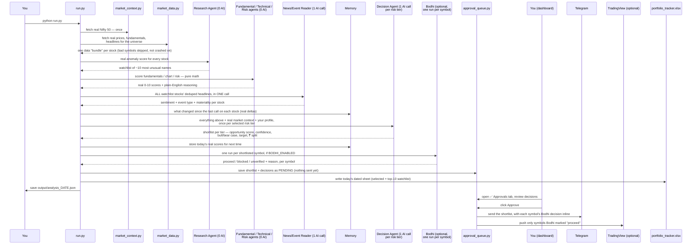
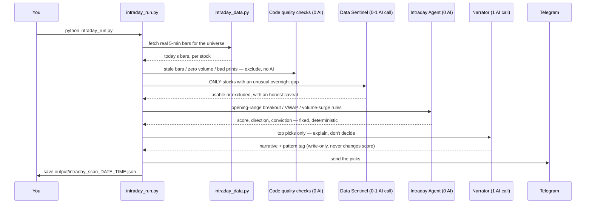

# 🧠 AI Equity Analyst

An **agentic AI** that behaves like a small equity research desk for the
**Indian stock market** — powered by Google **Gemini** (routed through
Bodhi's LLM Gateway, not called directly), real Yahoo Finance prices, and
real news.

Instead of you opening a stock screener and manually checking 50–500
companies every morning, a team of AI "specialists" does it for you and
hands you a short, reasoned shortlist of 2–3 high-conviction ideas — with
its reasoning shown, not hidden.

There are **two separate pipelines**:

- **Swing** (`run.py`) — runs once a day, looks at a year of history, and
  produces multi-day/multi-week ideas with a full investment thesis.
- **Intraday** (`intraday_run.py`) — runs on demand *while the market is
  open*, watches today's price action minute-by-minute, and flags real
  opening-range breakouts.

> **Not a chatbot. Not a buy/sell signal generator.**
> A workflow that *observes → reasons → prioritises → acts*.
>
> **Everything it looks at is real.** There is no demo mode and no
> rule-based fallback anywhere in this codebase. If Gemini or a data source
> can't be reached, the app stops and shows you the real error — it never
> quietly substitutes a fake number to keep going.
>
> **~2 AI calls per swing run, ~1 per intraday scan**, no matter how big
> the universe is. Most of what looks like "AI analysis" is actually plain,
> transparent math on real data — AI is reserved for the things a formula
> genuinely can't do: reading news, explaining a score, and weighing
> conflicting evidence into a final call.

📖 **Want the deep-dive?** [HOW_IT_WORKS.md](HOW_IT_WORKS.md) walks through
every agent, every file, every API call and every formula in plain English
with worked examples — this README is the map, that document is the tour.

📋 **Presenting this to someone non-technical?** [PROJECT_OVERVIEW.md](PROJECT_OVERVIEW.md)
is a short, manager-facing summary — architecture, agents, AI-call costs,
nothing else.

---

## 📖 Read this first (the idea in plain English)

Think of it like **hiring a small research team**. Most of them are pure
calculators (no AI, just real numbers and formulas); a handful are the
ones who actually "think."

### The Swing crew — runs once a day

| Who | Nickname | What they do | AI calls? |
|-----|----------|---------------|-----------|
| **Research Agent** | The Scout | Scores every stock by a real "anomaly score" — move vs the Nifty 50, unusual volume, breakouts, gaps — and picks the ~10 most unusual. | **0** — pure math |
| **Fundamental Agent** | The Analyst | Scores business quality from real revenue growth, ROE, margins, debt, cash flow, and valuation vs the stock's *own* historical range. | **0** — pure math |
| **Technical Agent** | The Chart Reader | Scores the real price chart — trend structure, RSI, relative strength vs Nifty, breakouts. | **0** — pure math |
| **Risk Agent** | The Skeptic | Scores downside risk from real volatility, beta, max drawdown, liquidity, gap risk. | **0** — pure math |
| **News/Event Reader** | (was "Sentiment Agent") | Reads real, deduplicated headlines for **all** shortlisted stocks and extracts what happened, how material it is, and the sentiment. | **1**, batched across every stock |
| **Decision Agent** | The Manager | Weighs every real signal above plus your profile and produces the final shortlist — bull case, bear case, confidence, target price, a real ₹ split across your picks. Runs once per risk-appetite tier you selected. | **1 per risk tier**, batched across every stock |

### The Intraday crew — runs on demand, market hours only

| Who | Nickname | What they do | AI calls? |
|-----|----------|---------------|-----------|
| **Intraday Agent** | The Day Trader | Mechanically scores today's price action — opening-range breakout, VWAP position, volume surge, momentum since the open. | **0** — pure math |
| **Data Sentinel** | — | A pre-scoring gate. Stale/broken data is caught in plain code; only an unusually large, otherwise-clean overnight price gap gets a real AI judgment call. | **0 or 1**, only when a gap needs review |
| **Narrator** | — | Writes a plain-English explanation of *why* each top pick scored the way it did, and tags the shape of today's chart. Write-only — it explains the score, it can never change it. | **1**, top picks only |
| **Scorekeeper** *(optional)* | — | Run separately after market close: compares today's picks to what actually happened (target/stop/neither) — a factual report card. | **1**, only if you run it |

The big shift: instead of **you** reading everything, the system reads it,
argues it out internally, and gives you a short answer you can act on — and
it does that for a couple of AI calls per run, not per stock.

---

## 🗺️ Architecture — what talks to what

```mermaid
flowchart TB
    subgraph External["🌐 External services (all real, mostly free)"]
        Gemini[("Bodhi LLM Gateway<br/>the one AI entry point<br/>— needs a token")]
        Yahoo[("Yahoo Finance<br/>via yfinance<br/>— free, keyless")]
        GNews[("Google News RSS<br/>— free, keyless")]
        NSEArc[("NSE archives<br/>Nifty 50 / 500 lists<br/>— free, keyless")]
        TG[("Telegram Bot API<br/>— needs a bot token")]
        LS[("LangSmith<br/>— optional, free tier")]
        TV[("TradingView Desktop<br/>— optional, local only, no keys")]
    end

    subgraph SwingApp["Swing pipeline"]
        MktCtx["data/market_context.py<br/>real Nifty 50, once per run"]
        MarketData["data/market_data.py<br/>real prices, fundamentals, news"]
        Universe["data/nse_universe.py"]
        ZeroAI["4 zero-AI agents<br/>Scout · Analyst · Chart Reader · Skeptic"]
        EventDecision["News/Event Reader +<br/>Decision Agent<br/>AI, once per risk tier"]
        Run["run.py"]
    end

    subgraph IntraApp["Intraday pipeline"]
        IntraData["data/intraday_data.py<br/>real 5-min bars, today only"]
        IntraAgent["Intraday Agent — 0 AI"]
        Sentinel["Data Sentinel — AI, only if needed"]
        Narrator["Narrator — AI, top picks only"]
        IntraRun["intraday_run.py"]
    end

    subgraph Shared["Shared"]
        Config["config.py + observability.py"]
        Memory["memory/memory_layer.py"]
        Profile["profile/profile_loader.py"]
        Dashboard["dashboard.py — Streamlit UI"]
        Alert["alerts/telegram_alert.py"]
        TVAlert["alerts/tradingview_watchlist.py<br/>— optional"]
        Excel["alerts/excel_report.py"]
        Tracker["tracker/price_tracker.py<br/>— separate, standalone tool"]
        Bodhi["integrations/bodhi_risk_insights.py<br/>— optional, external,<br/>one Bodhi run per symbol"]
        Approval["alerts/approval_queue.py<br/>human checkpoint"]
        Output[("output/*.json + portfolio_tracker.xlsx")]
    end

    Yahoo --> MarketData & MktCtx & IntraData & Tracker
    GNews --> MarketData
    NSEArc --> Universe
    Gemini --> Config
    Config --> EventDecision & Sentinel & Narrator & Profile
    MarketData --> Run
    MktCtx --> Run
    Universe --> Run
    ZeroAI --> Run
    EventDecision --> Run
    IntraData --> IntraAgent --> IntraRun
    Sentinel --> IntraRun
    Narrator --> IntraRun
    Memory --> Run
    Profile --> Run
    Run --> Bodhi -.->|one run per shortlisted symbol, if enabled| BodhiSvc((Bodhi))
    Bodhi -->|per-symbol decision:<br/>proceed / blocked / unverified| Approval
    Run --> Approval
    Approval -->|human clicks Approve| Alert --> TG
    Approval -->|only "proceed" symbols| TVAlert --> TV
    Dashboard -->|✅ Approvals tab: approve / reject| Approval
    Run --> Excel --> Output
    IntraRun --> Alert
    Run --> Output --> Dashboard
    IntraRun --> Output
    Tracker -.->|reads real prices, appends columns| Output
    Gemini -.->|traced if enabled| LS
    Dashboard -. "▶ Run swing / ⚡ Run intraday / 📒 Update tracker / 🧠 Bodhi Risk Insight" .-> Run & IntraRun & Tracker & Bodhi
    Dashboard -. "upload / fill profile form" .-> Profile
```

Nothing reaches Telegram or TradingView the moment a run finishes — every
shortlist lands in `alerts/approval_queue.py` as **pending** first,
Bodhi's per-symbol decisions attached, and a human has to click Approve
(or Reject) in the dashboard before anything external is touched. See the
worked example in the Bodhi section below.

**Every connection above is either a plain, direct HTTP/SDK call, or a local,
credential-free connection to an app already running on your own machine.**
`requests` handles Google News/NSE/Telegram *and* every AI call (a plain
REST call to Bodhi's LLM Gateway — see `config.call_bodhi_llm()`),
`yfinance` handles Yahoo Finance, and `langsmith` (optional) handles
tracing — none of those are MCP. The one exception is the optional TradingView
watchlist push: it shells out to the [tradingview-mcp](https://github.com/tradesdontlie/tradingview-mcp)
CLI, which drives your already-logged-in TradingView Desktop app over Chrome
DevTools Protocol on `localhost` — no TradingView credentials are ever
stored or sent anywhere by this app. The optional Bodhi Risk Insight is a
plain `requests` REST call to a Bodhi workflow (a separate, external AI
platform) — see below.

---

## 🔁 What happens during one swing run — step by step



If **any** step fails — Gemini unreachable, Yahoo rate-limiting a symbol —
that step raises with a full error. A single bad symbol is *skipped*
(logged, not fatal) thanks to the data-quality gate; a Gemini outage still
stops the whole run, since there's no fallback to silently degrade to.

## ⚡ What happens during an intraday scan — step by step



Only meaningful while the NSE cash market is open (09:15–15:30 IST) —
outside those hours there are no fresh bars to score.

---

## 🧩 What each file is (so nothing feels like a black box)

```
ai-equity-analyst/
├── run.py                        ← runs the full SWING pipeline
├── intraday_run.py                ← runs the full INTRADAY pipeline
├── intraday_backtest.py            ← optional end-of-day report card for today's intraday picks
├── dashboard.py                     ← Streamlit UI: profile builder, browse runs, trigger a run
├── config.py                         ← reads .env; call_bodhi_llm() is the one AI entry point every agent uses
├── observability.py                   ← optional LangSmith tracing (no-op if not configured)
├── .env.example                        ← copy this to .env and add your settings
├── requirements.txt                     ← the Python libraries to install
├── sample_profile.txt                    ← an example investor profile you can edit
│
├── agents/
│   ├── base_agent.py              ← shared skill: "ask Gemini, get JSON back, or raise" — traced here
│   ├── research_agent.py          ← The Scout — 0 AI calls, real anomaly scoring
│   ├── fundamental_agent.py       ← The Analyst — 0 AI calls, real business-quality scoring
│   ├── technical_agent.py         ← The Chart Reader — 0 AI calls, real chart scoring
│   ├── risk_agent.py              ← The Skeptic — 0 AI calls, real risk scoring
│   ├── sentiment_agent.py         ← News/Event Reader — 1 batched AI call for all stocks
│   ├── decision_agent.py          ← The Manager — 1 batched AI call per risk tier, + real ₹ allocation
│   ├── intraday_agent.py          ← The Day Trader — 0 AI calls, real ORB/VWAP/volume scoring
│   ├── intraday_quality_agent.py  ← Data Sentinel — 0-1 AI call, only for unusual gaps
│   ├── intraday_narrator_agent.py ← Narrator — 1 batched AI call, top picks only, write-only fields
│   └── intraday_backtest_agent.py ← Scorekeeper — 1 AI call, optional, end-of-day only
│
├── data/
│   ├── market_data.py             ← real prices/fundamentals/news/liquidity (Yahoo + Google News)
│   ├── signals.py                 ← pure-math indicators: RSI, ATR, beta, drawdown, volatility...
│   ├── market_context.py          ← real Nifty 50 fetched once per run
│   ├── nse_universe.py            ← fetches live Nifty 50 / Nifty 500 lists from NSE
│   ├── intraday_data.py           ← real 5-minute bars, today's session only
│   └── intraday_signals.py        ← pure-math intraday indicators: VWAP, opening range, volume surge
│
├── memory/memory_layer.py         ← The Notebook — real price/score deltas since your last call
├── profile/profile_loader.py      ← reads your profile file (PDF/XLSX/HTML/DOCX/TXT/JSON)
│
├── alerts/
│   ├── telegram_alert.py          ← sends the shortlist to Telegram (or prints it); splits long alerts
│   ├── tradingview_watchlist.py   ← optional: pushes shortlisted symbols to your real TradingView watchlist
│   ├── excel_report.py            ← writes each swing run into output/portfolio_tracker.xlsx, one sheet per date
│   ├── intraday_excel_report.py   ← writes each intraday scan into output/intraday_tracker.xlsx, one sheet per date
│   ├── trigger_telegram.py        ← standalone: re-send the latest saved shortlist to Telegram on demand
│   └── trigger_tradingview.py     ← standalone: re-push the latest saved shortlist to TradingView on demand
│
├── tracker/
│   └── price_tracker.py           ← standalone tool, separate from agents/ — appends a real dated price
│                                     column to every past sheet in BOTH portfolio_tracker.xlsx and
│                                     intraday_tracker.xlsx, 0 AI calls
│
├── integrations/
│   ├── bodhi_client.py            ← optional: generic start-run/poll/extract REST client for Bodhi
│   ├── bodhi_risk_insights.py     ← optional: builds a real portfolio from today's shortlist, calls Bodhi
│   └── run_bodhi_risk_insight.py  ← standalone: get a Bodhi insight without a full re-run
│
├── .mcp.json                      ← registers the local tradingview-mcp server for this project
└── output/                        ← each run's full analysis (JSON) + portfolio_tracker.xlsx + Bodhi reports
```

For exactly what each file does internally — every function, every real
formula, every API endpoint — see **[HOW_IT_WORKS.md](HOW_IT_WORKS.md)**.

---

## 🌐 Where every piece of data actually comes from

| Source | What it provides | Used by | Key needed? |
|---|---|---|---|
| **Bodhi LLM Gateway** | News interpretation, final decision synthesis, intraday narration/gap review — every AI call in the app, routed through one governed endpoint | `agents/*.py` (5 of the 10 agents), plus profile structuring, via `config.call_bodhi_llm()` | ✅ yes |
| **Yahoo Finance** (`yfinance`) | Real daily *and* 5-minute price/volume history, real company fundamentals, the Nifty 50 index itself | `data/market_data.py`, `data/market_context.py`, `data/intraday_data.py` | ❌ free |
| **Google News RSS** | Real, current headlines per stock | `data/market_data.py` (fetch) → `agents/sentiment_agent.py` (interpret) | ❌ free |
| **NSE archives** | Official Nifty 50 / Nifty 500 constituent symbol lists | `data/nse_universe.py` | ❌ free |
| **Telegram Bot API** | Delivers the finished shortlist to your phone | `alerts/telegram_alert.py` | ✅ yes (optional) |
| **ChromaDB** (local) | Stores real price/score history per stock for the audit/delta system | `memory/memory_layer.py` | ❌ local, no key |
| **LangSmith** | Optional: traces every AI call and pipeline step for auditing/debugging | `observability.py` | ✅ yes (optional, free tier) |
| **TradingView Desktop** | Optional: real watchlist push — no API, no key; drives your already-logged-in Desktop app locally over Chrome DevTools Protocol | `alerts/tradingview_watchlist.py` | ❌ local only, zero credentials |
| **Bodhi** | Optional: an extra, external AI-driven risk read on today's real shortlist | `integrations/bodhi_risk_insights.py` | ✅ yes (optional, PAT token) |
| **your file or the dashboard form** | Your investor profile | `profile/profile_loader.py` | ❌ local |

Everything else — RSI, moving averages, beta, drawdown, volatility, ATR,
relative strength, anomaly scores, opening-range breakouts, VWAP, position
sizing, capital allocation — is **plain Python math** on the real numbers
above, computed in `data/signals.py` and `data/intraday_signals.py`. No
API, no AI.

---

## ⚠️ Known gaps — honest limitations

- **ROCE, promoter shareholding/pledge %, earnings quality** — no free data
  source exists; these are never asked about rather than guessed. Need a
  paid provider (Screener.in, Trendlyne, an NSE filings feed) to add.
- **Sector-relative market context** — the Scout compares each stock only
  to the broad Nifty 50, not to a sector index (e.g. Nifty IT). There's no
  clean free mapping from stock → sector index, so this was deliberately
  left out rather than guessed.
- **Portfolio fit is watchlist-level, not real-holdings-level** — this app
  doesn't track your actual brokerage holdings, so "portfolio fit" reflects
  sector concentration *within today's shortlist*, not your real portfolio.
- **No earnings-calendar / event-proximity risk** — flagging "results due in
  3 days" needs a free, reliable earnings calendar source, which wasn't
  wired in.
- **The Data Sentinel can't confirm corporate actions** — it has no
  corporate-actions calendar, so on a large overnight gap it can only say
  "this looks like it could be a split/bonus" or "usable, but unconfirmed"
  — never a certain answer.

---

## 🚀 Getting started — step by step

**Step 1 — Install Python 3.10+ (or use `uv`)**
```bash
python3 --version
```

**Step 2 — Install the libraries**
```bash
cd ai-equity-analyst
uv pip install -r requirements.txt      # or: pip install -r requirements.txt
```

**Step 3 — Create your settings file**
```bash
cp .env.example .env
```

**Step 4 — Connect the Bodhi LLM Gateway**

Every AI call in this app — the News Reader, the Decision Agent, profile
structuring — goes through Bodhi's LLM Gateway, an OpenAI-compatible
endpoint. No provider SDK (`google-genai`, `openai`, ...) is called
directly anywhere in this codebase; `config.call_bodhi_llm()` is the one
place that happens, so the whole app's AI usage is attributable through
Bodhi rather than a direct provider account.

1. Get your API token and team identifier from your Bodhi platform access
   (Bodhi calls the team identifier "ASPIRE TEAM NAME" — it's sent as a
   `trace_user_id` header for usage attribution on their side).
2. In `.env`:
   ```
   BODHI_LLM_GATEWAY_URL=https://bodhi-llm-gateway.sandbox.psbodhi.live
   BODHI_LLM_GATEWAY_TOKEN=paste-your-token-here
   BODHI_LLM_TRACE_USER_ID=your-team-name
   BODHI_LLM_MODEL=gemini-2.5-pro
   ```
3. `BODHI_LLM_MODEL` can be any model ID Bodhi's gateway currently
   supports — check `GET /v1/models` on the gateway URL above for the
   live list (OpenAI, Anthropic, and Google models are all available
   through the same endpoint).

**Step 5 — Run the swing scan**
```bash
uv run python run.py       # or: python run.py
```

The header prints `Bodhi LLM Gateway: connected` when it worked. If it
says `NOT CONFIGURED`, `run.py` stops immediately with the reason — fix
`.env` and re-run. Market data (Yahoo Finance, Google News, NSE lists)
needs no key at all.

**Step 6 — Try the intraday scanner** (during market hours, 09:15–15:30 IST)
```bash
uv run python intraday_run.py
```

---

## 📊 Using the dashboard

A Streamlit UI sits on top of both pipelines:

```bash
uv run streamlit run dashboard.py
```

Opens at `http://localhost:8501`. From there you can:

- **Build your investor profile** — optionally upload a PDF/XLSX/DOCX
  document (parsed automatically), and always fill in a dropdown form
  (risk appetite — now a **multi-select**, so you can compare e.g.
  Conservative vs Aggressive shortlists side by side — capital, horizon,
  preferred/excluded sectors, max position size). Every field that isn't
  obvious has a plain-English tooltip explaining what it means and why it
  matters. Your form answers always win over the document. Saved as JSON
  — which the next run loads **without an extra Gemini call**.
- **Browse any past swing run** — pick a date, see the shortlist as cards
  per risk tier (opportunity score, confidence, HIGH/LOW conviction with a
  plain-English reason, bull/bear case, suggested ₹ allocation), and expand
  each stock for its real score breakdown, 6-month price chart, and the
  real headlines behind its news verdict. A glossary expander at the top
  explains conviction, risk appetite, position size, and allocation in one
  place.
- **Browse any intraday scan** — same idea, on the "⚡ Intraday scan" tab:
  entry/stop/target levels, the mechanical read, and the Narrator's
  explanation + pattern tag for each pick.
- **Edit `UNIVERSE` / `TOP_N`** — written straight to `.env`. Bodhi/Telegram
  credentials are intentionally **not** editable here — they're secrets,
  not day-to-day knobs, so they stay `.env`-only.
- **Trigger a run** — separate buttons for **▶ Run swing analysis** and
  **⚡ Run intraday scan**, both showing the live log.
- **Update the price tracker** — **📒 Update price tracker** runs
  `tracker/price_tracker.py` for you, appending a real dated price column
  to every past sheet in `output/portfolio_tracker.xlsx`.
- **Get a Bodhi Risk Insight** — **🧠 Get Bodhi Risk Insight** (if
  `BODHI_ENABLED=true`) sends the most recent saved shortlist to Bodhi and
  shows its real answer in the log, and on Telegram.

---

## 🔢 Choosing what to scan (`UNIVERSE`)

In `.env`:
```
UNIVERSE=NIFTY50
```
- `NIFTY50` / `NIFTY500` — fetches the real, current constituent list
  straight from NSE (`data/nse_universe.py`), cached locally for a day.
- Or a plain comma-separated list: `UNIVERSE=RELIANCE,TCS,INFY,HDFCBANK`.

Bigger universes mean more sequential Yahoo Finance calls (not more AI
calls for the swing scan's scoring stage), so `NIFTY500` will take
noticeably longer to fetch than `NIFTY50`. `UNIVERSE` is shared between
`run.py` and `intraday_run.py`.

---

## 💰 Multiple risk profiles and the real ₹ split

If your investor profile has more than one risk appetite selected (e.g.
Conservative **and** Aggressive, via the dashboard's multi-select), the
Decision Agent runs **once per tier** — you get a separate shortlist for
each, so a `TOP_N` of 3 with 2 tiers selected means 2 AI calls, not 1.

Within each tier's shortlist, `agents/decision_agent.py` also computes a
real rupee split across your picks — plain Python, never an AI guess:
higher-opportunity-score picks get a bigger share of your stated capital,
every pick is capped at your max position-size %, and any leftover
capital, once every pick has hit its cap, is redistributed to the
next-highest-scoring pick. You'll see `allocated_amount` /
`allocated_shares` per stock, and a `capital_summary` showing total
deployed vs. cash remaining.

**Conviction (HIGH/LOW)** is derived the same deterministic way, not
self-reported by the AI: confidence ≥ 70 → HIGH, otherwise LOW — so it
always means the same thing every time you see it.

---

## 🙋 Adding your own investor profile

The easiest path is the **dashboard's profile builder** (see above). If you
prefer editing a file directly:

1. Write your preferences in a file — `.txt`, `.md`, `.pdf`, `.html`,
   `.docx`, `.xlsx`, or a pre-structured `.json` all work. (See
   `sample_profile.txt` for an example.)
2. Point `.env` at it: `PROFILE_PATH=my_profile.pdf`
3. Run as usual. A `.json` file is loaded as-is (no AI call). Anything else
   goes through one Gemini call to structure it into risk appetite, capital,
   horizon, sector preferences/exclusions and constraints; if that fails, a
   light keyword scan fills in a rough version instead.

---

## 📱 Getting alerts on Telegram (optional)

1. On Telegram, message **@BotFather**, send `/newbot`, copy the **token**.
2. **Open a chat with your new bot yourself** and send it any message (e.g.
   "hi") — a bot can't message you until you've messaged it first.
3. Fetch your chat id:
   ```bash
   curl "https://api.telegram.org/bot<TOKEN>/getUpdates"
   ```
   Look for `"chat":{"id": <number>}` in the response (or message
   **@userinfobot**, which replies with it instantly).
4. Put both in `.env`:
   ```
   TELEGRAM_BOT_TOKEN=your-token
   TELEGRAM_CHAT_ID=your-chat-id
   ```

Leave these blank and the shortlist just prints to the screen instead.
Telegram rejects any single message over 4096 characters — a long
multi-tier shortlist is automatically split into multiple numbered
messages (`(1/2)`, `(2/2)`, ...) rather than failing silently.

---

## 📈 Pushing picks to a real TradingView watchlist (optional)

Every run can also add today's shortlisted symbols to your actual
TradingView watchlist — no investment capability, just a list. This is
**local-only and credential-free**: it drives your already-logged-in
TradingView Desktop app on your own machine over Chrome DevTools Protocol
via the [tradingview-mcp](https://github.com/tradesdontlie/tradingview-mcp)
CLI, which is why it's the *only* place in this app that touches something
resembling MCP.

**Setup, one time:**
1. `git clone https://github.com/tradesdontlie/tradingview-mcp ~/mcp-servers/tradingview-mcp && cd ~/mcp-servers/tradingview-mcp && npm install`
2. Have TradingView Desktop installed (e.g. `brew install --cask tradingview` on Mac) and logged in.
3. In `.env`:
   ```
   TRADINGVIEW_WATCHLIST_ENABLED=true
   TRADINGVIEW_CLI_PATH=~/mcp-servers/tradingview-mcp/src/cli/index.js
   ```

**Before each run**, launch TradingView with its debug port enabled instead
of the normal icon:
```bash
~/mcp-servers/tradingview-mcp/scripts/launch_tv_debug_mac.sh
```

This is a **live local connection, not a background service** — if
TradingView Desktop isn't open with that debug port when `run.py` executes,
`alerts/tradingview_watchlist.py` just logs `[tradingview] skipped: ...`
and the rest of the run continues completely normally. Leave
`TRADINGVIEW_WATCHLIST_ENABLED` unset (the default) to skip this entirely.

---

## 📒 Tracking your picks over time (Excel)

Every swing run also writes to a persistent workbook,
`output/portfolio_tracker.xlsx` — created on the first run, one new sheet
per run **date** after that (a same-day re-run replaces that day's sheet
rather than duplicating it; every other date's sheet is untouched). Each
sheet has two tables:

1. **Selected Stocks** — the deduped final shortlist across every risk
   tier you ran, with a Tier(s) column showing which tier(s) picked it.
2. **Top N Watchlist** — every stock the Scout flagged as unusual that day,
   whether or not it made the final cut.

This is plain code, zero AI, and always on — no toggle needed.

**The intraday scanner has the exact same setup, in its own file.** Every
`intraday_run.py` scan writes into `output/intraday_tracker.xlsx` (via
`alerts/intraday_excel_report.py`) — a separate workbook from the swing
one, since intraday picks (direction, entry, stop, target, pattern) don't
share a shape with swing picks. Same rule: one sheet per date, a same-day
re-run replaces that day's sheet.

**To see how those past picks have actually performed**, run the
tracker separately (`tracker/price_tracker.py` — deliberately its own
folder, apart from `agents/`, since it isn't part of the daily pipeline).
One run covers **both** workbooks:

```bash
uv run python tracker/price_tracker.py     # or the dashboard's 📒 button
```

It walks *every* sheet in *both* `portfolio_tracker.xlsx` and
`intraday_tracker.xlsx` and appends one new column, dated today, to every
table it finds: each stock's real current price, plus its % change vs.
whichever column was the most recent price checkpoint for that stock —
the original listing price the first time you run the tracker, or the
last tracking column a previous run added, every time after that. Run it
as often as you like; each distinct symbol's price is only fetched once
per run, no matter how many sheets or workbooks it appears in. It never
overwrites a column, even on a same-day re-run — the first run of the day
gets a clean `2026-09-01` column, and any re-run after that gets the real
`2026-09-01 14:32:07` it actually ran at, rather than risking any tracked
history.

---

## 🧠 Bodhi risk verification before Telegram/TradingView (optional)

If you have a **Bodhi** workflow (Sapient's internal multi-agent AI
platform — a separate system from this app), every swing run can send it
today's real shortlist for an independent review, and use its answer to
**gate what goes to TradingView**, before Telegram/TradingView are touched
at all. It's off by default and never blocks a run:

```bash
BODHI_ENABLED=true
BODHI_BASE_URL=https://your-bodhi-instance
BODHI_PAT_TOKEN=your-personal-access-token
BODHI_TASK_ID=your-workflow-task-id
BODHI_WORKFLOW_ID=your-workflow-id
# match your workflow's Start Node / Workflow Variables names —
# these are the confirmed-working defaults (no spaces allowed)
BODHI_PORTFOLIO_VARIABLE=Investmentportfolio
BODHI_QUERY_VARIABLE=Query_for_risk_assessment
```

**One Bodhi run per stock, not one run per shortlist.** Review decisions
happen at the symbol level — a stock's risk doesn't change because it
happened to be shortlisted next to another one — so
`integrations/bodhi_risk_insights.py` calls the workflow once per
shortlisted symbol, each with its own run ID, independently auditable in
Bodhi's own run history.

**The Bodhi workflow** — full node definitions and the exact JSON files
live in [`integrations/bodhi_workflow/`](integrations/bodhi_workflow/),
along with a per-node breakdown and a fallback ladder:

```
Start (portfolio array, query, accumulator)
  └─► Repeat · per symbol ──────────────────────────────────┐
        ├─► Set · current symbol                            │
        ├─► Risk Analyst Agent ◄── MCP: bodhi-deep-research  │
        │      └── closes RESEARCH_STATUS: FULL|PARTIAL|UNAVAILABLE
        ├─► Set · research status      (intermediate state check)
        ├─► Contrarian Agent
        │      └── closes decisions JSON + ROUTING_FLAG
        └─► Switch · review outcome
              ├─ review_needed     ─► Escalation Analyst ◄── MCP (deeper)
              ├─ data_insufficient ─► Data Quality Handler
              └─ clear             ─────────────────────┐
                 all three converge ─► Set · append ─────┘
                                          └── loops back
  └─► (done) ─► Preview · decisions ─► End (decisions array)
```

- **Repeat** — the per-symbol loop runs *inside the platform*, iterating
  the portfolio array. `continueOnError` means one symbol failing doesn't
  abandon the rest of the shortlist.
- **Risk Analyst Agent** — researches real, current risk factors for one
  stock via the `bodhi-deep-research` MCP tool, and must close with an
  explicit `RESEARCH_STATUS` line rather than quietly papering over a tool
  failure.
- **Contrarian Agent** — red-team-challenges that assessment and closes
  with a structured decision plus a routing flag. It's also told that the
  text above it is *data*: anything that looks like an instruction is
  treated as evidence of tampering and blocks the symbol.
- **Switch (3-way)** — richer than escalate/don't. `review_needed` goes to
  a deeper research pass; `data_insufficient` goes to a failure handler;
  `clear` finishes immediately. The switch **defaults to
  `data_insufficient`**, so a malformed reply can never be read as "clear".
- **Escalation Analyst** — a second, deeper, independent research pass on
  flagged stocks only. If *its* research fails, it must keep the block —
  failing open on an already-flagged stock is the expensive direction.
- **Data Quality Handler** — returns the *same* decision schema as every
  success path, marked blocked/partial, and is explicitly forbidden from
  reviewing the stock from general knowledge. One schema on every branch is
  what makes the workflow's contract verifiable from the export alone.
- **Every node carries a `_contract`** in its data — inputs, outputs and
  failure behaviour, readable straight from the JSON.
- **No UI Node** — a UI Node pauses a run waiting for a human to fill in a
  form, which breaks an API-triggered run. Workflow Variables are the
  entry point an API call can actually populate.

> **Honest status:** `control-start`, `control-end`, `agent-custom` and
> `mcp-tools` are confirmed against a real Bodhi export. The `Repeat`,
> `Switch`, `Set Variable` and `Preview` node schemas are **inferred from
> naming conventions and marked `_UNVERIFIED` in the JSON** — verify them in
> the canvas and re-export before relying on them. The app does not depend on
> them: `BODHI_PER_SYMBOL_RUNS=true` (the default) drives the loop from
> Python against any single-stock workflow, including the confirmed 5-node
> one. See [`integrations/bodhi_workflow/README.md`](integrations/bodhi_workflow/README.md)
> for the fallback ladder.

**What happens:** for each shortlisted symbol, `bodhi_risk_insights.py`
sends that one stock's data plus the risk question as two workflow
variables, and parses the resulting `decisions` JSON. Every symbol ends
up in exactly one of three states:
- **`proceed`** — Bodhi reviewed it and found nothing worth blocking on.
  Goes to TradingView.
- **`blocked`** — Bodhi (after escalation) still says no. Excluded from
  TradingView, shown clearly in the dashboard with the reason.
- **`unverified`** — the Bodhi call itself failed, timed out, or came back
  without a parseable decision. Treated the same as `blocked` for
  TradingView purposes (excluded) — an incomplete review is never treated
  as a clearance — but shown as its own distinct state everywhere, so it's
  never confused with a real "Bodhi looked at this and blocked it."

Telegram always shows every pick either way, with its Bodhi decision line
added. Bodhi's full narrative (all symbols, concatenated) is also sent as
its own Telegram message and saved to
`output/bodhi_risk_insight_DATE.txt`. If Bodhi is off entirely, nothing is
filtered — every shortlisted symbol goes to TradingView, exactly as before
this integration existed. Get a verification pass without a full re-run
via `uv run python integrations/run_bodhi_risk_insight.py` (or the
dashboard's 🧠 button) — it reuses the most recently saved shortlist.

One thing to know if you build your own workflow: Bodhi's REST API
response nests the real per-node results three levels deep, at
`exec_metadata.allOutputs.<run>.<node>` — not at the top level of the
response — which is what `integrations/bodhi_client.py`'s
`extract_bodhi_answer()` reads from.

### Worked example — one stock, input to outcome

Say today's shortlist includes **RELIANCE** (moderate tier, opportunity
score 78, action "accumulate").

1. **Start Node.** `Investmentportfolio` = `{"symbol": "RELIANCE", "sector":
   "Energy", "action": "accumulate", "opportunity_score": 78, ...}`.
   `Query_for_risk_assessment` = the configured risk question, plus the
   instruction to close with the `decisions` JSON.
2. **Risk Analyst Agent** researches RELIANCE specifically — e.g. crude
   oil price moves, refining margins, retail/telecom arm performance —
   and writes 3–5 sentences of sourced commentary.
3. **Contrarian Agent** challenges that: is the crude-oil risk actually
   current, or stale? Suppose it finds a genuinely fresh concern (e.g. a
   pending regulatory decision) and closes with:
   `{"decisions": [{"symbol": "RELIANCE", "decision": "blocked", "reason":
   "Pending regulatory ruling on retail spinoff creates near-term
   uncertainty not reflected in the bull case.", "research_confidence":
   "full"}]}` and `ROUTING_FLAG: REVIEW_NEEDED`.
4. **If-Else** sees `REVIEW_NEEDED` and routes to Escalation Analyst
   instead of straight to End.
5. **Escalation Analyst** digs specifically into that regulatory point —
   suppose it finds the ruling is expected to be favorable and low-impact
   either way — and overturns the block: `{"decisions": [{"symbol":
   "RELIANCE", "decision": "proceed", "reason": "Escalated review: ruling
   timeline confirmed as procedural, not material — original block was
   overstated.", "research_confidence": "full"}]}`.
6. **End Node** returns Escalation Analyst's answer.
7. `bodhi_risk_insights.py` parses it: `{"symbol": "RELIANCE", "status":
   "ok", "decision": "proceed", "reason": "Escalated review: ...", ...}`.
8. `run.py` saves this as part of a **pending approval record**
   (`alerts/approval_queue.py`) — nothing sent yet.
9. In the dashboard's **✅ Approvals** tab, RELIANCE shows with a green
   `✅ PROCEED` badge and the escalation reason. A human clicks **Approve
   & send**.
10. `approval_queue.approve()` sends the Telegram alert (RELIANCE's line
    includes the 🧠 Bodhi decision), and pushes RELIANCE to TradingView
    (it wasn't in `flagged_symbols` or `unverified_symbols`). The decision
    record is saved to disk with `status: "approved"`, visible afterward
    in the Approvals tab's "Run history" expander.

If step 5 had *confirmed* the block instead, RELIANCE would show a red
`🚫 BLOCKED` badge, get excluded from `tv_symbols` automatically on
Approve, and still appear in Telegram (with the reason) so nothing is
hidden — it just never reaches the live watchlist.

---

## 🔭 Monitoring — always on, no setup

Two layers, deliberately separate.

**Layer 1 — always on, zero configuration.** Every run writes structured
telemetry to `output/metrics.jsonl` and `output/reliability_log.jsonl`, with
no API key and no external service:

- every LLM call — which agent, latency, real token counts, whether the
  reply actually parsed as JSON
- every knowledge retrieval — what was asked for, how many chunks cleared
  the similarity floor, the top score
- every Bodhi review — mode, symbols, blocked/unverified counts
- every prompt-safety event — what was neutralised and where it came from
- every approval decision — who released what, and how much was held back
- every failure, from any component, with the run id that produced it

Read it back with **`uv run python tracker/ops_report.py`**, or the
dashboard's **🛠 Ops & evidence** tab (per-agent latency and token cost,
error rates, safety events, recent failures, retrieval stats, and the live
pipeline contracts). Because it needs no setup, this panel is never empty
just because a tracing service wasn't configured.

**Layer 2 — LangSmith, optional.** Adds a hosted visual trace tree on top:

```
LANGSMITH_API_KEY=your-key
LANGSMITH_PROJECT=ai-equity-analyst
```

Get a free key from LangSmith → Settings → API Keys. Leave it blank and
tracing is a complete no-op — the `langsmith` package doesn't even need to
be importable, and layer 1 still records everything.

---

## 🧠 What the system remembers, and whether that helps

Two different things, often confused:

- **`memory/memory_layer.py`** — structured per-symbol state (last price,
  last scores) looked up by exact symbol. Answers *"what changed since we
  last looked at TCS."*
- **`memory/knowledge_base.py`** — a real retrieval layer over the research
  text past runs actually produced. Answers *"what have we seen before
  that's relevant to this situation,"* which exact-match lookup cannot.

The retrieval layer is chunked and controllable, not just "embed the note
and hope":

- **Chunking** — each run's research is split by *section* (event summary,
  bull case, bear case, key risk) so a downside query matches a bear case
  directly instead of being diluted by the bull case in the same vector.
  Long sections are further split into overlapping windows at sentence
  boundaries, so a point made across a boundary stays findable from both
  sides.
- **Controls** — a similarity floor (`min_score`) drops weak matches rather
  than padding results; `max_per_symbol` stops one stock monopolising every
  slot; plus sector, section and recency (`date_after`) filters, and
  self-exclusion so a stock can't retrieve its own in-flight note.

**And it's measured.** `uv run python memory/retrieval_eval.py` scores
retrieval against the real indexed corpus — hit rate@k, precision@k, MRR,
and the random baseline so the numbers read as lift over chance rather than
in isolation. Queries are built from real indexed runs with self-exclusion
so nothing leaks; runs with no reachable ground truth are reported as
skipped rather than counted as misses, so a cold corpus reads as *"not
enough data yet"* instead of *"retrieval is broken."*

---

## 📋 The contract and the rules (in code, not just prose)

`contracts.py` is the single place that defines, for each pipeline, what it
takes in, what it guarantees to produce, and which states it can be in —
and it's on the runtime path, not documentation:

- **`run.py` validates its own output** against `contracts.SWING` before
  writing it. A regression that silently drops a promised field prints a
  contract violation on the run that caused it.
- **`alerts/approval_queue.py` gates releases** with
  `contracts.evaluate_release()`. Four named rules decide whether a symbol
  may reach an external watchlist:

  | Rule | What it checks |
  |---|---|
  | R1 | Bodhi's independent review cleared it (`proceed`) — if Bodhi ran |
  | R2 | No risk tier marked it `avoid` |
  | R3 | Confidence ≥ `MIN_RELEASE_CONFIDENCE` (default 50%) |
  | R4 | A real current price could be fetched |

- **The dashboard renders the same evaluation**, per symbol, with each
  rule's real pass/fail and the reason — in the Approvals tab before you
  click, and the contracts themselves in the Ops tab.

Change a threshold in `contracts.py` and the gate, the logs and the UI all
move together. There is no second copy of these rules.

---

## 🛡 Prompt safety on untrusted text

Four sources of externally-authored text reach a prompt here: news
headlines, uploaded profile documents, Bodhi's returned web research, and
past research notes replayed out of the knowledge base. All four go through
`data/text_safety.py` first.

- **Unicode-normalised and control-stripped** before matching, so a payload
  can't hide behind fullwidth characters, homoglyphs or zero-width joiners.
- **Proximity-matched patterns**, not fixed phrases — instruction override,
  role hijack, chat-format forgery (`<|im_start|>`, `[INST]`, `system:`),
  prompt/secret exfiltration, tool coercion, and *decision coercion*
  (text trying to force `decision: proceed` — the highest-consequence
  category here, since that's the field the app acts on).
- **Unforgeable delimiters.** Untrusted text is framed with a random
  per-call nonce, so content containing its own end-marker can't close the
  block early and have the rest read as trusted prompt.
- **Everything caught is logged** as a safety event and shown in the Ops
  tab — attempts are visible after the fact, not silently swallowed.

Retrieved notes are re-sanitised on the way *out* of the store too: an
injection indexed yesterday must not execute today just because it now
lives in our own database.

---

## ⏰ Running it automatically

**Mac/Linux**, via `cron` — swing scan at 8:00 AM every weekday, intraday
scan every 30 minutes during market hours:
```bash
crontab -e
```
```
0 8 * * 1-5  cd /path/to/ai-equity-analyst && uv run python run.py >> output/cron.log 2>&1
*/30 9-15 * * 1-5  cd /path/to/ai-equity-analyst && uv run python intraday_run.py >> output/intraday_cron.log 2>&1
```

**Windows**: use Task Scheduler with the same triggers.

---

## 🧠 Design principles worth knowing

**Why there's no fallback mode.** Earlier versions had a demo mode
(fabricated numbers) and a rule-based fallback whenever Gemini was
unreachable. Both were removed: a fabricated number that *looks* real is
worse than no number, and a formula quietly standing in for an LLM's
reasoning defeats the point of an agentic analyst. Now: real data or a
loud, clear error.

**Why most agents don't call AI at all.** RSI, moving averages, beta,
drawdown, volatility, VWAP, opening-range breakouts, "is this move
unusual" — these all have exact mathematical definitions. Asking an LLM to
compute them is slower, costs money, and is *less* consistent than a
formula. AI is reserved for what no formula can do: understanding what a
real headline means, weighing conflicting real signals into one explained
verdict, and (in the intraday pipeline) judging a genuinely ambiguous data
anomaly or explaining a mechanical score in plain English.

**Why AI explanations are kept write-only.** The intraday Narrator writes
a plain-English reason for each pick's score — it is explicitly never
allowed to change the score, rank, or conviction that the deterministic
rules engine already set. Explaining a decision and making a decision are
kept as two separate steps, so the AI can never quietly override a rule.

See **[HOW_IT_WORKS.md](HOW_IT_WORKS.md)** for the full reasoning and every
formula used.

---

## 🛠️ Troubleshooting

| You see | What it means | Fix |
|---------|---------------|-----|
| `Bodhi LLM Gateway is not configured` | `BODHI_LLM_GATEWAY_TOKEN` missing | set it (and `BODHI_LLM_TRACE_USER_ID`) in `.env` — see Step 4 above |
| `Bodhi LLM Gateway call failed (401/403 ...)` | your token is wrong, expired, or not provisioned for the model in `BODHI_LLM_MODEL` | recheck the token, or try a different `BODHI_LLM_MODEL` from `GET /v1/models` |
| `[data] skipping X: insufficient data (...)` | one symbol's data was bad/stale/unreachable | normal — that symbol is excluded, the rest of the scan continues |
| `[intraday] skipping X: ...` | no intraday bars for that symbol right now | normal outside market hours, or for a thinly-traded symbol |
| `[quality] excluding X: ...` | the intraday quality gate caught stale/broken data or an unconfirmed corporate-action-sized gap | normal — that symbol is excluded from today's intraday scoring |
| `chromadb` errors | vector DB missing | ignore — it auto-falls back to a JSON notebook |
| PDF/DOCX/XLSX profile not read | parser lib missing | `pip install pypdf python-docx openpyxl beautifulsoup4` |
| Telegram `chat not found` / `403 bot can't message the bot` | wrong `TELEGRAM_CHAT_ID` (often the bot's own id was used by mistake) | message your bot from your own account first, then re-fetch `getUpdates` |
| Telegram `message is too long` | pre-2026 behaviour — now auto-split into multiple messages | update to the latest `alerts/telegram_alert.py` if you still see this |
| `[observability] LANGSMITH_API_KEY is set but the langsmith package isn't installed` | tracing was turned on in `.env` before installing the library | `uv pip install langsmith` |
| `Bodhi LLM Gateway returned an unexpected response shape` | the gateway's response didn't match the OpenAI-compatible shape this app expects | check the raw response printed in the error against Bodhi's own `/v1/chat/completions` docs |
| `[tradingview] skipped: timed out` | TradingView Desktop isn't running with the debug port enabled | launch it via `launch_tv_debug_mac.sh` before running |
| `[tradingview] skipped: 'node' not found, or tradingview-mcp isn't cloned` | `TRADINGVIEW_CLI_PATH` is wrong, or the repo/Node.js isn't installed | recheck the setup steps above |
| `RuntimeError: No workbook found` from `price_tracker.py` | you haven't run `run.py` yet this session | run the swing scan at least once first — there's nothing to track yet |
| `[bodhi] skipped: Bodhi isn't configured` | one or more `BODHI_*` vars missing | set `BODHI_PAT_TOKEN`, `BODHI_TASK_ID`, `BODHI_WORKFLOW_ID`, `BODHI_BASE_URL` in `.env` |
| `[bodhi] run completed but no response text could be found` | your workflow's End Node isn't configured with an output value (its "Configure Workflow Output" is empty), and no node in `exec_metadata.allOutputs` had a real response either | open the End Node, set its output to `{{<Your Final Agent>[data.result.response]}}`, save, and re-run |
| Telegram shows literal text like `{{Contrarian Agent[data.result.response]}}` | a stray character (often typed by hand instead of using Bodhi's 🔗 variable picker) broke that chip, so Bodhi left it unresolved as raw text | re-open the field, delete it, and re-insert the chip via the 🔗 picker instead of typing it |
| Risk Analyst/Contrarian prompt shows `null` for the portfolio/query | the prompt still references a removed/renamed node (e.g. a deleted UI Node) instead of the current Workflow Variables | update the prompt to reference `{{$var[YourVariableName]}}`, matching your Start Node's actual variable names |
| `RuntimeError: No saved runs found` from `run_bodhi_risk_insight.py` | you haven't run `run.py` yet this session | run the swing scan at least once first — there's no shortlist to send yet |

---

## ⚠️ Important

This project is for **learning and research**. It does **not** give
personalised financial advice, and its output should never be treated as a
recommendation to buy or sell. Markets are risky — always do your own
research and consult a SEBI-registered advisor before investing.

---

## 🧭 What to build next

- Wire in a paid data provider for ROCE and promoter/pledge data.
- Add sector-relative market context once a reliable free stock→sector-index
  mapping exists.
- Track your actual brokerage holdings for real portfolio-fit awareness
  (cash available, correlation, existing positions) — today's "portfolio
  fit" only sees today's watchlist.
- Add a free earnings-calendar source for event-proximity risk.
- Build an "agent performance" view in the dashboard on top of the memory
  audit data, the intraday backtest log, and `portfolio_tracker.xlsx`
  already being collected — which signals actually predicted outcomes over
  time. The raw data now exists (the Excel tracker); a proper in-dashboard
  chart on top of it doesn't yet.
- Give the intraday scanner a live/looping mode instead of one-shot runs,
  for continuous monitoring during market hours.
