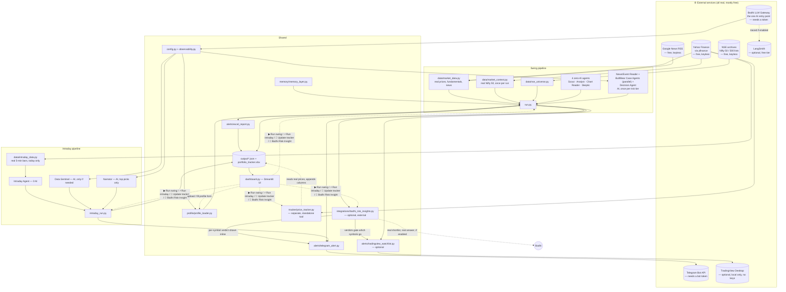
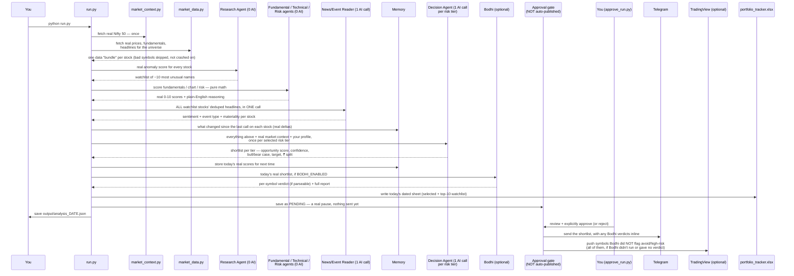
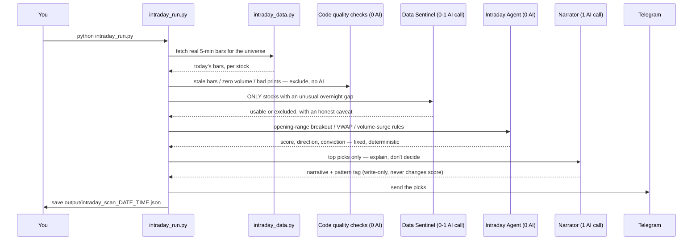

# 🧠 AI Equity Analyst

**An internal Publicis Sapient engineering project** — a working,
end-to-end reference implementation of agentic AI orchestration, built
against a real, non-toy domain (Indian equity screening) specifically
because that domain has real data, real risk, and a real measurable
outcome, rather than a synthetic demo where "it works" can't really be
checked.

> **The short version — who, what, and what should change:**
> - **Who adopts this:** any PS engineer starting a multi-agent, tool-
>   using, or Bodhi-governed AI project — this repo is the thing to fork
>   or read end-to-end before building from scratch.
> - **What it replaces:** the usual first-project ramp-up of
>   re-discovering, from zero, how to batch LLM calls sanely, route
>   through a governed gateway, wire a real LangGraph state machine, build
>   a Bodhi Workflow Builder flow with real branching, and add a human
>   approval gate before anything ships — each of those took multiple
>   real iterations to get right here (see `integrations/bodhi_workflow/README.md`'s
>   fix history for what a first attempt actually gets wrong).
> - **What should improve after adoption:** less trial-and-error on the
>   same platform gotchas (e.g. Bodhi's `set-variable` node quirks are
>   fully documented, not rediscovered per-project) and a working,
>   tested starting skeleton instead of a blank file — see
>   **§ Reusing this as a starter template** below for exactly what to
>   copy.

Built as part of the Gen AI 201 curriculum, for other Publicis Sapient
engineers to read end-to-end, adapt, and build on: multi-agent
orchestration, governed model access through Bodhi's LLM Gateway, and a
real Bodhi Workflow Builder flow with branching and escalation logic —
see `integrations/bodhi_workflow/` for the exported workflow itself.

# 🏗️ Part 1 — the engineering pattern (read this first)

## Who this is for, and how to judge it

**Beneficiary, named specifically, not just "PS engineers":** this is a
**Publicis Sapient Engineering — Bodhi Agentic Systems** delivery
pattern — the specific internal audience is whichever PS team is about
to build its own Bodhi-governed, multi-agent, tool-using system and
would otherwise re-derive the same platform quirks and architecture
decisions this repo already worked through. It's positioned as an
internal developer-productivity and reference-pattern project, not a
product for external investors. Two concrete things it's meant to
deliver:

1. **A reference pattern other PS engineers can copy.** A real,
   documented example of: batching AI calls aggressively instead of
   calling an LLM per item (see §5 below — ~2 calls per run regardless of
   universe size), routing every model call through Bodhi's Gateway
   instead of a direct provider SDK, and expressing multi-step review
   logic (research → challenge → escalate) as an actual Bodhi Workflow
   Builder graph rather than only in prompts.
2. **A real, measured quality signal — not a claim.** `tracker/quality_report.py`
   computes, from real tracked prices (never invented), whether past picks
   actually went up or down since they were listed. This is the project's
   own success metric, and it's reported honestly, including when it's
   unflattering: as of this submission, 11 tracked picks show a 0% win
   rate and a -2.38% average move since listing. That's not a good
   result — it's an honest one, and it's exactly the kind of measurement
   an internal tool needs so a team can tell whether it's actually helping
   before relying on it, rather than assuming a demo that "looks smart"
   is the same as a tool that "picks well." Run
   `uv run python tracker/quality_report.py` to recompute it against
   whatever history exists at the time.

**How a PS team would know this starter actually helped them** — a
short, checkable definition of done, not a vague "saves time" claim:

| Measure | What "it worked" looks like | How to check |
|---|---|---|
| Setup time to a first governed AI call | Hours, not days — `config.py` + `.env.example` copied, one token pasted in, `call_llm()` works | time your own first successful call from `git clone` |
| Bodhi Workflow Builder mistakes avoided | Zero of the 4 real `set-variable`/`if-else` bugs this project already hit and fixed (see `integrations/bodhi_workflow/README.md`'s fix history) | did your first branching workflow need to rediscover any of those 4? |
| First-run success | A real, passing `uv run pytest tests/` before writing any new code, from `git clone` alone | `git clone` -> `pip install -r requirements.txt` -> `pytest` — should be green with zero edits |
| Approval-gate adoption | A human checkpoint reused as-is (`alerts/approval_gate.py` + `approve_run.py`), not rebuilt from scratch | is there a `pending_approval/` -> `approved/`/`rejected/` split in the new project, or did they roll their own? |

This isn't a hypothetical — it's exactly what a reusing team can self-check
against without needing this project's own author to explain it.

### Reusing this as a starter template

This isn't a library to `import` — it's a **pattern to fork and gut**.
The domain-specific pieces (`agents/research_agent.py`,
`data/market_data.py`, everything under `alerts/`) are what you'd
delete; the parts worth copying wholesale are the domain-agnostic
plumbing:

| Copy this | For | Why it's worth reusing rather than rebuilding |
|---|---|---|
| `config.py` | Governed model access | The Bodhi Gateway REST call, retry/backoff, fail-closed behavior, and typed error classification (`BodhiGatewayAuthError`/`ShapeError`/`UnavailableError`) — no provider SDK, one call site |
| `schemas.py` | Typed contracts at every handoff | Pydantic models gating agent-to-agent and workflow-to-code boundaries — a malformed reply is rejected loudly or fed back into a retry loop, never trusted as a bare dict |
| `agents/base_agent.py` | The one shared agent skill | `ask_json()` + real telemetry (`observability.record_call()`) wired in once, inherited by every agent |
| `agents/orchestrator_agent.py` | A real self-checking loop | The `decide → reflect → route` LangGraph pattern — swap in your own domain's quality check |
| `agents/research_graph.py` | Genuine parallel multi-agent decomposition | The `Bull Case`/`Bear Case` fan-out is a template for "two independent takes, one arbiter" in any domain |
| `alerts/approval_gate.py` + `approve_run.py` | Human-in-the-loop before anything ships | Pending → approved/rejected, can't double-publish, works for any kind of output, not just stock picks |
| `safety/text_safety.py` | The one real untrusted-input boundary | Injection scanning + PII redaction, applied wherever your project reads outside text |
| `integrations/bodhi_workflow/README.md` | Bodhi Workflow Builder gotchas | The `set-variable`/`if-else` fix history — real platform behavior, not guessed, saves re-discovering it |
| `tests/conftest.py` pattern | Test isolation | Autouse fixture that redirects every log/storage path so tests never touch real `output/` |
| `.github/workflows/tests.yml` | Regression gating | Runs the full suite + an import sanity check on every push/PR — copy as-is, point it at your own `tests/` |

There are **two separate pipelines**:

- **Swing** (`run.py`) — runs once a day, looks at a year of history, and
  produces multi-day/multi-week ideas with a full investment thesis.
- **Intraday** (`intraday_run.py`) — runs on demand *while the market is
  open*, watches today's price action minute-by-minute, and flags real
  opening-range breakouts.

> **Not a chatbot. Not a buy/sell signal generator.**
> A workflow that *observes → reasons → prioritises → acts*.
>
> **Everything it looks at is real.** There is no demo mode and no
> rule-based fallback anywhere in this codebase. If the Bodhi LLM Gateway
> or a data source can't be reached, the app stops and shows you the real
> error — it never quietly substitutes a fake number to keep going.
>
> **~4 AI calls per swing run, ~1 per intraday scan**, no matter how big
> the universe is: 1 for the News/Event Reader, 2 for the Bull Case and
> Bear Case Agents (run once per run, genuinely in parallel, shared
> across every risk tier — see §3b), and 1 per selected risk tier for the
> Decision Agent (occasionally +1 more per tier, only when the
> Orchestrator's quality check finds a real issue and asks for one
> bounded retry — see §3a). Most of what looks like "AI analysis" is
> actually plain, transparent math on real data — AI is reserved for the
> things a formula genuinely can't do: reading news, explaining a score, and
> weighing conflicting evidence into a final call. Every one of those calls
> goes through **one governed entry point**, `config.call_llm()` — **Bodhi's
> LLM Gateway**, and only Bodhi's LLM Gateway. No provider SDK (Gemini,
> OpenAI, Anthropic) is imported anywhere in this codebase, and there is
> no alternate backend to fall back to.

📖 **Want the deep-dive?** [HOW_IT_WORKS.md](HOW_IT_WORKS.md) walks through
every agent, every file, every API call and every formula in plain English
with worked examples — this README is the map, that document is the tour.

📋 **Presenting this to someone non-technical?** [PROJECT_OVERVIEW.md](PROJECT_OVERVIEW.md)
is a short, manager-facing summary — architecture, agents, AI-call costs,
nothing else.

---

# 📈 Part 2 — the equity-analysis domain

**Everything above this line is the actual deliverable**: the reusable
governed-AI/multi-agent/Bodhi-workflow engineering pattern. Everything
from here down is the **worked example** that pattern is proven against —
Indian equity screening was chosen because it's a real, data-rich, hard
domain (not because stock-picking is the point of this project). If
you're here to reuse the pattern and not to run a stock screener, you
already have what you need in Part 1 above; read on only if you want to
see the pattern actually working end to end.

## 📖 Read this first (the idea in plain English)

Think of it like **hiring a small research team**. Most of them are pure
calculators (no AI, just real numbers and formulas); a handful are the
ones who actually "think."

### The Swing crew — runs once a day

| Who | Nickname | What they do | AI calls? |
|-----|----------|---------------|-----------|
| **Research Agent** | The Scout | Scores every stock by a real "anomaly score" — move vs the Nifty 50, unusual volume, breakouts, gaps — and picks the ~10 most unusual. | **0** — pure math |
| **Fundamental Agent** | The Analyst | Scores business quality from real revenue growth, ROE, margins, debt, cash flow, and valuation vs the stock's *own* historical range. | **0** — pure math |
| **Technical Agent** | The Chart Reader | Scores the real price chart — trend structure, RSI, relative strength vs Nifty, breakouts. | **0** — pure math |
| **Risk Agent** | The Skeptic | Scores downside risk from real volatility, beta, max drawdown, liquidity, gap risk. | **0** — pure math |
| **News/Event Reader** | (was "Sentiment Agent") | Reads real, deduplicated headlines for **all** shortlisted stocks and extracts what happened, how material it is, and the sentiment. | **1**, batched across every stock |
| **Bull Case Agent** | The Optimist | Independently argues the strongest honest upside case for every shortlisted stock, from the same real data everyone else sees — has no visibility into the Bear Case Agent's output. Runs once per run, shared across every risk tier (a bull case doesn't change with risk appetite). | **1**, batched, runs in parallel with Bear Case |
| **Bear Case Agent** | The Skeptic's Voice | The independent counterpart — argues the strongest honest downside case, with no visibility into the Bull Case Agent's output. Same batching, same tier-independence. | **1**, batched, runs in parallel with Bull Case |
| **Decision Agent** | The Manager | Adjudicates between the Bull and Bear Case Agents' independent analyses — not inventing both sides itself — plus every real signal above and your profile, into the final shortlist: confidence, target price, a real ₹ split across your picks. Also grounded with real, retrieved sector-risk notes (see §3a). Runs once per risk-appetite tier you selected. | **1 per risk tier**, batched across every stock |
| **Orchestrator** | The Controller | Not a fixed step — a real router. Runs the Decision Agent, checks its own output for real, checkable issues (missing fields, internally inconsistent calls, confidence that ignores a flagged data-quality issue), then decides at runtime whether to accept the result or send it back with specific feedback for one more attempt. Bounded to 1 retry — it can never run away. | **0 normally** — **+1 per risk tier only when a retry is actually needed** |

### 3a. The Orchestrator loop and retrieval — not a hardcoded sequence

Every step above this point in the table is a genuine fixed pipeline — Step 2
really does need Step 1's output, there's nothing to route between. The
Decision Agent's output is different: it's a judgment call that can be wrong
in checkable ways, so instead of just trusting it, `run.py` hands it to a
real state machine (`agents/orchestrator_agent.py`, built on
[LangGraph](https://github.com/langchain-ai/langgraph)):

```
decide (Decision Agent) → reflect (deterministic quality check, plain code)
    → route (Orchestrator agent decides: retry, or finish)
          ↳ back to "decide" with specific feedback, or → done
```

The quality *check* is plain code (a required field is either present or
it isn't — same "no AI where a formula suffices" rule as the rest of this
app). The quality *decision* — is this issue worth a retry, and what
exactly should the Decision Agent fix — is a genuine judgment call, so
that part is a real LLM call, made only when the check actually finds
something wrong.

Separately, the Decision Agent's prompt is grounded with **real
retrieval-augmented generation**: `memory/knowledge_base.py` holds a
curated set of India-equity risk source documents (multi-sentence
paragraphs per sector, plus cross-sector "general" risk notes), and
every Decision Agent call runs three real RAG steps, not a static
text block:

1. **Chunked source material** — each source paragraph is split into
   overlapping 2-sentence chunks at index time (40 real chunks from 12
   source documents), so retrieval returns the specific relevant chunk,
   not a whole undifferentiated paragraph.
2. **Metadata filtering** — retrieval queries the stock's own
   sector-tagged chunk pool via an exact ChromaDB `where` filter, and
   separately queries the "general" pool for cross-sector risk factors
   (liquidity, index-rebalance flows, governance red flags) — two
   filtered pools, not one undifferentiated search.
3. **Query rewriting** — the query text sent to the vector search is
   built from that stock's own real event type (from the News/Event
   Reader) and risk flags (from the Risk Agent), not one fixed template
   reused for every stock in a sector — two stocks in the same sector
   with different real events retrieve different chunks.

Returns nothing (never the whole knowledge base) if retrieval isn't
available — a fallback that dumps everything regardless of relevance
isn't retrieval.

### 3b. Bull vs. Bear — real parallel multi-agent decomposition

Before the Orchestrator loop above even starts, `run.py` runs a separate
real multi-agent step: `agents/research_graph.py`, a small LangGraph
fan-out that runs the Bull Case Agent and the Bear Case Agent as
genuinely **parallel** branches, not one after another:

```
        ┌── Bull Case Agent ──┐
start ──┤                     ├── end
        └── Bear Case Agent ──┘
```

Both branches hang off the graph's `START` with no edge between them, so
LangGraph's scheduler runs them in the same execution step — this is
verified, not just claimed: `tests/test_research_graph.py` times two
mocked 0.6s calls and asserts the graph finishes in ~0.6s, not ~1.2s.

**Why this is genuine task decomposition, not decoration.** The same job
— "argue a case for this stock" — is split into two independent roles.
Neither agent's prompt ever includes the other's output (their
`_build_prompt()` methods don't even accept it as an argument — the
independence is structural, not a convention that could quietly slip).
The Decision Agent is the *first* place both analyses are seen together,
and its job changed accordingly: it no longer invents a bull case and a
bear case from scratch — it **adjudicates** between two already-argued,
independent positions, explicitly saying where it agrees, disagrees, or
thinks one side overstates its case.

**Cost, stated plainly:** this adds 2 AI calls per run (not per stock,
not per tier — both agents are tier-independent and batch across the
whole watchlist in one call each, same discipline as every other agent
here). That's a real, bounded increase, made deliberately: cheap
sequential reasoning by one agent and genuine independent multi-agent
reasoning are different things, and this project treats the difference as
worth two calls, not something to fake for free.

### The Intraday crew — runs on demand, market hours only

| Who | Nickname | What they do | AI calls? |
|-----|----------|---------------|-----------|
| **Intraday Agent** | The Day Trader | Mechanically scores today's price action — opening-range breakout, VWAP position, volume surge, momentum since the open. | **0** — pure math |
| **Data Sentinel** | — | A pre-scoring gate. Stale/broken data is caught in plain code; only an unusually large, otherwise-clean overnight price gap gets a real AI judgment call. | **0 or 1**, only when a gap needs review |
| **Narrator** | — | Writes a plain-English explanation of *why* each top pick scored the way it did, and tags the shape of today's chart. Write-only — it explains the score, it can never change it. | **1**, top picks only |
| **Scorekeeper** *(optional)* | — | Run separately after market close: compares today's picks to what actually happened (target/stop/neither) — a factual report card. | **1**, only if you run it |

The big shift: instead of **you** reading everything, the system reads it,
argues it out internally, and gives you a short answer you can act on — and
it does that for a couple of AI calls per run, not per stock.

---

## 🗺️ Architecture — what talks to what



**Every connection above is either a plain, direct HTTP/SDK call, or a local,
credential-free connection to an app already running on your own machine.**
`requests` handles Google News/NSE/Telegram, `yfinance` handles Yahoo Finance,
`requests` handles Bodhi's LLM Gateway, and `langsmith` (optional) handles tracing —
none of those are MCP. The exception is TradingView, which this app touches
in two genuinely different ways via the same local
[tradingview-mcp](https://github.com/tradesdontlie/tradingview-mcp) CLI (Chrome
DevTools Protocol against your already-logged-in Desktop app, `localhost`
only, no credentials ever stored or sent): a **procedural push**
(`alerts/tradingview_watchlist.py`) that fires once, after a human
approves a run — no agent ever sees it or reasons about it — and a
**real agent tool call** (`integrations/tradingview_quote.py`): the
Decision Agent pulls a live quote for every stock it's about to
adjudicate, *during* its own reasoning, and is explicitly asked to flag
when that live read disagrees with its other, slower-moving price data.
That second one is the actual "tool integration" case — an agent deciding
it needs a live external read mid-task and reasoning over what comes
back, not a static push at the end of a pipeline. The optional Bodhi Risk
Insight is a plain `requests` REST call to a Bodhi workflow (a separate,
external AI platform, with its own MCP research tool wired into two of
*its* agent nodes) — see below.

---

## 🔁 What happens during one swing run — step by step



If **any** step fails — the Bodhi LLM Gateway unreachable, Yahoo rate-limiting a symbol —
that step raises with a full error. A single bad symbol is *skipped*
(logged, not fatal) thanks to the data-quality gate; a Bodhi Gateway outage still
stops the whole run, since there's no fallback to silently degrade to.

**Nothing is sent to Telegram or pushed to TradingView by `run.py` itself.**
Every finished shortlist stops as a PENDING run — see
[§ Human approval before anything gets sent](#-human-approval-before-anything-gets-sent-telegramtradingview).

## ⚡ What happens during an intraday scan — step by step



Only meaningful while the NSE cash market is open (09:15–15:30 IST) —
outside those hours there are no fresh bars to score.

---

## 🧩 What each file is (so nothing feels like a black box)

```
ai-equity-analyst/
├── run.py                        ← runs the full SWING pipeline (saves a PENDING run — doesn't publish)
├── approve_run.py                 ← the human checkpoint: review a pending run, then publish (or reject) it
├── intraday_run.py                ← runs the full INTRADAY pipeline
├── intraday_backtest.py            ← optional end-of-day report card for today's intraday picks
├── dashboard.py                     ← Streamlit UI: profile builder, browse runs, trigger a run
├── config.py                         ← reads .env; call_llm() is the one AI entry point every agent uses
├── schemas.py                         ← typed contracts (pydantic) at every agent/gateway/Bodhi handoff
├── observability.py                   ← optional LangSmith tracing (no-op if not configured), + 4 always-on JSONL logs
├── .env.example                        ← copy this to .env and add your settings
├── requirements.txt                     ← the Python libraries to install
├── sample_profile.txt                    ← an example investor profile you can edit
├── .github/workflows/tests.yml           ← CI: the full pytest suite + an import sanity check, on every push/PR
│
├── agents/
│   ├── base_agent.py              ← shared skill: "ask Bodhi's LLM Gateway, get JSON back, or raise" — traced here
│   ├── research_agent.py          ← The Scout — 0 AI calls, real anomaly scoring
│   ├── fundamental_agent.py       ← The Analyst — 0 AI calls, real business-quality scoring
│   ├── technical_agent.py         ← The Chart Reader — 0 AI calls, real chart scoring
│   ├── risk_agent.py              ← The Skeptic — 0 AI calls, real risk scoring
│   ├── sentiment_agent.py         ← News/Event Reader — 1 batched AI call for all stocks
│   ├── bull_case_agent.py         ← The Optimist — 1 batched AI call, independent, tier-independent
│   ├── bear_case_agent.py         ← The Skeptic's Voice — 1 batched AI call, independent, tier-independent
│   ├── research_graph.py          ← real LangGraph fan-out: Bull + Bear run genuinely in parallel
│   ├── decision_agent.py          ← The Manager — adjudicates Bull vs Bear, 1 batched AI call per risk tier
│   ├── orchestrator_agent.py      ← The Controller — LangGraph decide→reflect→route loop around the Manager
│   ├── intraday_agent.py          ← The Day Trader — 0 AI calls, real ORB/VWAP/volume scoring
│   ├── intraday_quality_agent.py  ← Data Sentinel — 0-1 AI call, only for unusual gaps
│   ├── intraday_narrator_agent.py ← Narrator — 1 batched AI call, top picks only, write-only fields
│   └── intraday_backtest_agent.py ← Scorekeeper — 1 AI call, optional, end-of-day only
│
├── data/
│   ├── market_data.py             ← real prices/fundamentals/news/liquidity (Yahoo + Google News)
│   ├── signals.py                 ← pure-math indicators: RSI, ATR, beta, drawdown, volatility...
│   ├── market_context.py          ← real Nifty 50 fetched once per run
│   ├── nse_universe.py            ← fetches live Nifty 50 / Nifty 500 lists from NSE
│   ├── intraday_data.py           ← real 5-minute bars, today's session only
│   └── intraday_signals.py        ← pure-math intraday indicators: VWAP, opening range, volume surge
│
├── memory/memory_layer.py         ← The Notebook — real price/score deltas, consolidated trend, AND persisted goal tracking
├── memory/knowledge_base.py       ← real RAG: chunked docs + metadata filtering + query rewriting into the Manager's prompt
├── profile/profile_loader.py      ← reads your profile file (PDF/XLSX/HTML/DOCX/TXT/JSON)
├── safety/text_safety.py          ← guardrails on the one untrusted-input boundary: injection scan + PII redaction
├── safety/verification_guardrail.py ← guardrails on a CONFIDENTLY WRONG output: deterministic override, not a retry
│
├── service/                       ← a genuinely SEPARATE, independently deployable microservice (see § below)
│   ├── approval_service.py        ← the same approve/reject/publish logic as approve_run.py, exposed over real HTTP
│   ├── Dockerfile                 ← builds it as a standalone container image
│   └── README.md                  ← why this boundary, how to run/deploy/test it
│
├── alerts/
│   ├── approval_gate.py           ← the real pause: pending -> approved/rejected, never auto-published
│   ├── telegram_alert.py          ← sends the shortlist to Telegram (or prints it); splits long alerts
│   ├── tradingview_watchlist.py   ← optional: pushes shortlisted symbols to your real TradingView watchlist
│   ├── excel_report.py            ← writes each swing run into output/portfolio_tracker.xlsx, one sheet per date
│   ├── intraday_excel_report.py   ← writes each intraday scan into output/intraday_tracker.xlsx, one sheet per date
│   ├── trigger_telegram.py        ← standalone: re-send the latest APPROVED shortlist to Telegram on demand
│   └── trigger_tradingview.py     ← standalone: re-push the latest APPROVED shortlist to TradingView on demand
│
├── tracker/
│   └── price_tracker.py           ← standalone tool, separate from agents/ — appends a real dated price
│                                     column to every past sheet in BOTH portfolio_tracker.xlsx and
│                                     intraday_tracker.xlsx, 0 AI calls
│
├── integrations/
│   ├── bodhi_client.py            ← optional: generic start-run/poll/extract REST client for Bodhi
│   ├── bodhi_risk_insights.py     ← optional: builds a real portfolio from today's shortlist, calls Bodhi
│   ├── run_bodhi_risk_insight.py  ← standalone: get a Bodhi insight without a full re-run
│   ├── tradingview_quote.py       ← optional: TWO real agent TOOL CALLS — live quote (CDP) + symbol
│   │                                 search (REST) — Decision Agent calls both mid-reasoning (see § below)
│   ├── mcp_tool_guard.py          ← real tool-shadowing defense for the Bodhi workflow's MCP nodes
│   ├── mcp_server.py              ← a real MCP SERVER this project owns — Tools+Resources+Prompts, stdio
│   └── mcp_pipeline_client.py     ← a real MCP CLIENT speaking real protocol to mcp_server.py (see § below)
│
├── scripts/generate_sample_telemetry.py ← writes real, reviewer-visible sample logs to docs/sample_telemetry/
├── docs/sample_telemetry/               ← generated (not hand-written) samples of all 4 JSONL log shapes
├── .mcp.json                      ← registers the local tradingview-mcp server for this project
└── output/                        ← each run's full analysis (JSON) + portfolio_tracker.xlsx + Bodhi reports
```

For exactly what each file does internally — every function, every real
formula, every API endpoint — see **[HOW_IT_WORKS.md](HOW_IT_WORKS.md)**.

---

## 🌐 Where every piece of data actually comes from

| Source | What it provides | Used by | Key needed? |
|---|---|---|---|
| **Bodhi LLM Gateway** | News interpretation, final decision synthesis, orchestrator routing, intraday narration/gap review — every AI call in the app, through one governed entry point, no alternate backend | `agents/*.py`, plus profile structuring, via `config.call_llm()` | ✅ yes |
| **Yahoo Finance** (`yfinance`) | Real daily *and* 5-minute price/volume history, real company fundamentals, the Nifty 50 index itself | `data/market_data.py`, `data/market_context.py`, `data/intraday_data.py` | ❌ free |
| **Google News RSS** | Real, current headlines per stock | `data/market_data.py` (fetch) → `agents/sentiment_agent.py` (interpret) | ❌ free |
| **NSE archives** | Official Nifty 50 / Nifty 500 constituent symbol lists | `data/nse_universe.py` | ❌ free |
| **Telegram Bot API** | Delivers the finished shortlist to your phone | `alerts/telegram_alert.py` | ✅ yes (optional) |
| **ChromaDB** (local) | Stores real price/score history per stock for the audit/delta system, and the retrieval knowledge base | `memory/memory_layer.py`, `memory/knowledge_base.py` | ❌ local, no key |
| **LangSmith** | Optional: traces every AI call and pipeline step for auditing/debugging | `observability.py` | ✅ yes (optional, free tier) |
| **TradingView Desktop** | Optional, two uses: (1) a real watchlist push after human approval, (2) a real live-quote **tool call the Decision Agent makes itself** for every stock, mid-reasoning — no API, no key; both drive your already-logged-in Desktop app locally over Chrome DevTools Protocol | `alerts/tradingview_watchlist.py` (push), `integrations/tradingview_quote.py` (agent tool call) | ❌ local only, zero credentials |
| **Bodhi** | Optional: an extra, external AI-driven risk read on today's real shortlist | `integrations/bodhi_risk_insights.py` | ✅ yes (optional, PAT token) |
| **your file or the dashboard form** | Your investor profile | `profile/profile_loader.py` | ❌ local |

Everything else — RSI, moving averages, beta, drawdown, volatility, ATR,
relative strength, anomaly scores, opening-range breakouts, VWAP, position
sizing, capital allocation — is **plain Python math** on the real numbers
above, computed in `data/signals.py` and `data/intraday_signals.py`. No
API, no AI.

---

## 🧪 Testing, and what actually happened at runtime

**A real, runnable test suite** — `tests/`, 170 tests, no real network/LLM
calls (mocked at the exact boundary — `BaseAgent.ask_json`, `requests.post`,
`subprocess.run`, never the business logic around them) and no shared
state (every test that touches storage uses an isolated temp directory
via `monkeypatch`, including `tests/conftest.py`'s two autouse fixtures:
one that redirects every observability log so running the suite never
writes to the real `output/` tree, and one that force-disables both
TradingView tool-call flags for every test — found by a real bug this
session, see below):

```bash
uv run pytest tests/ -v
```

**Wired into CI** — `.github/workflows/tests.yml` runs the full suite
plus a whole-codebase import sanity check on every push/PR to `main`, so
a routing/retrieval/typed-contract regression is caught automatically,
not noticed later in a real run.

What's covered, briefly:
- `test_orchestrator.py` — the decide→reflect→route LangGraph loop: a
  clean output finishes in 0 retries; a broken one retries exactly once
  and stops, even against a mocked Orchestrator that would keep asking
  to retry forever — `max_retries` is a hard ceiling, not a suggestion.
  Also verifies the Bull/Bear Case Agents' real analyses actually reach
  the Decision Agent's prompt, not just get threaded through state.
- `test_research_graph.py` — the Bull Case / Bear Case parallel fan-out:
  proves genuine concurrency by timing two mocked 0.6s calls and
  asserting the graph finishes in ~0.6s, not ~1.2s — not just a claim
  that it's parallel, a timed proof — plus confirms neither agent's
  prompt can ever contain the other's output.
- `test_knowledge_base.py` — real chunking (every source doc splits into
  >1 chunk), real metadata filtering, and real query rewriting (two
  different real contexts for the same sector retrieve different top
  passages — proof the query text actually changes, not just asserted).
- `test_text_safety.py` — real injection-pattern detection, real PII
  redaction, and confirmation that clean profile text is never falsely
  flagged.
- `test_approval_gate.py` — pending → approved/rejected state
  transitions, and that a run can never be approved twice.
- `test_decision_agent_math.py` — the plain-Python position-sizing and
  capital-allocation formulas: real caps are respected, capital is never
  over-allocated.
- `test_memory_layer.py` — the short-term delta vs. the consolidated
  multi-call trend are genuinely different computations, per symbol —
  including a real momentum read (accelerating/decelerating/reversed)
  that a plain first-to-last comparison can't see: a steady climb and a
  climb-then-sharp-reversal can show the identical overall change, and
  only the shape across the whole history tells them apart. Also
  `goal_status()` — persisted goal tracking ACROSS separate runs (not
  the within-run retry loop below): a target price/invalidation from a
  prior call is found and reported against today's real price even when
  it's aged past the 5-call trend window, the most recent of several
  open goals wins, and a symbol with history but no stored goal
  correctly reports nothing rather than inventing one.
- `test_decision_agent_context_budget.py` — the per-field context
  budget covers EVERY variable-length field that reaches the Decision
  Agent's prompt, not just retrieved KB notes: an oversized bull/bear
  case, key risk, event summary, research note, investor-typed profile
  constraint, retry feedback, and a persisted goal status are each
  proven trimmed inside the real assembled prompt — not merely described
  as capped.
- `test_approve_run.py` — the real, COORDINATED multi-channel publish
  action: one call to `approve_run.py::_publish()` — the function both
  the CLI's `--auto-approve` and the dashboard's "Approve & publish"
  button actually call — sends the shortlist AND the Bodhi report to
  Telegram AND pushes the TradingView watchlist together, proven with
  the real request/subprocess payloads captured at the true I/O
  boundary, not asserted from reading the code.
- `test_verification_guardrail.py` — containment for a confidently WRONG
  answer, not just a thrown exception: a pick two independent tools both
  failed to verify gets its action/confidence deterministically
  overridden regardless of what the Decision Agent argued, a single
  failed tool alone does NOT trigger it (the narrow, deliberate
  trigger), and only the flagged symbol is touched, never the rest of
  the shortlist.
- `test_approval_service.py` — the approval microservice
  (`service/approval_service.py`) over REAL HTTP requests (FastAPI's
  `TestClient`, genuine ASGI routing): approving over HTTP triggers the
  same coordinated Telegram+TradingView publish as the CLI, a run can't
  be approved twice, an unknown run 404s, and a path-traversal `run_id`
  is refused before it ever reaches the filesystem.
- `test_bodhi_client.py` — `extract_bodhi_answer()` against the real
  response shapes seen during this project's actual live Bodhi runs,
  including a regression test for the exact bug it was once fixed for
  (an unresolved node template being mistaken for the real answer).
- `test_schemas.py` — every typed contract in `schemas.py` directly: a
  gateway response missing `choices`, a bull-case strength out of
  0-100, a decision action outside `accumulate/hold/avoid`, a Bodhi
  verdict value outside `clear/caution/avoid`, a memory record with the
  wrong type for a score — each rejected, each documented valid shape
  accepted.
- `test_config_gateway.py` — `config.call_llm()`'s typed error
  classification: a 401/403 raises `BodhiGatewayAuthError` with exactly
  one HTTP attempt (never retried — retrying an identity/permissions
  denial just repeats it), a malformed 2xx body raises
  `BodhiGatewayShapeError`, a retryable 5xx recovers on the next
  attempt, all against a mocked `requests.post`.
- `test_tradingview_quote.py` — both real TradingView tool primitives
  the Decision Agent calls mid-reasoning (`get_live_quote` and
  `verify_symbol`): disabled by default, a well-formed CLI reply parses
  and caches per symbol, a CLI failure/timeout/malformed reply returns
  `None` rather than raising — mocked `subprocess.run` throughout, no
  real TradingView Desktop connection in tests.
- `test_scenario_full_pipeline.py` — a real end-to-end MULTI-AGENT
  scenario, not isolated node checks: the actual Bull/Bear parallel
  fan-out feeding its real output into the actual decide→reflect→route
  retry loop, hitting a real typed-shape defect (`schemas.DecisionPick`
  rejects an empty `bear_case`) and recovering within the bounded retry.
- `test_scenario_bodhi_branches.py` — `verify_shortlist()` exercised
  against BOTH of the Bodhi workflow's real, documented branch outcomes
  (clean vs. escalated — see `integrations/bodhi_workflow/README.md`),
  including the escalation-branch detection and the degraded-research
  detection together in the same report.
- `test_approval_gate.py` — now also a full pending→approved scenario
  carrying `bodhi_research_degraded` through unchanged, verified against
  `approve_run.py`'s real summary text, not just the approval-gate
  state machine in isolation.

**A real bug this hardening found**: wiring `get_live_quote()`/
`verify_symbol()` directly into `agents/decision_agent.py` meant any
test exercising its real `_build_prompt()` — most of
`test_orchestrator.py`, both new scenario tests — was silently making a
REAL ~20s subprocess call to the TradingView CLI whenever a real `.env`
had `TRADINGVIEW_QUOTE_ENABLED=true`, exactly the non-deterministic
external dependency this suite otherwise refuses to have. Fixed with a
second autouse fixture in `tests/conftest.py` that force-disables both
flags for every test; a test that wants the real call back
(`test_tradingview_quote.py`) explicitly re-enables it with its own
`monkeypatch`, safely overriding the fixture for just that test.

**What actually happened at runtime** — four always-on JSONL logs,
zero setup, that persist real evidence to disk on every run (see
`observability.py`):

| File | What's in it |
|---|---|
| `output/llm_call_log.jsonl` | every successful AI call's real latency (ms) and real token usage, attributed to the calling agent |
| `output/reliability_log.jsonl` | every Bodhi Gateway retry, timeout, and failure — now typed (`BodhiGatewayAuthError`/`BodhiGatewayShapeError`/`BodhiGatewayUnavailableError`, see `config.py`), plus every dropped malformed Bodhi verdict item and refused memory write |
| `output/orchestrator_decisions.jsonl` | every real Orchestrator retry-vs-finish branch decision, with its reason |
| `output/tool_call_log.jsonl` | every real non-LLM tool call an agent makes mid-reasoning — currently the Decision Agent's live TradingView quote (`integrations/tradingview_quote.py`) |

None of these need `LANGSMITH_API_KEY` — they're separate from, and
persist even without, the optional LangSmith tracing described below.
All four are readable from the dashboard's Activity tab via
`observability.read_recent()`, not just as raw files.

**Want to see the real shape without running anything first?**
`docs/sample_telemetry/` has all four, generated (not hand-written) by
`uv run python scripts/generate_sample_telemetry.py` — it calls this
project's actual `observability.record_*()` functions against a small
deterministic scenario, so the JSON is real, just not from a captured
production run (see that folder's own README for the exact line between
"real function, real shape" and "not a live incident").

**Exact real schema for all four** (see `observability.record_call()` /
`record_failure()` / `record_orchestrator_decision()` / `record_tool_call()`
in `observability.py` for the precise fields each one writes):
```json
// llm_call_log.jsonl — one line per successful call
{"timestamp": "...", "backend": "bodhi_llm_gateway", "model": "...", "agent": "Decision Agent", "latency_ms": 842.3, "prompt_tokens": 500, "completion_tokens": 120, "total_tokens": 620, "attempts": 1}
// reliability_log.jsonl — one line per retry/timeout/failure
{"timestamp": "...", "component": "bodhi_llm_gateway", "detail": "...", "attempt": 1, "status_code": 429, "model": "..."}
// orchestrator_decisions.jsonl — one line per real routing decision
{"timestamp": "...", "tier": "moderate", "retries_so_far": 0, "issues_found": [], "next_step": "finish", "reason": "quality check passed — no issues found"}
// tool_call_log.jsonl — one line per real tool call an agent makes mid-reasoning
{"timestamp": "...", "tool": "tradingview_live_quote", "target": "NSE:RELIANCE", "success": true, "latency_ms": 21870.4, "agent": "Decision Agent"}
```

## 🔒 Typed contracts at every agent-to-agent and workflow-to-code boundary

`schemas.py` — pydantic models gating every place a raw LLM/Bodhi reply
used to be trusted as a dict and left to fail with a confusing
`KeyError` three functions later if it wasn't:

| Model | Gates | On failure |
|---|---|---|
| `GatewayChatCompletion` | `config.call_llm()`'s raw response from Bodhi's LLM Gateway | raises `BodhiGatewayShapeError` |
| `BullCaseItem` / `BearCaseItem` | each symbol's entry from the Bull/Bear Case Agents | raises, naming the exact symbol + field |
| `DecisionResult` / `DecisionPick` | the Decision Agent's shortlist, checked in the Orchestrator's reflect step | becomes a normal issue string — feeds the SAME retry loop as any other quality problem, never a raw crash |
| `BodhiVerdictItem` | each per-symbol verdict parsed from the Bodhi Workflow Builder's answer | **repaired** first (a paraphrase like `"Avoid — high risk"` is normalized to `"avoid"` by keyword match — `_repair_verdict_value()`), only dropped (logged) if repair also fails |
| `LiveQuoteResult` / `SymbolSearchResult` | both real TradingView tool calls (`integrations/tradingview_quote.py`) | **retried once** (2 attempts total) before returning `None` — each attempt logged separately |
| `MemoryRecord` | every record `memory/memory_layer.py::store()` writes | a decorated numeric string (`"₹1,292.50"`) is **repaired** first (`_repair_numeric_fields()`); raises before the write only if still invalid — a bad record can never quietly corrupt future trend reads |

Malformed tool/verdict results are **repaired or retried where they're
consumed, not just validated and discarded** — real behavior, not only
a check: see `tests/test_tradingview_quote.py::test_a_failed_first_attempt_is_retried_and_can_still_succeed`,
`tests/test_bodhi_risk_insights.py::test_parse_verdicts_repairs_a_paraphrased_verdict_instead_of_dropping_it`,
and `tests/test_memory_layer.py::test_store_repairs_a_decorated_numeric_string_instead_of_rejecting`.
Every repair is logged distinctly from a drop (`output/reliability_log.jsonl`,
component names ending in `_repaired`) and surfaced in the dashboard's
Activity tab (🩹 vs ⚠️), so a repair is never confused with a real failure.

`config.py` also splits what used to be one generic `RuntimeError` into
`BodhiGatewayAuthError` (a real 401/403 — an identity/permissions
problem, never retried), `BodhiGatewayShapeError` (the gateway answered
but not in the documented shape), and `BodhiGatewayUnavailableError`
(network/timeout/exhausted retries) — callers, logs, and this README can
now say exactly which kind of failure happened instead of "something
went wrong." An optional `BODHI_LLM_TOKEN_BUDGET_WARNING` logs a visible
(never blocking, never a fallback-model trigger — this app has exactly
one AI backend by design) event when a single real call's reported
token usage crosses it.

---

## 💰 Deliberate model selection and an ENFORCED token budget

Two governed-gateway features, both in `config.py`:

- **`BODHI_LLM_MODEL_OVERRIDES`** — per-agent model selection, not one
  fixed model for every call. `"Orchestrator=gemini-2.5-flash"` routes
  just that agent's classification-shaped routing decision (temperature
  0.1, one short JSON field) to a different model than the Decision
  Agent's real multi-signal synthesis — a deliberate choice with a
  stated reason, not a downgrade by accident. Left commented/opt-in in
  `.env.example`: unlike the budget below (a plain number, safe to ship
  active), a wrong model id here would hard-fail an agent's very first
  call, and the real catalog is account-specific — this repo's own
  token got a real `403` ("explicit deny in an identity-based policy")
  querying `GET /v1/models`, so it isn't safe to ship a "confirmed" id
  for every account. The mechanism itself is real and fully proven end
  to end regardless — `tests/test_config_gateway.py::test_per_agent_model_override_is_used_in_the_real_request`
  asserts the overridden id lands in the actual outgoing request body,
  and a sibling test proves an agent with no override still gets the
  configured default, untouched.
- **`BODHI_LLM_TOKEN_BUDGET_LIMIT`** — a real, ENFORCED ceiling, distinct
  from `BODHI_LLM_TOKEN_BUDGET_WARNING` above (which only logs after a
  call already succeeded). This one estimates the prompt's own size
  (chars ÷ 4 — a documented approximation, not a real tokenizer) and
  refuses the call BEFORE anything is sent to the gateway if it would
  exceed the limit — `BodhiGatewayBudgetExceededError`, tested in
  `tests/test_config_gateway.py` by asserting `requests.post` is never
  even called. **Ships ON, not 0/disabled**: `.env.example`'s defaults
  (`WARNING=12000`, `LIMIT=20000`) are MEASURED, not guessed — the
  Decision Agent's batched, up-to-10-stock prompt is the single largest
  real prompt in this app, every variable-length field in it is already
  capped at 500 chars each (see Context engineering below), which makes
  its true worst case computable rather than open-ended. Building that
  exact worst case (10 stocks, every optional field — retrieved KB
  notes, bull/bear case, key risk, event summary, research note, a
  persisted goal, profile constraints, retry feedback — at its trimmed
  cap) through the real `_build_prompt()` measures ~59,700 real
  characters, ~14,920 estimated tokens; `LIMIT` sits ~34% above that
  measured ceiling so an ordinary maximal-but-legitimate run never
  trips it, while a genuinely runaway prompt still gets refused.

## 🧠 Context engineering, named against the real framework (not just "we have memory")

Using the terms from [LangChain's own context-engineering framework](https://www.langchain.com/blog/context-engineering-for-agents)
(Write / Select / Compress / Isolate) to name what this project already
does, deliberately, rather than by default:

- **Write** — persisting information outside the active call so a later
  step can use it without re-deriving it. Two DISTINCT real examples, on
  two different timescales, not one mechanism wearing two names:
  - **Persisted GOAL tracking, across separate runs/days.**
    `memory/memory_layer.py::goal_status()` resurfaces a target price and
    invalidation condition the Decision Agent itself set on a PRIOR call
    for this exact symbol — carried forward via new `target_price`/
    `invalidation` fields on `schemas.MemoryRecord`, written by
    `run.py` alongside every other score at `memory.store()` time. On a
    LATER run, `goal_status()` finds that record, computes the real
    price move against the stored target with plain code (a target
    crossing is a fact, reported as-is), and hands the Decision Agent
    both that computed fact and the original invalidation text —
    leaving the qualitative judgment (has *this* condition actually
    happened, given today's real event/data) to the agent, the same
    plain-code/LLM split used everywhere else in this codebase. Read
    back into the very next prompt via `decision_agent.py`'s new
    `goal_txt` block. Tested in `tests/test_memory_layer.py`
    (`test_goal_status_*`) and proven wired into the real prompt in
    `tests/test_decision_agent_context_budget.py`.
  - **Goal tracking within one call's retries.**
    `agents/orchestrator_agent.py`'s `route()` produces
    `feedback_for_decision_agent`, an explicit statement of what the
    NEXT retry of the SAME call must fix, threaded through
    `TierState.feedback` into the next `decide_node` call — a retry
    isn't "try again blind," it's "here is what changed since last
    attempt and what specifically to fix." Tested in
    `tests/test_orchestrator.py` and `tests/test_scenario_full_pipeline.py`.
  - These are deliberately kept separate rather than conflated: one
    persists a real-world objective across days of actual market
    movement; the other persists a correction across a few seconds of
    the same LangGraph loop. Confusing the two would understate what
    either one actually does.
- **Select** — retrieval scoped to the step that needs it, not the whole
  corpus every time: `memory/knowledge_base.py::retrieve_for_stock()`
  filters to THIS stock's sector plus a general-risk pool, and rewrites
  its query from the stock's own real event type and risk flags — two
  stocks in the same sector with different real events retrieve
  different chunks (`tests/test_knowledge_base.py`).
- **Compress** — `agents/decision_agent.py::_budget_trim()` caps how much
  text ANY variable-length field can contribute per stock — not just
  retrieved KB notes and a memory delta/trend line, but every field that
  can grow unboundedly or has no length contract: bull/bear case, key
  risk, event summary, research note, a persisted goal status, an
  investor-typed profile constraint, and Orchestrator retry feedback —
  with a visible `…[trimmed for context budget]` marker when it actually
  cuts something. Real enforcement, not a description, at the point
  content is assembled into the prompt. The real constraint: this call
  is batched across the whole watchlist in one prompt, so any one of
  these fields multiplies across every stock in the same call — never
  individually wrong, but silently compounding. This SAME measured
  ceiling is also what grounds `BODHI_LLM_TOKEN_BUDGET_LIMIT`'s shipped
  default above — one real number serving both the context-engineering
  budget and the gateway's own enforced cost budget, not two
  disconnected numbers. Proven wired into the real prompt assembly, not
  just tested in isolation, in `tests/test_decision_agent_context_budget.py`.
- **Isolate** — a deliberate choice between two real options, argued
  both ways elsewhere in this same codebase, not a reflex:
  - **Compaction, not isolation, for the Decision Agent's per-stock
    fields** (the Compress bullet above). The alternative — one
    subagent call per stock instead of one batched call for the whole
    watchlist — is rejected against a real, already-documented
    constraint: `run.py`'s own module docstring fixes the AI-call
    budget regardless of universe size ("4 AI calls happen per
    run... no matter how big the universe is"). Isolating per stock
    would multiply Decision Agent calls by watchlist size (up to 10x),
    breaking that constraint; compaction keeps the call count fixed
    while still bounding what any one stock contributes.
  - **Isolation, not compaction, for the Bull Case and Bear Case
    Agents** (§3b above) — they never see each other's output, by
    construction. Here the constraint is anchoring (one agent's
    reasoning biasing the other's if either saw the other's conclusion
    first), which compaction can't fix — shrinking a field doesn't stop
    it from being seen. `agents/research_graph.py`'s docstring states
    this explicitly.
  - Same framework, two different real constraints, two different
    correct answers — the point of naming both is showing the choice
    was actually made, not defaulted into.

## 🛡️ Tool-shadowing defense (MCP)

A node labelled `bodhi-deep-research` in the Bodhi workflow JSON is not,
by itself, proof it talks to the real research backend — a label is
text, not an identity. `integrations/mcp_tool_guard.py::find_shadowed_tools()`
checks every real `mcp-tools` node's actual server url and tool name
against a pinned, trusted identity for that label, flagging any mismatch
(the real attack shape: a trusted-looking label with its server quietly
swapped for something else). Both checked-in workflow JSON files pass
clean; `tests/test_mcp_tool_guard.py` includes a synthetic shadowed-url
case proving the detector actually catches the attack shape, not just
that it runs clean on already-clean input. Wired into CI
(`.github/workflows/tests.yml`) so a future edit that quietly changes a
trusted node's server url fails the build.

---

## 🔌 A second, real MCP surface — different transport, two primitives beyond Tools

Everywhere above this section, "MCP" meant one specific thing: Bodhi's
own `bodhi-deep-research` node, reached over **HTTP**, exposing exactly
**one** primitive (Tools). `integrations/mcp_server.py` +
`integrations/mcp_pipeline_client.py` are a second, genuinely different
MCP surface — built, run, and tested entirely by this project, using
the official `mcp` Python SDK:

| | Bodhi's `bodhi-deep-research` | This project's own MCP server |
|---|---|---|
| Transport | Streamable HTTP | **stdio** (a local process pipe — the other transport the MCP spec defines) |
| Primitives | Tools only | Tools **+ Resources + Prompts** |
| Runs on | Bodhi's infrastructure | Spawned locally by the client, per call |

**Three real calls, one per primitive**, all in `mcp_pipeline_client.py`:
- `verify_symbol_via_mcp()` — **Tool** (`tools/call`): confirms a ticker
  against this project's own real NIFTY50 universe
  (`data/nse_universe.py`) — a third, independent verification path
  alongside TradingView's CDP and REST checks, with no external app
  dependency at all.
- `get_sector_notes_via_mcp()` — **Resource** (`resources/read`): serves
  this project's own real sector risk documents
  (`memory/knowledge_base.py`'s source docs) as directly addressable
  `sector-notes://{sector}` resources — the same real content the RAG
  pipeline chunks and indexes, reachable here without going through
  retrieval at all.
- `get_risk_review_prompt_via_mcp()` — **Prompt** (`prompts/get`): a
  reusable, parameterized prompt template fetched over the protocol,
  not copy-pasted per caller.

**Why not Sampling too?** The certification's own rubric example lists
"Resources, Prompts, Sampling" as the primitives beyond Tools — checking
the actual current MCP spec (2026-07-28) before implementing anything
found that **Sampling is deprecated** as of that exact version ("New
implementations should integrate directly with LLM provider APIs"),
superseded by the newer Elicitation primitive for a different purpose
(servers requesting user input, not model completions). Building a
deprecated primitive to check a box would be the wrong call — Resources
and Prompts are the two that are still current, and both are real here.

**Typed contracts on BOTH sides of the handoff, with repair, not just
validation** — `schemas.McpVerifySymbolInput.repair()` cleans a
decorated symbol (`"nse:reliance"`, `" Reliance \n"`) into the bare
ticker the tool actually expects *before* the real round-trip is made
(refusing the call entirely if nothing usable remains), and
`schemas.McpSymbolVerification` validates what comes back — the same
"repair before reject" discipline as `_repair_verdict_value()` (Bodhi
verdicts) and `_repair_numeric_fields()` (memory records), now applied
to the input side of a tool call as well as the output side, per the
certification's own explicit ask.

**A real bug this was built against, not a hypothetical**: under stdio
transport, stdout **is** the MCP protocol channel — `data/nse_universe.py`
prints real status lines to stdout for normal CLI/`run.py` use, which
silently corrupted the JSON-RPC stream the first time this was tested
live (confirmed via a real `pydantic_core.ValidationError: Invalid JSON`
from the client, tracing straight to that print line).
`integrations/mcp_server.py::_stdout_reserved_for_mcp_protocol()` fixes
it by redirecting stdout to stderr for the duration of that one call —
the same discipline `tradingview-mcp`'s own server.js uses for its
startup banner — without changing `nse_universe.py`'s normal,
correct-for-every-other-caller behavior. Covered by a permanent
regression test, `tests/test_mcp_pipeline_client.py::test_stdout_is_not_corrupted_by_an_imported_modules_print_statements`.

**Fully real, fully tested, zero mocks**: `tests/test_mcp_pipeline_client.py`'s
9 tests spawn the actual server subprocess and speak the actual
protocol over actual pipes — deterministic and CI-safe because the
server is fully local (no TradingView Desktop, no Bodhi credentials, no
network beyond `nse_universe.py`'s own cached NSE fetch). Optional in
the real pipeline (`MCP_VERIFICATION_ENABLED`, wired into `run.py`'s
Step 3 alongside the TradingView check) — best-effort throughout, same
non-blocking discipline as every other optional tool here.

---

## 🚨 Containment for a confidently WRONG answer, not just a crash

Every other check in this codebase either stops the pipeline (a raised
error) or asks the LLM to try again (the Orchestrator's retry loop).
Neither covers a different, real failure mode: the Decision Agent
returning a well-shaped, internally-consistent, CONFIDENT recommendation
for a symbol that two independent, non-LLM tools have already flagged as
unable to confirm as a real, tradeable NSE equity at all — a case a
retry can't fix, since re-reasoning over the same data doesn't change
what TradingView's symbol search or the local MCP universe check already
found.

`safety/verification_guardrail.py::contain_unverifiable_picks()` is a
real, deterministic, POST-HOC override — no LLM call, runs after the
Decision Agent's output is final, and can't be talked around by a
differently-worded retry. The trigger is deliberately narrow: **both**
independent tools (TradingView's REST symbol search and the local MCP
server — two genuinely different transports checking the same claim two
different ways) must have actually run and both must have failed. Either
flag alone is a real but softer signal already shown to the Decision
Agent as context to weigh itself; both together — two independent tools,
two different mechanisms, same negative finding — is the specific,
narrow condition this guardrail contains automatically instead of
leaving to the model's own judgment. When it fires: `action` is forced
to `"avoid"`, `confidence` is capped well below the conviction
threshold, `conviction`/`conviction_note` are recomputed to match (never
a stale "HIGH conviction" badge next to an overridden pick), and the
override is logged to `output/reliability_log.jsonl`
(`reliability_guardrail_unverifiable_pick`) with the ORIGINAL action/
confidence the Decision Agent gave, for a real audit trail. Wired into
`run.py` right after the per-tier decision loop, before anything is
stored to memory or published. 8 tests in
`tests/test_verification_guardrail.py` cover the narrow trigger (neither
flag alone fires it), multi-tier overrides, that only the flagged
symbol is touched, and the audit log entry itself.

---

## 🧱 Agentic Microservices: the approval/publish path, independently deployable

Everywhere else in this project, "approval" means a CLI script
(`approve_run.py`) or a Streamlit sidebar button (`dashboard.py`) — both
only exist while a human is at that terminal or has that browser tab
open. `service/approval_service.py` is a THIRD, genuinely SEPARATE
interface onto the exact same logic: a real FastAPI app, its own
process, its own `Dockerfile`, reachable over plain HTTP from anywhere —
another service, a scheduled job, a phone.

**Why this boundary, specifically:** `run.py` (market data + multi-agent
analysis) is compute-heavy, scheduled, and has no reason to be
always-on — it's a batch job that runs once a day and takes minutes. The
approval/publish path is the opposite shape: a human needs to review and
act on a pending run **at any time**, independent of whether an analysis
run is currently executing. That split already exists conceptually in
this codebase (`run.py` never publishes; `approve_run.py` is already a
separate step) — this service gives that seam a second, always-available
interface instead of only a CLI/dashboard one.

**Not a second implementation to keep in sync** — every endpoint calls
straight into `alerts/approval_gate.py` (the same pending →
approved/rejected state machine) and `approve_run.py::_publish()` (the
same function that sends to Telegram and pushes to TradingView) that the
CLI and dashboard already use:

| Method | Path | What it does |
|---|---|---|
| `GET` | `/health` | Real health check, for a load balancer or container orchestrator |
| `GET` | `/pending` | List pending runs with a per-tier pick count |
| `GET` | `/pending/{run_id}` | The full record for one pending run |
| `POST` | `/pending/{run_id}/approve` | Publishes to every configured channel, moves the run to `output/approved/` |
| `POST` | `/pending/{run_id}/reject` | Moves the run to `output/rejected/` with a reason |
| `GET` | `/approved` / `/rejected` | List runs already actioned |

`run_id` is validated against the exact real pending-filename shape
**before** it's ever used to build a filesystem path — a malformed or
path-traversal `run_id` is refused with a `400`/`404`, never silently
joined into a path (`tests/test_approval_service.py` proves this with a
real `..%2F..%2F`-encoded attempt).

Run it standalone: `uv run uvicorn service.approval_service:app --host
0.0.0.0 --port 8000`. A real `uvicorn` process (not just FastAPI's
in-process `TestClient`) was started and hit with real HTTP requests
against this project's actual pending-run data during development — see
`service/README.md` for the exact commands and its one honest,
disclosed limitation (the `Dockerfile` was written and reviewed but not
build-tested, since Docker isn't installed in this development
environment). 8 tests in `tests/test_approval_service.py` exercise
every endpoint over real HTTP, including that approving over HTTP
triggers the identical coordinated Telegram+TradingView publish
`tests/test_approve_run.py` proves for the CLI path.

---

## ⚠️ Known gaps — honest limitations

- **ROCE, promoter shareholding/pledge %, earnings quality** — no free data
  source exists; these are never asked about rather than guessed. Need a
  paid provider (Screener.in, Trendlyne, an NSE filings feed) to add.
- **Sector-relative market context** — the Scout compares each stock only
  to the broad Nifty 50, not to a sector index (e.g. Nifty IT). There's no
  clean free mapping from stock → sector index, so this was deliberately
  left out rather than guessed.
- **Portfolio fit is watchlist-level, not real-holdings-level** — this app
  doesn't track your actual brokerage holdings, so "portfolio fit" reflects
  sector concentration *within today's shortlist*, not your real portfolio.
- **No earnings-calendar / event-proximity risk** — flagging "results due in
  3 days" needs a free, reliable earnings calendar source, which wasn't
  wired in.
- **The Data Sentinel can't confirm corporate actions** — it has no
  corporate-actions calendar, so on a large overnight gap it can only say
  "this looks like it could be a split/bonus" or "usable, but unconfirmed"
  — never a certain answer.

---

## 🚀 Getting started — step by step

**Step 1 — Install Python 3.10+ (or use `uv`)**
```bash
python3 --version
```

**Step 2 — Install the libraries**
```bash
cd ai-equity-analyst
uv pip install -r requirements.txt      # or: pip install -r requirements.txt
```

**Step 3 — Create your settings file**
```bash
cp .env.example .env
```

**Step 4 — Connect Bodhi's LLM Gateway**

Every real AI call in this app — news interpretation, decision synthesis,
orchestrator routing, profile structuring — goes through one governed
entry point, `config.call_llm()`, which routes to **Bodhi's LLM Gateway**
and only Bodhi's LLM Gateway. No agent file ever calls a provider SDK
directly, and there is no alternate backend to fall back to.

```
BODHI_LLM_GATEWAY_URL=https://bodhi-llm-gateway.sandbox.psbodhi.live
BODHI_LLM_GATEWAY_TOKEN=your-token-here
BODHI_LLM_TRACE_USER_ID=your-team-name    # Bodhi calls this "ASPIRE TEAM NAME"
BODHI_LLM_MODEL=gemini-2.5-pro            # check GET /v1/models if unsure
```

**Step 5 — Run the swing scan**
```bash
uv run python run.py       # or: python run.py
```

The header prints `LLM backend : Bodhi LLM Gateway (connected)` when it
worked. If it says `NOT CONFIGURED`, `run.py` stops immediately with the
reason — fix `.env` and re-run. Market data (Yahoo Finance, Google News,
NSE lists) needs no key at all.

**Step 6 — Try the intraday scanner** (during market hours, 09:15–15:30 IST)
```bash
uv run python intraday_run.py
```

---

## 📊 Using the dashboard

A Streamlit UI sits on top of both pipelines:

```bash
uv run streamlit run dashboard.py
```

Opens at `http://localhost:8501`. From there you can:

- **Build your investor profile** — optionally upload a PDF/XLSX/DOCX
  document (parsed automatically), and always fill in a dropdown form
  (risk appetite — now a **multi-select**, so you can compare e.g.
  Conservative vs Aggressive shortlists side by side — capital, horizon,
  preferred/excluded sectors, max position size). Every field that isn't
  obvious has a plain-English tooltip explaining what it means and why it
  matters. Your form answers always win over the document. Saved as JSON
  — which the next run loads **without an extra AI call**.
- **Browse any past swing run** — pick a date, see the shortlist as cards
  per risk tier (opportunity score, confidence, HIGH/LOW conviction with a
  plain-English reason, bull/bear case, suggested ₹ allocation), and expand
  each stock for its real score breakdown, 6-month price chart, the real
  headlines behind its news verdict, and (when this isn't the first time
  a stock's been seen) a **🧠 Memory** expander — the real short-term
  delta and consolidated multi-call trend `memory/memory_layer.py`
  actually computed for that stock, the same real numbers the Decision
  Agent's own prompt was given, not a UI-only summary. A glossary
  expander at the top explains conviction, risk appetite, position size,
  and allocation in one place.
- **Browse any intraday scan** — same idea, on the "⚡ Intraday scan" tab:
  entry/stop/target levels, the mechanical read, and the Narrator's
  explanation + pattern tag for each pick.
- **Edit `UNIVERSE` / `TOP_N`** — written straight to `.env`. Bodhi/Telegram
  credentials are intentionally **not** editable here — they're secrets,
  not day-to-day knobs, so they stay `.env`-only.
- **Trigger a run** — separate buttons for **▶ Run swing analysis** and
  **⚡ Run intraday scan**, both showing the live log via real Streamlit
  streaming (`st.write_stream`, `dashboard.py::_run_with_live_progress()`)
  — the run's real stdout renders incrementally as it's actually
  produced, with genuine back-pressure (Streamlit consumes the process
  output only as fast as it can render; nothing is buffered in memory
  before the first line appears), not a spinner or a poll-driven
  full-redraw.
- **Update the price tracker** — **📒 Update price tracker** runs
  `tracker/price_tracker.py` for you, appending a real dated price column
  to every past sheet in `output/portfolio_tracker.xlsx`.
- **Get a Bodhi Risk Insight** — **🧠 Get Bodhi Risk Insight** (if
  `BODHI_ENABLED=true`) sends the most recent saved shortlist to Bodhi and
  shows its real answer in the log, and on Telegram.
- **See real tool calls and routing decisions** — the **📜 Activity** tab's
  new sections read straight from the JSONL logs above: every real
  TradingView live-quote tool call an agent made (symbol, success/fail,
  latency), and every Orchestrator retry-vs-finish decision with its
  reason and the specific issues found — operator-visible evidence of
  what the agents actually did, not just the final shortlist.

---

## 🔢 Choosing what to scan (`UNIVERSE`)

In `.env`:
```
UNIVERSE=NIFTY50
```
- `NIFTY50` / `NIFTY500` — fetches the real, current constituent list
  straight from NSE (`data/nse_universe.py`), cached locally for a day.
- Or a plain comma-separated list: `UNIVERSE=RELIANCE,TCS,INFY,HDFCBANK`.

Bigger universes mean more sequential Yahoo Finance calls (not more AI
calls for the swing scan's scoring stage), so `NIFTY500` will take
noticeably longer to fetch than `NIFTY50`. `UNIVERSE` is shared between
`run.py` and `intraday_run.py`.

---

## 💰 Multiple risk profiles and the real ₹ split

If your investor profile has more than one risk appetite selected (e.g.
Conservative **and** Aggressive, via the dashboard's multi-select), the
Decision Agent runs **once per tier** — you get a separate shortlist for
each, so a `TOP_N` of 3 with 2 tiers selected means 2 AI calls, not 1.

Within each tier's shortlist, `agents/decision_agent.py` also computes a
real rupee split across your picks — plain Python, never an AI guess:
higher-opportunity-score picks get a bigger share of your stated capital,
every pick is capped at your max position-size %, and any leftover
capital, once every pick has hit its cap, is redistributed to the
next-highest-scoring pick. You'll see `allocated_amount` /
`allocated_shares` per stock, and a `capital_summary` showing total
deployed vs. cash remaining.

**Conviction (HIGH/LOW)** is derived the same deterministic way, not
self-reported by the AI: confidence ≥ 70 → HIGH, otherwise LOW — so it
always means the same thing every time you see it.

---

## 🙋 Adding your own investor profile

The easiest path is the **dashboard's profile builder** (see above). If you
prefer editing a file directly:

1. Write your preferences in a file — `.txt`, `.md`, `.pdf`, `.html`,
   `.docx`, `.xlsx`, or a pre-structured `.json` all work. (See
   `sample_profile.txt` for an example.)
2. Point `.env` at it: `PROFILE_PATH=my_profile.pdf`
3. Run as usual. A `.json` file is loaded as-is (no AI call). Anything else
   goes through one Bodhi Gateway call to structure it into risk appetite, capital,
   horizon, sector preferences/exclusions and constraints; if that fails, a
   light keyword scan fills in a rough version instead.

---

## 🧑‍⚖️ Human approval before anything gets sent (Telegram/TradingView)

This project hands out real financial recommendations, so `run.py` never
sends a Telegram alert or pushes to TradingView itself. Every finished
shortlist is saved as a **PENDING run** (`alerts/approval_gate.py`) and
stops there — a real pause, not a formality. Nothing is sent until a
human explicitly approves *that specific run*:

```bash
uv run python approve_run.py --latest       # review, then a real y/n prompt before publishing
uv run python approve_run.py                # just list what's pending
uv run python approve_run.py --show <path>  # review one without acting on it
uv run python approve_run.py --latest --reject "reason"
```

Or use the dashboard's **② Review & Approve** section — it shows the same
summary and has explicit **✅ Approve & publish** / **🚫 Reject** buttons.

**Real, COORDINATED multi-channel delivery from that one approval** — not
a checklist of separate sends a human has to remember to click through.
`approve_run.py::_publish()` is the single function both the CLI path
above and the dashboard's "Approve & publish" button actually call, and
it fires every configured channel together:
- **Telegram** (chat) — the shortlist, split across multiple messages if
  it's over Telegram's 4096-char limit, plus a SECOND message with the
  full Bodhi risk report when one ran.
- **TradingView** (a live trading terminal) — the post-Bodhi-filter
  candidate list pushed to your real watchlist.
- **Excel** (`alerts/excel_report.py`) — a structurally different,
  spreadsheet format, written unconditionally in `run.py` for every run
  (local record-keeping, not "sending out," so it isn't gated behind
  approval).
- **The dashboard itself** — every run, pending or approved, stays
  reviewable in the Activity tab regardless of the other three.

One real, human action reaches every channel; the format genuinely
differs per channel (chat message vs. watchlist symbols vs. spreadsheet
rows), not the same string just copy-pasted three times. Proven with the
real request/subprocess payloads captured at the true I/O boundary in
`tests/test_approve_run.py` — not just read from the code and assumed.

This isn't just cosmetic: `alerts/trigger_telegram.py` and
`alerts/trigger_tradingview.py` (the "re-send" buttons below and in the
dashboard) read **only** from `output/approved/` — a run that was never
explicitly approved can never be sent, not even by accident via a
"re-send the latest" button. A run can only be approved or rejected
once; approving moves it out of the pending queue so it can't be
double-published.

For unattended/cron use, `approve_run.py --latest --auto-approve` skips
the interactive prompt — but that flag has to be typed explicitly every
time; there is no way to make auto-approval the silent default.

---

## 📱 Getting alerts on Telegram (optional)

Sent only when you approve a run (see the section above) — never automatically.

1. On Telegram, message **@BotFather**, send `/newbot`, copy the **token**.
2. **Open a chat with your new bot yourself** and send it any message (e.g.
   "hi") — a bot can't message you until you've messaged it first.
3. Fetch your chat id:
   ```bash
   curl "https://api.telegram.org/bot<TOKEN>/getUpdates"
   ```
   Look for `"chat":{"id": <number>}` in the response (or message
   **@userinfobot**, which replies with it instantly).
4. Put both in `.env`:
   ```
   TELEGRAM_BOT_TOKEN=your-token
   TELEGRAM_CHAT_ID=your-chat-id
   ```

Leave these blank and the shortlist just prints to the screen instead.
Telegram rejects any single message over 4096 characters — a long
multi-tier shortlist is automatically split into multiple numbered
messages (`(1/2)`, `(2/2)`, ...) rather than failing silently.

---

## 📈 Pushing picks to a real TradingView watchlist (optional)

Pushed only when you approve a run (see the approval section above) —
never automatically. Adds today's shortlisted symbols to your actual
TradingView watchlist — no investment capability, just a list. This is
**local-only and credential-free**: it drives your already-logged-in
TradingView Desktop app on your own machine over Chrome DevTools Protocol
via the [tradingview-mcp](https://github.com/tradesdontlie/tradingview-mcp)
CLI, which is why it's the *only* place in this app that touches something
resembling MCP.

**Setup, one time:**
1. `git clone https://github.com/tradesdontlie/tradingview-mcp ~/mcp-servers/tradingview-mcp && cd ~/mcp-servers/tradingview-mcp && npm install`
2. Have TradingView Desktop installed (e.g. `brew install --cask tradingview` on Mac) and logged in.
3. In `.env`:
   ```
   TRADINGVIEW_WATCHLIST_ENABLED=true
   TRADINGVIEW_CLI_PATH=~/mcp-servers/tradingview-mcp/src/cli/index.js
   ```

**Before each run**, launch TradingView with its debug port enabled instead
of the normal icon:
```bash
~/mcp-servers/tradingview-mcp/scripts/launch_tv_debug_mac.sh
```

This is a **live local connection, not a background service** — if
TradingView Desktop isn't open with that debug port when `run.py` executes,
`alerts/tradingview_watchlist.py` just logs `[tradingview] skipped: ...`
and the rest of the run continues completely normally. Leave
`TRADINGVIEW_WATCHLIST_ENABLED` unset (the default) to skip this entirely.

---

## 🎯 Two real agent tool calls, two transports (optional)

Separate from the push above, and a genuinely different use of the same
local CLI — `integrations/tradingview_quote.py` gives the **Decision
Agent** two distinct, independently-toggleable tools it calls *while
it's reasoning* about a stock, not before the run starts or after it
ends:

| Tool | Transport | Typical latency | Flag |
|---|---|---|---|
| `get_live_quote()` | Chrome DevTools Protocol against TradingView Desktop | ~20-22s (measured) | `TRADINGVIEW_QUOTE_ENABLED=true` |
| `verify_symbol()` | TradingView's own symbol-search REST endpoint, no Desktop round-trip | <1s (measured) | `TRADINGVIEW_SYMBOL_SEARCH_ENABLED=true` |

Both results are validated against a typed contract (`schemas.LiveQuoteResult` /
`schemas.SymbolSearchResult`) before they ever reach a prompt, and both
land in that stock's prompt block alongside its other data: the live
quote so the agent can flag disagreement with a slower/stale price,
the symbol verification so it can flag a shortlisted ticker TradingView
itself can't confirm as a real NSE equity (mistyped, delisted, wrong
exchange) — a real data-quality signal, not just a formatting nicety.

This is the actual distinction between "using a tool" and "an agent using
a tool": the LLM doesn't just receive this data as a static input prepared
by app code beforehand — both values are pulled at the moment the agent
is forming its view on this specific stock.

**`verify_symbol()` also runs earlier, before any AI spend** —
`run.py`'s Step 3 (Fundamental/Technical/Risk, 0 AI calls) calls it for
every shortlisted symbol as it builds each stock's data-quality flags,
independent of whether the Decision Agent's own later call happens. A
tool integration that only shows up inside an LLM prompt would miss this
half: the same real tool, reached from plain pipeline code, catching a
bad ticker before a single token gets spent reasoning about it.

**Setup** is the same CLI/Desktop requirement as the watchlist push above
(one `git clone`, TradingView Desktop logged in, launched via
`launch_tv_debug_mac.sh` — `verify_symbol()` alone doesn't even need
Desktop running, since it's a plain REST call), plus the flag(s) above in
`.env`. Enable either independently, or both.

**Real, measured cost, worth knowing before you enable `TRADINGVIEW_QUOTE_ENABLED`:**
each call opens a fresh Chrome DevTools Protocol connection — live
testing showed this consistently takes ~20-22 seconds per symbol, not a
sub-second REST response. A per-process cache means a symbol shortlisted
across more than one risk tier in the same run only pays that cost once,
but a 3-stock shortlist still adds roughly a minute of real wall-clock
time to a swing run. `verify_symbol()` has no such cost — live testing
showed well under a second per symbol. Best-effort throughout for both:
if TradingView Desktop isn't open, a call times out, or the CLI/`node`
aren't available, the function returns `None` and the Decision Agent
reasons on its existing data exactly as it did before either feature
existed — nothing here can block or corrupt a run.

---

## 📒 Tracking your picks over time (Excel)

Every swing run also writes to a persistent workbook,
`output/portfolio_tracker.xlsx` — created on the first run, one new sheet
per run **date** after that (a same-day re-run replaces that day's sheet
rather than duplicating it; every other date's sheet is untouched). Each
sheet has two tables:

1. **Selected Stocks** — the deduped final shortlist across every risk
   tier you ran, with a Tier(s) column showing which tier(s) picked it.
2. **Top N Watchlist** — every stock the Scout flagged as unusual that day,
   whether or not it made the final cut.

This is plain code, zero AI, and always on — no toggle needed.

**The intraday scanner has the exact same setup, in its own file.** Every
`intraday_run.py` scan writes into `output/intraday_tracker.xlsx` (via
`alerts/intraday_excel_report.py`) — a separate workbook from the swing
one, since intraday picks (direction, entry, stop, target, pattern) don't
share a shape with swing picks. Same rule: one sheet per date, a same-day
re-run replaces that day's sheet.

**To see how those past picks have actually performed**, run the
tracker separately (`tracker/price_tracker.py` — deliberately its own
folder, apart from `agents/`, since it isn't part of the daily pipeline).
One run covers **both** workbooks:

```bash
uv run python tracker/price_tracker.py     # or the dashboard's 📒 button
```

It walks *every* sheet in *both* `portfolio_tracker.xlsx` and
`intraday_tracker.xlsx` and appends one new column, dated today, to every
table it finds: each stock's real current price, plus its % change vs.
whichever column was the most recent price checkpoint for that stock —
the original listing price the first time you run the tracker, or the
last tracking column a previous run added, every time after that. Run it
as often as you like; each distinct symbol's price is only fetched once
per run, no matter how many sheets or workbooks it appears in. It never
overwrites a column, even on a same-day re-run — the first run of the day
gets a clean `2026-09-01` column, and any re-run after that gets the real
`2026-09-01 14:32:07` it actually ran at, rather than risking any tracked
history.

---

## 🧠 Bodhi risk verification before Telegram/TradingView (optional)

If you have a **Bodhi** workflow (Sapient's internal multi-agent AI
platform — a separate system from this app), every swing run can send it
today's real shortlist — every field the Decision Agent produced:
bull/bear case, opportunity score, target price, ₹ allocation — and use
its answer to **gate what goes to TradingView**, before Telegram/TradingView
are touched at all. It's off by default and never blocks a run:

```bash
BODHI_ENABLED=true
BODHI_BASE_URL=https://your-bodhi-instance
BODHI_PAT_TOKEN=your-personal-access-token
BODHI_TASK_ID=your-workflow-task-id
BODHI_WORKFLOW_ID=your-workflow-id
# match your workflow's Start Node / Workflow Variables names —
# these are the confirmed-working defaults (no spaces allowed)
BODHI_PORTFOLIO_VARIABLE=Investmentportfolio
BODHI_QUERY_VARIABLE=Query_for_risk_assessment
```

**The Bodhi workflow this was built and tested against**, if you want to
recreate it exactly rather than build your own from scratch:
```
Start Node → Risk Analyst Agent → Contrarian Agent → End Node
                     │
              MCP Tool: bodhi-deep-research
```
- **Risk Analyst Agent** — reads the portfolio JSON and risk question from
  the Start Node's Workflow Variables (referenced in its prompt as
  `{{$var[Investmentportfolio]}}` / `{{$var[Query_for_risk_assessment]}}`),
  and researches real, current risk factors per stock using the
  `bodhi-deep-research` MCP tool wired to its `tool` port.
- **Contrarian Agent** — reads the Risk Analyst's output
  (`{{Risk Analyst Agent[data.result.response]}}`) and the original
  portfolio, red-team-challenges it, and is explicitly prompted to close
  with a `{"verdicts": [{"symbol", "verdict", "notes"}]}` JSON block.
- **End Node** — its "Configure Workflow Output" is set to
  `{{Contrarian Agent[data.result.response]}}`, so the workflow's official
  output is the Contrarian's final answer.
- **No UI Node** — a UI Node pauses a run waiting for a human to fill in a
  form, which breaks an API-triggered run. Workflow Variables (set via the
  Start Node) are the entry point an API call can actually populate.

**What happens:** `integrations/bodhi_risk_insights.py` sends the real
shortlist as JSON text plus the risk question (with an explicit ask for
that `"verdicts"` array) as two workflow variables. If Bodhi's answer
contains that array:
- **Telegram** shows every pick either way, with Bodhi's verdict line added
  under the ones it commented on — nothing is hidden.
- **TradingView** only gets symbols Bodhi did *not* mark `avoid`/high-risk —
  the verified subset becomes the actionable watchlist.
- Bodhi's full narrative report is also sent as its own Telegram message
  and saved to `output/bodhi_risk_insight_DATE.txt`.

If Bodhi is off, unreachable, times out, or its answer doesn't contain a
parseable verdict array, **nothing is filtered** — every shortlisted
symbol still goes to TradingView, exactly as before this integration
existed. Get a verification pass without a full re-run via
`uv run python integrations/run_bodhi_risk_insight.py` (or the dashboard's
🧠 button) — it reuses the most recently saved shortlist.

**Confirmed working end-to-end** against a live Bodhi run — a real
shortlist in, genuinely stock-specific research and a red-teamed challenge
out, with a clean parseable verdict per symbol. One thing to know if you
build your own workflow instead of copying the one above: Bodhi's REST API
response nests the real per-node results three levels deep, at
`exec_metadata.allOutputs.<run>.<node>` — not at the top level of the
response — which is what `integrations/bodhi_client.py`'s
`extract_bodhi_answer()` reads from.

---

## 🔭 Tracing every AI call (LangSmith, optional)

Set these in `.env` and every real AI call, plus every pipeline step,
shows up as one visual trace tree at [smith.langchain.com](https://smith.langchain.com):

```
LANGSMITH_API_KEY=your-key
LANGSMITH_PROJECT=ai-equity-analyst
```

Get a free key from LangSmith → Settings → API Keys. You'll see, per run:
which agent ran in what order, the exact prompt and response for every AI
call, real latency, and real token counts (so you can see actual cost per
run). Leave `LANGSMITH_API_KEY` blank and tracing is a complete no-op —
nothing about the app's behaviour changes, and the `langsmith` package
doesn't even need to be importable.

---

## ⏰ Running it automatically

**Mac/Linux**, via `cron` — swing scan at 8:00 AM every weekday, intraday
scan every 30 minutes during market hours:
```bash
crontab -e
```
```
0 8 * * 1-5  cd /path/to/ai-equity-analyst && uv run python run.py >> output/cron.log 2>&1
*/30 9-15 * * 1-5  cd /path/to/ai-equity-analyst && uv run python intraday_run.py >> output/intraday_cron.log 2>&1
```

`run.py` alone only gets you a pending run — it deliberately does not
publish. A cron job that should also publish unattended needs an explicit
second line making that choice out loud, never silently:
```
5 8 * * 1-5  cd /path/to/ai-equity-analyst && uv run python approve_run.py --latest --auto-approve >> output/cron.log 2>&1
```

**Windows**: use Task Scheduler with the same triggers.

---

## 🧠 Design principles worth knowing

**Why there's no fallback mode.** Earlier versions had a demo mode
(fabricated numbers) and a rule-based fallback whenever the AI gateway was
unreachable. Both were removed: a fabricated number that *looks* real is
worse than no number, and a formula quietly standing in for an LLM's
reasoning defeats the point of an agentic analyst. Now: real data or a
loud, clear error.

**Why most agents don't call AI at all.** RSI, moving averages, beta,
drawdown, volatility, VWAP, opening-range breakouts, "is this move
unusual" — these all have exact mathematical definitions. Asking an LLM to
compute them is slower, costs money, and is *less* consistent than a
formula. AI is reserved for what no formula can do: understanding what a
real headline means, weighing conflicting real signals into one explained
verdict, and (in the intraday pipeline) judging a genuinely ambiguous data
anomaly or explaining a mechanical score in plain English.

**Why AI explanations are kept write-only.** The intraday Narrator writes
a plain-English reason for each pick's score — it is explicitly never
allowed to change the score, rank, or conviction that the deterministic
rules engine already set. Explaining a decision and making a decision are
kept as two separate steps, so the AI can never quietly override a rule.

**Why publishing is a separate, human step.** `run.py` produces a
shortlist but never sends it anywhere — see [§ Human approval before
anything gets sent](#-human-approval-before-anything-gets-sent-telegramtradingview).
A financial recommendation is exactly the kind of output that shouldn't
leave the system on the AI's say-so alone.

**Why the one untrusted-input boundary gets a real guardrail.** Every
prompt this app builds comes from data it fetched itself, except one: an
uploaded investor profile document. `safety/text_safety.py` scans it for
prompt-injection patterns and redacts PII before it reaches a prompt — see
`profile/profile_loader.py`.

See **[HOW_IT_WORKS.md](HOW_IT_WORKS.md)** for the full reasoning and every
formula used.

---

## 🛠️ Troubleshooting

| You see | What it means | Fix |
|---------|---------------|-----|
| `Bodhi LLM Gateway is not configured` | `BODHI_LLM_GATEWAY_TOKEN` missing | set it (and `BODHI_LLM_TRACE_USER_ID`) in `.env` — see Step 4 above |
| `Bodhi LLM Gateway call failed (401/403 ...)` | your token is wrong, expired, or not provisioned for the model in `BODHI_LLM_MODEL` | recheck the token, or try a different `BODHI_LLM_MODEL` from `GET /v1/models` |
| `[data] skipping X: insufficient data (...)` | one symbol's data was bad/stale/unreachable | normal — that symbol is excluded, the rest of the scan continues |
| `[intraday] skipping X: ...` | no intraday bars for that symbol right now | normal outside market hours, or for a thinly-traded symbol |
| `[quality] excluding X: ...` | the intraday quality gate caught stale/broken data or an unconfirmed corporate-action-sized gap | normal — that symbol is excluded from today's intraday scoring |
| `chromadb` errors | vector DB missing | ignore — it auto-falls back to a JSON notebook |
| PDF/DOCX/XLSX profile not read | parser lib missing | `pip install pypdf python-docx openpyxl beautifulsoup4` |
| Telegram `chat not found` / `403 bot can't message the bot` | wrong `TELEGRAM_CHAT_ID` (often the bot's own id was used by mistake) | message your bot from your own account first, then re-fetch `getUpdates` |
| Telegram `message is too long` | pre-2026 behaviour — now auto-split into multiple messages | update to the latest `alerts/telegram_alert.py` if you still see this |
| `[observability] LANGSMITH_API_KEY is set but the langsmith package isn't installed` | tracing was turned on in `.env` before installing the library | `uv pip install langsmith` |
| `Bodhi LLM Gateway returned an unexpected response shape` | the gateway's response didn't match the OpenAI-compatible shape this app expects | check the raw response printed in the error against Bodhi's own `/v1/chat/completions` docs |
| `[tradingview] skipped: timed out` | TradingView Desktop isn't running with the debug port enabled | launch it via `launch_tv_debug_mac.sh` before running |
| `[tradingview] skipped: 'node' not found, or tradingview-mcp isn't cloned` | `TRADINGVIEW_CLI_PATH` is wrong, or the repo/Node.js isn't installed | recheck the setup steps above |
| `RuntimeError: No workbook found` from `price_tracker.py` | you haven't run `run.py` yet this session | run the swing scan at least once first — there's nothing to track yet |
| `[bodhi] skipped: Bodhi isn't configured` | one or more `BODHI_*` vars missing | set `BODHI_PAT_TOKEN`, `BODHI_TASK_ID`, `BODHI_WORKFLOW_ID`, `BODHI_BASE_URL` in `.env` |
| `[bodhi] run completed but no response text could be found` | your workflow's End Node isn't configured with an output value (its "Configure Workflow Output" is empty), and no node in `exec_metadata.allOutputs` had a real response either | open the End Node, set its output to `{{<Your Final Agent>[data.result.response]}}`, save, and re-run |
| Telegram shows literal text like `{{Contrarian Agent[data.result.response]}}` | a stray character (often typed by hand instead of using Bodhi's 🔗 variable picker) broke that chip, so Bodhi left it unresolved as raw text | re-open the field, delete it, and re-insert the chip via the 🔗 picker instead of typing it |
| Risk Analyst/Contrarian prompt shows `null` for the portfolio/query | the prompt still references a removed/renamed node (e.g. a deleted UI Node) instead of the current Workflow Variables | update the prompt to reference `{{$var[YourVariableName]}}`, matching your Start Node's actual variable names |
| `RuntimeError: No saved runs found` from `run_bodhi_risk_insight.py` | you haven't run `run.py` yet this session | run the swing scan at least once first — there's no shortlist to send yet |

---

## ⚠️ Important

This project is for **learning and research**. It does **not** give
personalised financial advice, and its output should never be treated as a
recommendation to buy or sell. Markets are risky — always do your own
research and consult a SEBI-registered advisor before investing.

---

## 🧭 What to build next

- Wire in a paid data provider for ROCE and promoter/pledge data.
- Add sector-relative market context once a reliable free stock→sector-index
  mapping exists.
- Track your actual brokerage holdings for real portfolio-fit awareness
  (cash available, correlation, existing positions) — today's "portfolio
  fit" only sees today's watchlist.
- Add a free earnings-calendar source for event-proximity risk.
- Build an "agent performance" view in the dashboard on top of the memory
  audit data, the intraday backtest log, and `portfolio_tracker.xlsx`
  already being collected — which signals actually predicted outcomes over
  time. The raw data now exists (the Excel tracker); a proper in-dashboard
  chart on top of it doesn't yet.
- Give the intraday scanner a live/looping mode instead of one-shot runs,
  for continuous monitoring during market hours.
