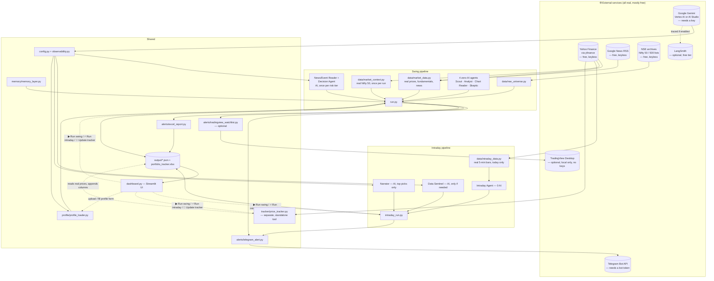
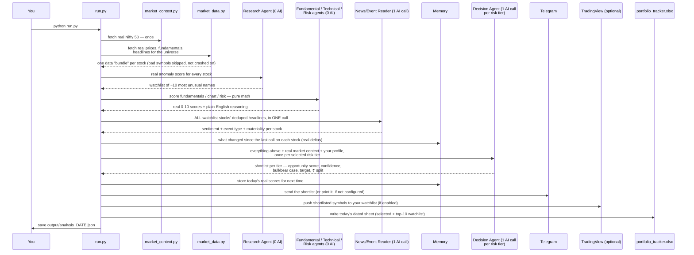
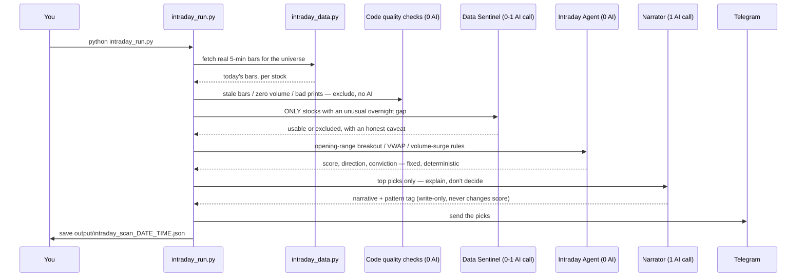

# 🧠 AI Equity Analyst

An **agentic AI** that behaves like a small equity research desk for the
**Indian stock market** — powered by Google **Gemini**, real Yahoo Finance
prices, and real news.

Instead of you opening a stock screener and manually checking 50–500
companies every morning, a team of AI "specialists" does it for you and
hands you a short, reasoned shortlist of 2–3 high-conviction ideas — with
its reasoning shown, not hidden.

There are **two separate pipelines**:

- **Swing** (`run.py`) — runs once a day, looks at a year of history, and
  produces multi-day/multi-week ideas with a full investment thesis.
- **Intraday** (`intraday_run.py`) — runs on demand *while the market is
  open*, watches today's price action minute-by-minute, and flags real
  opening-range breakouts.

> **Not a chatbot. Not a buy/sell signal generator.**
> A workflow that *observes → reasons → prioritises → acts*.
>
> **Everything it looks at is real.** There is no demo mode and no
> rule-based fallback anywhere in this codebase. If Gemini or a data source
> can't be reached, the app stops and shows you the real error — it never
> quietly substitutes a fake number to keep going.
>
> **~2 AI calls per swing run, ~1 per intraday scan**, no matter how big
> the universe is. Most of what looks like "AI analysis" is actually plain,
> transparent math on real data — AI is reserved for the things a formula
> genuinely can't do: reading news, explaining a score, and weighing
> conflicting evidence into a final call.

📖 **Want the deep-dive?** [HOW_IT_WORKS.md](HOW_IT_WORKS.md) walks through
every agent, every file, every API call and every formula in plain English
with worked examples — this README is the map, that document is the tour.

📋 **Presenting this to someone non-technical?** [PROJECT_OVERVIEW.md](PROJECT_OVERVIEW.md)
is a short, manager-facing summary — architecture, agents, AI-call costs,
nothing else.

---

## 📖 Read this first (the idea in plain English)

Think of it like **hiring a small research team**. Most of them are pure
calculators (no AI, just real numbers and formulas); a handful are the
ones who actually "think."

### The Swing crew — runs once a day

| Who | Nickname | What they do | AI calls? |
|-----|----------|---------------|-----------|
| **Research Agent** | The Scout | Scores every stock by a real "anomaly score" — move vs the Nifty 50, unusual volume, breakouts, gaps — and picks the ~10 most unusual. | **0** — pure math |
| **Fundamental Agent** | The Analyst | Scores business quality from real revenue growth, ROE, margins, debt, cash flow, and valuation vs the stock's *own* historical range. | **0** — pure math |
| **Technical Agent** | The Chart Reader | Scores the real price chart — trend structure, RSI, relative strength vs Nifty, breakouts. | **0** — pure math |
| **Risk Agent** | The Skeptic | Scores downside risk from real volatility, beta, max drawdown, liquidity, gap risk. | **0** — pure math |
| **News/Event Reader** | (was "Sentiment Agent") | Reads real, deduplicated headlines for **all** shortlisted stocks and extracts what happened, how material it is, and the sentiment. | **1**, batched across every stock |
| **Decision Agent** | The Manager | Weighs every real signal above plus your profile and produces the final shortlist — bull case, bear case, confidence, target price, a real ₹ split across your picks. Runs once per risk-appetite tier you selected. | **1 per risk tier**, batched across every stock |

### The Intraday crew — runs on demand, market hours only

| Who | Nickname | What they do | AI calls? |
|-----|----------|---------------|-----------|
| **Intraday Agent** | The Day Trader | Mechanically scores today's price action — opening-range breakout, VWAP position, volume surge, momentum since the open. | **0** — pure math |
| **Data Sentinel** | — | A pre-scoring gate. Stale/broken data is caught in plain code; only an unusually large, otherwise-clean overnight price gap gets a real AI judgment call. | **0 or 1**, only when a gap needs review |
| **Narrator** | — | Writes a plain-English explanation of *why* each top pick scored the way it did, and tags the shape of today's chart. Write-only — it explains the score, it can never change it. | **1**, top picks only |
| **Scorekeeper** *(optional)* | — | Run separately after market close: compares today's picks to what actually happened (target/stop/neither) — a factual report card. | **1**, only if you run it |

The big shift: instead of **you** reading everything, the system reads it,
argues it out internally, and gives you a short answer you can act on — and
it does that for a couple of AI calls per run, not per stock.

---

## 🗺️ Architecture — what talks to what



**Every connection above is either a plain, direct HTTP/SDK call, or a local,
credential-free connection to an app already running on your own machine.**
`requests` handles Google News/NSE/Telegram, `yfinance` handles Yahoo Finance,
`google-genai` handles Gemini, and `langsmith` (optional) handles tracing —
none of those are MCP. The one exception is the optional TradingView
watchlist push: it shells out to the [tradingview-mcp](https://github.com/tradesdontlie/tradingview-mcp)
CLI, which drives your already-logged-in TradingView Desktop app over Chrome
DevTools Protocol on `localhost` — no TradingView credentials are ever
stored or sent anywhere by this app.

---

## 🔁 What happens during one swing run — step by step



If **any** step fails — Gemini unreachable, Yahoo rate-limiting a symbol —
that step raises with a full error. A single bad symbol is *skipped*
(logged, not fatal) thanks to the data-quality gate; a Gemini outage still
stops the whole run, since there's no fallback to silently degrade to.

## ⚡ What happens during an intraday scan — step by step



Only meaningful while the NSE cash market is open (09:15–15:30 IST) —
outside those hours there are no fresh bars to score.

---

## 🧩 What each file is (so nothing feels like a black box)

```
ai-equity-analyst/
├── run.py                        ← runs the full SWING pipeline
├── intraday_run.py                ← runs the full INTRADAY pipeline
├── intraday_backtest.py            ← optional end-of-day report card for today's intraday picks
├── dashboard.py                     ← Streamlit UI: profile builder, browse runs, trigger a run
├── config.py                         ← reads .env, logs in to Gemini
├── observability.py                   ← optional LangSmith tracing (no-op if not configured)
├── .env.example                        ← copy this to .env and add your settings
├── requirements.txt                     ← the Python libraries to install
├── sample_profile.txt                    ← an example investor profile you can edit
│
├── agents/
│   ├── base_agent.py              ← shared skill: "ask Gemini, get JSON back, or raise" — traced here
│   ├── research_agent.py          ← The Scout — 0 AI calls, real anomaly scoring
│   ├── fundamental_agent.py       ← The Analyst — 0 AI calls, real business-quality scoring
│   ├── technical_agent.py         ← The Chart Reader — 0 AI calls, real chart scoring
│   ├── risk_agent.py              ← The Skeptic — 0 AI calls, real risk scoring
│   ├── sentiment_agent.py         ← News/Event Reader — 1 batched AI call for all stocks
│   ├── decision_agent.py          ← The Manager — 1 batched AI call per risk tier, + real ₹ allocation
│   ├── intraday_agent.py          ← The Day Trader — 0 AI calls, real ORB/VWAP/volume scoring
│   ├── intraday_quality_agent.py  ← Data Sentinel — 0-1 AI call, only for unusual gaps
│   ├── intraday_narrator_agent.py ← Narrator — 1 batched AI call, top picks only, write-only fields
│   └── intraday_backtest_agent.py ← Scorekeeper — 1 AI call, optional, end-of-day only
│
├── data/
│   ├── market_data.py             ← real prices/fundamentals/news/liquidity (Yahoo + Google News)
│   ├── signals.py                 ← pure-math indicators: RSI, ATR, beta, drawdown, volatility...
│   ├── market_context.py          ← real Nifty 50 fetched once per run
│   ├── nse_universe.py            ← fetches live Nifty 50 / Nifty 500 lists from NSE
│   ├── intraday_data.py           ← real 5-minute bars, today's session only
│   └── intraday_signals.py        ← pure-math intraday indicators: VWAP, opening range, volume surge
│
├── memory/memory_layer.py         ← The Notebook — real price/score deltas since your last call
├── profile/profile_loader.py      ← reads your profile file (PDF/XLSX/HTML/DOCX/TXT/JSON)
│
├── alerts/
│   ├── telegram_alert.py          ← sends the shortlist to Telegram (or prints it); splits long alerts
│   ├── tradingview_watchlist.py   ← optional: pushes shortlisted symbols to your real TradingView watchlist
│   └── excel_report.py            ← writes each run into output/portfolio_tracker.xlsx, one sheet per date
│
├── tracker/
│   └── price_tracker.py           ← standalone tool, separate from agents/ — appends a real dated price
│                                     column to every past sheet in portfolio_tracker.xlsx, 0 AI calls
│
├── .mcp.json                      ← registers the local tradingview-mcp server for this project
└── output/                        ← each run's full analysis (JSON) + portfolio_tracker.xlsx
```

For exactly what each file does internally — every function, every real
formula, every API endpoint — see **[HOW_IT_WORKS.md](HOW_IT_WORKS.md)**.

---

## 🌐 Where every piece of data actually comes from

| Source | What it provides | Used by | Key needed? |
|---|---|---|---|
| **Google Gemini** | News interpretation, final decision synthesis, intraday narration/gap review | `agents/*.py` (5 of the 10 agents), plus profile structuring | ✅ yes |
| **Yahoo Finance** (`yfinance`) | Real daily *and* 5-minute price/volume history, real company fundamentals, the Nifty 50 index itself | `data/market_data.py`, `data/market_context.py`, `data/intraday_data.py` | ❌ free |
| **Google News RSS** | Real, current headlines per stock | `data/market_data.py` (fetch) → `agents/sentiment_agent.py` (interpret) | ❌ free |
| **NSE archives** | Official Nifty 50 / Nifty 500 constituent symbol lists | `data/nse_universe.py` | ❌ free |
| **Telegram Bot API** | Delivers the finished shortlist to your phone | `alerts/telegram_alert.py` | ✅ yes (optional) |
| **ChromaDB** (local) | Stores real price/score history per stock for the audit/delta system | `memory/memory_layer.py` | ❌ local, no key |
| **LangSmith** | Optional: traces every AI call and pipeline step for auditing/debugging | `observability.py` | ✅ yes (optional, free tier) |
| **TradingView Desktop** | Optional: real watchlist push — no API, no key; drives your already-logged-in Desktop app locally over Chrome DevTools Protocol | `alerts/tradingview_watchlist.py` | ❌ local only, zero credentials |
| **your file or the dashboard form** | Your investor profile | `profile/profile_loader.py` | ❌ local |

Everything else — RSI, moving averages, beta, drawdown, volatility, ATR,
relative strength, anomaly scores, opening-range breakouts, VWAP, position
sizing, capital allocation — is **plain Python math** on the real numbers
above, computed in `data/signals.py` and `data/intraday_signals.py`. No
API, no AI.

---

## ⚠️ Known gaps — honest limitations

- **ROCE, promoter shareholding/pledge %, earnings quality** — no free data
  source exists; these are never asked about rather than guessed. Need a
  paid provider (Screener.in, Trendlyne, an NSE filings feed) to add.
- **Sector-relative market context** — the Scout compares each stock only
  to the broad Nifty 50, not to a sector index (e.g. Nifty IT). There's no
  clean free mapping from stock → sector index, so this was deliberately
  left out rather than guessed.
- **Portfolio fit is watchlist-level, not real-holdings-level** — this app
  doesn't track your actual brokerage holdings, so "portfolio fit" reflects
  sector concentration *within today's shortlist*, not your real portfolio.
- **No earnings-calendar / event-proximity risk** — flagging "results due in
  3 days" needs a free, reliable earnings calendar source, which wasn't
  wired in.
- **The Data Sentinel can't confirm corporate actions** — it has no
  corporate-actions calendar, so on a large overnight gap it can only say
  "this looks like it could be a split/bonus" or "usable, but unconfirmed"
  — never a certain answer.

---

## 🚀 Getting started — step by step

**Step 1 — Install Python 3.10+ (or use `uv`)**
```bash
python3 --version
```

**Step 2 — Install the libraries**
```bash
cd ai-equity-analyst
uv pip install -r requirements.txt      # or: pip install -r requirements.txt
```

**Step 3 — Create your settings file**
```bash
cp .env.example .env
```

**Step 4 — Connect Gemini** (pick **one** method)

#### Method 1 — Google AI Studio API key (easiest)
1. Go to **https://aistudio.google.com/apikey** and create a free API key.
2. In `.env`:
   ```
   GOOGLE_AUTH_MODE=token
   GOOGLE_GENAI_USE_VERTEXAI=FALSE
   GOOGLE_API_KEY=paste-your-key-here
   ```

#### Method 2 — Google Cloud / Vertex AI
1. Install the gcloud CLI, then log in:
   ```bash
   gcloud auth application-default login
   ```
2. Enable the Vertex AI API on your project (one time):
   ```bash
   gcloud services enable aiplatform.googleapis.com --project YOUR_PROJECT
   ```
3. In `.env`:
   ```
   GOOGLE_AUTH_MODE=adc
   GOOGLE_GENAI_USE_VERTEXAI=TRUE
   GOOGLE_CLOUD_PROJECT=your-project-id
   GOOGLE_CLOUD_LOCATION=europe-west2
   ```

> `GOOGLE_AUTH_MODE=auto` tries Vertex AI first, then falls back to the API
> key — handy if you're not sure which will work. Note: if
> `GOOGLE_GENAI_USE_VERTEXAI=TRUE`, the SDK routes through Vertex even in
> token mode — set it to `FALSE` if you want the API key to actually hit
> AI Studio instead.

**Step 5 — Run the swing scan**
```bash
uv run python run.py       # or: python run.py
```

The header prints `Gemini login: adc (connected)` or `token (connected)`
when it worked. If it says `NOT CONNECTED`, `run.py` stops immediately with
the reason — fix `.env` and re-run. Market data (Yahoo Finance, Google
News, NSE lists) needs no key at all.

**Step 6 — Try the intraday scanner** (during market hours, 09:15–15:30 IST)
```bash
uv run python intraday_run.py
```

---

## 📊 Using the dashboard

A Streamlit UI sits on top of both pipelines:

```bash
uv run streamlit run dashboard.py
```

Opens at `http://localhost:8501`. From there you can:

- **Build your investor profile** — optionally upload a PDF/XLSX/DOCX
  document (parsed automatically), and always fill in a dropdown form
  (risk appetite — now a **multi-select**, so you can compare e.g.
  Conservative vs Aggressive shortlists side by side — capital, horizon,
  preferred/excluded sectors, max position size). Every field that isn't
  obvious has a plain-English tooltip explaining what it means and why it
  matters. Your form answers always win over the document. Saved as JSON
  — which the next run loads **without an extra Gemini call**.
- **Browse any past swing run** — pick a date, see the shortlist as cards
  per risk tier (opportunity score, confidence, HIGH/LOW conviction with a
  plain-English reason, bull/bear case, suggested ₹ allocation), and expand
  each stock for its real score breakdown, 6-month price chart, and the
  real headlines behind its news verdict. A glossary expander at the top
  explains conviction, risk appetite, position size, and allocation in one
  place.
- **Browse any intraday scan** — same idea, on the "⚡ Intraday scan" tab:
  entry/stop/target levels, the mechanical read, and the Narrator's
  explanation + pattern tag for each pick.
- **Edit `UNIVERSE` / `TOP_N`** — written straight to `.env`. Gemini/Telegram
  credentials are intentionally **not** editable here — they're secrets,
  not day-to-day knobs, so they stay `.env`-only.
- **Trigger a run** — separate buttons for **▶ Run swing analysis** and
  **⚡ Run intraday scan**, both showing the live log.
- **Update the price tracker** — **📒 Update price tracker** runs
  `tracker/price_tracker.py` for you, appending a real dated price column
  to every past sheet in `output/portfolio_tracker.xlsx`.

---

## 🔢 Choosing what to scan (`UNIVERSE`)

In `.env`:
```
UNIVERSE=NIFTY50
```
- `NIFTY50` / `NIFTY500` — fetches the real, current constituent list
  straight from NSE (`data/nse_universe.py`), cached locally for a day.
- Or a plain comma-separated list: `UNIVERSE=RELIANCE,TCS,INFY,HDFCBANK`.

Bigger universes mean more sequential Yahoo Finance calls (not more AI
calls for the swing scan's scoring stage), so `NIFTY500` will take
noticeably longer to fetch than `NIFTY50`. `UNIVERSE` is shared between
`run.py` and `intraday_run.py`.

---

## 💰 Multiple risk profiles and the real ₹ split

If your investor profile has more than one risk appetite selected (e.g.
Conservative **and** Aggressive, via the dashboard's multi-select), the
Decision Agent runs **once per tier** — you get a separate shortlist for
each, so a `TOP_N` of 3 with 2 tiers selected means 2 AI calls, not 1.

Within each tier's shortlist, `agents/decision_agent.py` also computes a
real rupee split across your picks — plain Python, never an AI guess:
higher-opportunity-score picks get a bigger share of your stated capital,
every pick is capped at your max position-size %, and any leftover
capital, once every pick has hit its cap, is redistributed to the
next-highest-scoring pick. You'll see `allocated_amount` /
`allocated_shares` per stock, and a `capital_summary` showing total
deployed vs. cash remaining.

**Conviction (HIGH/LOW)** is derived the same deterministic way, not
self-reported by the AI: confidence ≥ 70 → HIGH, otherwise LOW — so it
always means the same thing every time you see it.

---

## 🙋 Adding your own investor profile

The easiest path is the **dashboard's profile builder** (see above). If you
prefer editing a file directly:

1. Write your preferences in a file — `.txt`, `.md`, `.pdf`, `.html`,
   `.docx`, `.xlsx`, or a pre-structured `.json` all work. (See
   `sample_profile.txt` for an example.)
2. Point `.env` at it: `PROFILE_PATH=my_profile.pdf`
3. Run as usual. A `.json` file is loaded as-is (no AI call). Anything else
   goes through one Gemini call to structure it into risk appetite, capital,
   horizon, sector preferences/exclusions and constraints; if that fails, a
   light keyword scan fills in a rough version instead.

---

## 📱 Getting alerts on Telegram (optional)

1. On Telegram, message **@BotFather**, send `/newbot`, copy the **token**.
2. **Open a chat with your new bot yourself** and send it any message (e.g.
   "hi") — a bot can't message you until you've messaged it first.
3. Fetch your chat id:
   ```bash
   curl "https://api.telegram.org/bot<TOKEN>/getUpdates"
   ```
   Look for `"chat":{"id": <number>}` in the response (or message
   **@userinfobot**, which replies with it instantly).
4. Put both in `.env`:
   ```
   TELEGRAM_BOT_TOKEN=your-token
   TELEGRAM_CHAT_ID=your-chat-id
   ```

Leave these blank and the shortlist just prints to the screen instead.
Telegram rejects any single message over 4096 characters — a long
multi-tier shortlist is automatically split into multiple numbered
messages (`(1/2)`, `(2/2)`, ...) rather than failing silently.

---

## 📈 Pushing picks to a real TradingView watchlist (optional)

Every run can also add today's shortlisted symbols to your actual
TradingView watchlist — no investment capability, just a list. This is
**local-only and credential-free**: it drives your already-logged-in
TradingView Desktop app on your own machine over Chrome DevTools Protocol
via the [tradingview-mcp](https://github.com/tradesdontlie/tradingview-mcp)
CLI, which is why it's the *only* place in this app that touches something
resembling MCP.

**Setup, one time:**
1. `git clone https://github.com/tradesdontlie/tradingview-mcp ~/mcp-servers/tradingview-mcp && cd ~/mcp-servers/tradingview-mcp && npm install`
2. Have TradingView Desktop installed (e.g. `brew install --cask tradingview` on Mac) and logged in.
3. In `.env`:
   ```
   TRADINGVIEW_WATCHLIST_ENABLED=true
   TRADINGVIEW_CLI_PATH=~/mcp-servers/tradingview-mcp/src/cli/index.js
   ```

**Before each run**, launch TradingView with its debug port enabled instead
of the normal icon:
```bash
~/mcp-servers/tradingview-mcp/scripts/launch_tv_debug_mac.sh
```

This is a **live local connection, not a background service** — if
TradingView Desktop isn't open with that debug port when `run.py` executes,
`alerts/tradingview_watchlist.py` just logs `[tradingview] skipped: ...`
and the rest of the run continues completely normally. Leave
`TRADINGVIEW_WATCHLIST_ENABLED` unset (the default) to skip this entirely.

---

## 📒 Tracking your picks over time (Excel)

Every swing run also writes to a persistent workbook,
`output/portfolio_tracker.xlsx` — created on the first run, one new sheet
per run **date** after that (a same-day re-run replaces that day's sheet
rather than duplicating it; every other date's sheet is untouched). Each
sheet has two tables:

1. **Selected Stocks** — the deduped final shortlist across every risk
   tier you ran, with a Tier(s) column showing which tier(s) picked it.
2. **Top N Watchlist** — every stock the Scout flagged as unusual that day,
   whether or not it made the final cut.

This is plain code, zero AI, and always on — no toggle needed.

**To see how those past picks have actually performed**, run the
tracker separately (`tracker/price_tracker.py` — deliberately its own
folder, apart from `agents/`, since it isn't part of the daily pipeline):

```bash
uv run python tracker/price_tracker.py     # or the dashboard's 📒 button
```

It walks *every* sheet in the workbook and appends one new column, dated
today, to every table it finds: each stock's real current price, plus its
% change vs. whichever column was the most recent price checkpoint for
that stock — the original listing price the first time you run the
tracker, or the last tracking column a previous run added, every time
after that. Run it as often as you like; each distinct symbol's price is
only fetched once per run, no matter how many sheets it appears in.

---

## 🔭 Tracing every AI call (LangSmith, optional)

Set these in `.env` and every real Gemini call, plus every pipeline step,
shows up as one visual trace tree at [smith.langchain.com](https://smith.langchain.com):

```
LANGSMITH_API_KEY=your-key
LANGSMITH_PROJECT=ai-equity-analyst
```

Get a free key from LangSmith → Settings → API Keys. You'll see, per run:
which agent ran in what order, the exact prompt and response for every AI
call, real latency, and real token counts (so you can see actual cost per
run). Leave `LANGSMITH_API_KEY` blank and tracing is a complete no-op —
nothing about the app's behaviour changes, and the `langsmith` package
doesn't even need to be importable.

---

## ⏰ Running it automatically

**Mac/Linux**, via `cron` — swing scan at 8:00 AM every weekday, intraday
scan every 30 minutes during market hours:
```bash
crontab -e
```
```
0 8 * * 1-5  cd /path/to/ai-equity-analyst && uv run python run.py >> output/cron.log 2>&1
*/30 9-15 * * 1-5  cd /path/to/ai-equity-analyst && uv run python intraday_run.py >> output/intraday_cron.log 2>&1
```

**Windows**: use Task Scheduler with the same triggers.

---

## 🧠 Design principles worth knowing

**Why there's no fallback mode.** Earlier versions had a demo mode
(fabricated numbers) and a rule-based fallback whenever Gemini was
unreachable. Both were removed: a fabricated number that *looks* real is
worse than no number, and a formula quietly standing in for an LLM's
reasoning defeats the point of an agentic analyst. Now: real data or a
loud, clear error.

**Why most agents don't call AI at all.** RSI, moving averages, beta,
drawdown, volatility, VWAP, opening-range breakouts, "is this move
unusual" — these all have exact mathematical definitions. Asking an LLM to
compute them is slower, costs money, and is *less* consistent than a
formula. AI is reserved for what no formula can do: understanding what a
real headline means, weighing conflicting real signals into one explained
verdict, and (in the intraday pipeline) judging a genuinely ambiguous data
anomaly or explaining a mechanical score in plain English.

**Why AI explanations are kept write-only.** The intraday Narrator writes
a plain-English reason for each pick's score — it is explicitly never
allowed to change the score, rank, or conviction that the deterministic
rules engine already set. Explaining a decision and making a decision are
kept as two separate steps, so the AI can never quietly override a rule.

See **[HOW_IT_WORKS.md](HOW_IT_WORKS.md)** for the full reasoning and every
formula used.

---

## 🛠️ Troubleshooting

| You see | What it means | Fix |
|---------|---------------|-----|
| `google-genai not installed` | Gemini library missing | `pip install google-genai` |
| `Gemini is not configured` | credentials didn't load | recheck the `.env` auth setup above |
| `[data] skipping X: insufficient data (...)` | one symbol's data was bad/stale/unreachable | normal — that symbol is excluded, the rest of the scan continues |
| `[intraday] skipping X: ...` | no intraday bars for that symbol right now | normal outside market hours, or for a thinly-traded symbol |
| `[quality] excluding X: ...` | the intraday quality gate caught stale/broken data or an unconfirmed corporate-action-sized gap | normal — that symbol is excluded from today's intraday scoring |
| `chromadb` errors | vector DB missing | ignore — it auto-falls back to a JSON notebook |
| PDF/DOCX/XLSX profile not read | parser lib missing | `pip install pypdf python-docx openpyxl beautifulsoup4` |
| Telegram `chat not found` / `403 bot can't message the bot` | wrong `TELEGRAM_CHAT_ID` (often the bot's own id was used by mistake) | message your bot from your own account first, then re-fetch `getUpdates` |
| Telegram `message is too long` | pre-2026 behaviour — now auto-split into multiple messages | update to the latest `alerts/telegram_alert.py` if you still see this |
| `[observability] LANGSMITH_API_KEY is set but the langsmith package isn't installed` | tracing was turned on in `.env` before installing the library | `uv pip install langsmith` |
| `RefreshError: Reauthentication is needed` | your Google Cloud ADC token expired (Vertex AI mode) | `gcloud auth application-default login` |
| `403 API_KEY_SERVICE_BLOCKED` on a token-mode call | `GOOGLE_GENAI_USE_VERTEXAI=TRUE` is routing an API-key call through Vertex, which the key isn't provisioned for | set `GOOGLE_GENAI_USE_VERTEXAI=FALSE` for true AI Studio routing |
| `[tradingview] skipped: timed out` | TradingView Desktop isn't running with the debug port enabled | launch it via `launch_tv_debug_mac.sh` before running |
| `[tradingview] skipped: 'node' not found, or tradingview-mcp isn't cloned` | `TRADINGVIEW_CLI_PATH` is wrong, or the repo/Node.js isn't installed | recheck the setup steps above |
| `RuntimeError: No workbook found` from `price_tracker.py` | you haven't run `run.py` yet this session | run the swing scan at least once first — there's nothing to track yet |

---

## ⚠️ Important

This project is for **learning and research**. It does **not** give
personalised financial advice, and its output should never be treated as a
recommendation to buy or sell. Markets are risky — always do your own
research and consult a SEBI-registered advisor before investing.

---

## 🧭 What to build next

- Wire in a paid data provider for ROCE and promoter/pledge data.
- Add sector-relative market context once a reliable free stock→sector-index
  mapping exists.
- Track your actual brokerage holdings for real portfolio-fit awareness
  (cash available, correlation, existing positions) — today's "portfolio
  fit" only sees today's watchlist.
- Add a free earnings-calendar source for event-proximity risk.
- Build an "agent performance" view in the dashboard on top of the memory
  audit data, the intraday backtest log, and `portfolio_tracker.xlsx`
  already being collected — which signals actually predicted outcomes over
  time. The raw data now exists (the Excel tracker); a proper in-dashboard
  chart on top of it doesn't yet.
- Give the intraday scanner a live/looping mode instead of one-shot runs,
  for continuous monitoring during market hours.
