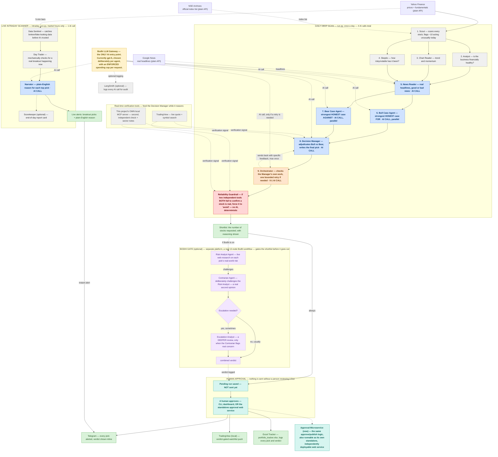
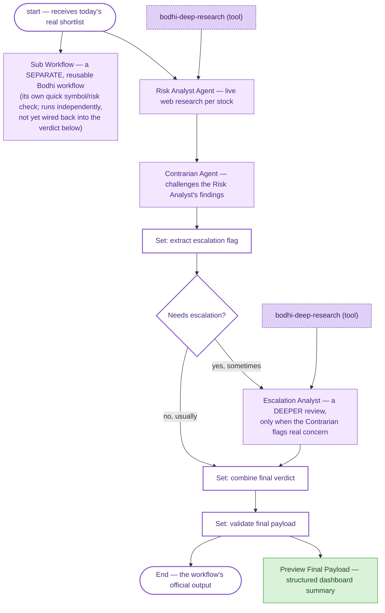
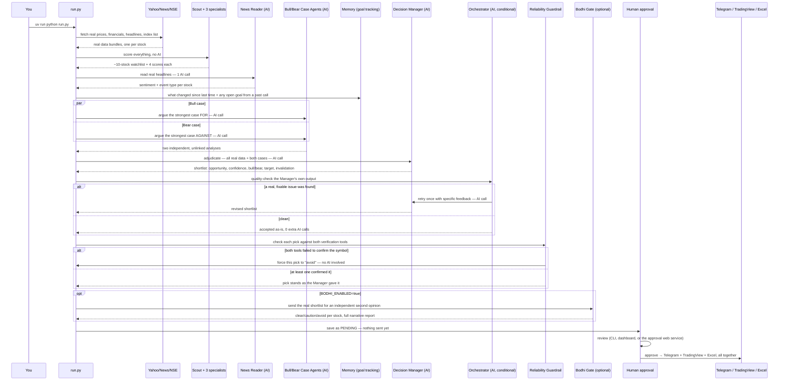

# AI Equity Analyst — Architecture

This document supersedes the diagram originally shared for use-case
approval. It covers the same system, updated to what's actually running
today: two more agents in the daily scan (an independent Bull/Bear debate
and a real controller that checks its own work), a second MCP surface
this project owns end to end, a deterministic safety override, and a
human-approval checkpoint before anything is sent anywhere.

For the full plain-English walkthrough (every formula, every file, every
API call), see `HOW_IT_WORKS.md`. For a shorter manager-facing summary,
see `PROJECT_OVERVIEW.md`. This document is the diagram-first reference.

---

## High-level architecture

### Legend

| Style | Meaning |
|---|---|
| ⬜ Grey | Code only — plain math, no AI, no cost |
| 🟦 Blue | AI call — happens every time this box runs |
| 🟧 Orange | Router/controller — an AI call, but only 0 or 1 times, only when its own check finds something worth fixing |
| 🟥 Red | Deterministic safety override — no AI involved, can't be talked out of it |
| 🟪 Purple, dashed | Optional — a separate platform (Bodhi), gates the shortlist before it goes out |
| 🟩 Teal | Human-in-the-loop — a real person has to act before anything moves forward |
| 🟩 Green | Output / deliverable |
| 🟨 Yellow | The one governed model-access point every AI call goes through |

Lines: solid = always happens. Dashed = an AI call, an optional/conditional path, or an audit/logging path.

---

## What changed since the last architecture review

| | Before | Now |
|---|---|---|
| AI calls per daily scan | ~2 (News Reader + Decision Manager) | **4** — News Reader + Bull Case Agent + Bear Case Agent (run once, genuinely in parallel) + Decision Manager |
| Who argues the case | Decision Manager alone, both sides | Bull Case Agent and Bear Case Agent argue independently — **neither sees the other's output** — Decision Manager now *adjudicates* between them instead of inventing both sides itself |
| Self-checking | None | **Orchestrator** — a real controller that checks the Decision Manager's own output for real issues and can send it back for exactly one bounded retry, with specific feedback on what to fix |
| Wrong-but-confident picks | Not specifically guarded against | **Reliability Guardrail** — if two independent tools both fail to confirm a picked stock is real, it's automatically forced to "avoid," no matter how confidently the AI argued for it |
| Model | Google Gemini, fixed | **Bodhi LLM Gateway only** — currently routed to `gpt-5`, confirmed against the account's real, live model catalog (30+ real models, spanning OpenAI/Anthropic/Gemini/Amazon families, all reached through the one gateway) |
| Model choice per agent | One fixed model for every call | **Deliberate per-agent routing available** — a simple, classification-shaped decision (like the Orchestrator's retry-or-finish call) can be routed to a cheaper/faster model than the Decision Manager's real synthesis work, opt-in, tested against the real request body |
| AI spending | No ceiling | **A real, enforced cap per request** — refuses an oversized request BEFORE it's sent, not just flagged after. Sized against this system's own actual largest real prompt, not a guess |
| Bodhi workflow shape | 2 flat agents in a straight line (Risk Analyst → Contrarian) | **A real 13-node graph**: adds a nested, reusable sub-workflow, a conditional escalation branch (a second, DEEPER review agent that only runs when the Contrarian actually flags real concern — not on every run), and a structured "preview" of the final payload. See the detailed diagram below |
| Tool use | tradingview-mcp for one thing (watchlist push) | tradingview-mcp now used for **three** things (watchlist push + a live quote + a symbol check, the last two pulled in *while the Decision Manager is reasoning*), plus a **second, independent MCP server this project built and owns**, running locally, for a second real verification check |
| Before anything is sent | Not shown | **Human approval, explicit and unavoidable** — every finished shortlist is saved as *pending*; nothing reaches Telegram or TradingView until a person reviews and approves that specific run |
| Deployment | One local process | The approval/publish step can now **also** run as its own small, independently deployable web service (its own container image), separate from the daily scan |

---

## Bodhi workflow — the real graph, in detail

The high-level diagram above shows the Bodhi gate as a single grouped box
to stay readable. This is what's actually running on Bodhi's platform —
the exact structure, confirmed against a real, live, completed run
(id `9248a51c-aea8-4376-8bd8-345954cf842a`), not a design sketch:

What each new piece actually buys us:
- **The escalation branch** means every pick doesn't get the same fixed
  amount of scrutiny — a stock the Contrarian is genuinely unsure about
  gets a real, additional, deeper review; a clean one doesn't pay that
  cost. In the run this was confirmed against, the branch outcome was
  "clean — no escalation needed," which is itself evidence the condition
  is real and doesn't fire on every run.
- **The sub-workflow** is a separately reusable Bodhi workflow, called
  from inside this one — real workflow composition, not everything
  flattened into one graph. Honest caveat: right now it runs as an
  independent leaf (its own output isn't yet merged back into the
  combined verdict below it) — a known, deliberate simplification, not
  an oversight.
- **The preview node** gives the finished payload a structured,
  dashboard-style summary as part of the workflow's own output, not just
  raw text.

---

## Low-level architecture — one real daily run, step by step

### Component map

| Layer | File(s) | AI? |
|---|---|---|
| Conductor | `run.py` / `intraday_run.py` | No |
| Zero-AI scoring | `agents/research_agent.py`, `fundamental_agent.py`, `technical_agent.py`, `risk_agent.py`, `intraday_agent.py` | No |
| News reading | `agents/sentiment_agent.py` | Yes — 1 batched call |
| Independent debate | `agents/bull_case_agent.py`, `agents/bear_case_agent.py`, `agents/research_graph.py` (real parallel fan-out) | Yes — 2 batched calls, parallel |
| Final adjudication | `agents/decision_agent.py` | Yes — 1 call per risk profile selected |
| Self-checking controller | `agents/orchestrator_agent.py` | Only if a retry is needed |
| Memory + goal tracking | `memory/memory_layer.py`, `memory/knowledge_base.py` | No |
| Real-time tool calls | `integrations/tradingview_quote.py` (TradingView, via its local CLI), `integrations/mcp_server.py` + `integrations/mcp_pipeline_client.py` (this project's own MCP server, over stdio) | No — plain lookups |
| Deterministic safety net | `safety/verification_guardrail.py` | No |
| Untrusted-input guardrail | `safety/text_safety.py` | No |
| Governed model access | `config.py` — the one function (`call_llm()`) every AI call above goes through | — |
| Independent risk review | Bodhi Workflow Builder graph — 13 real nodes (Risk Analyst, Contrarian, a conditional Escalation Analyst, a nested sub-workflow, a preview node), called from `integrations/bodhi_risk_insights.py` | Yes, on Bodhi's own platform |
| Human approval | `alerts/approval_gate.py`, `approve_run.py`, `dashboard.py`, `service/approval_service.py` | No |
| Delivery | `alerts/telegram_alert.py`, `alerts/tradingview_watchlist.py`, `alerts/excel_report.py` | No |

---

## Model & governance details

- **Single entry point.** Every AI call in this codebase — no exceptions — goes through `config.py::call_llm()`, which talks only to the Bodhi LLM Gateway. No provider SDK (OpenAI, Anthropic, Google) is imported anywhere.
- **Model in use today:** `gpt-5`, confirmed against the account's real, live model catalog.
- **Deliberate per-agent routing (optional):** a simple, classification-shaped decision (like the Orchestrator's retry-or-finish call) can be routed to a different, cheaper model than the Decision Manager's real synthesis work — a stated choice, not a blanket setting.
- **Enforced spending cap:** a real ceiling on how large a single request is allowed to be, checked *before* anything is sent — refuses an oversized call outright rather than just warning after the fact. The current limit is set with real headroom above the largest request this system actually produces, not picked arbitrarily.

## MCP tools actually used

- **tradingview-mcp** (external) — this project's one direct connection to TradingView Desktop, used for three real things now: pushing approved picks to a real watchlist, pulling a live quote while the Decision Manager reasons, and confirming a ticker is real before any AI time is spent on it.
- **This project's own local MCP server** (new) — built and owned end to end, running locally over the standard stdio transport, offering a second, independent way to confirm a stock is real plus structured sector-risk notes. Needs nothing else open or running.
- **bodhi-deep-research** — used internally by Bodhi's own Risk Analyst Agent, on Bodhi's platform. Not called directly by this codebase.
- Everything else (Yahoo Finance, Google News, NSE, Telegram, Excel, LangSmith) is a plain API or library call, not MCP.
